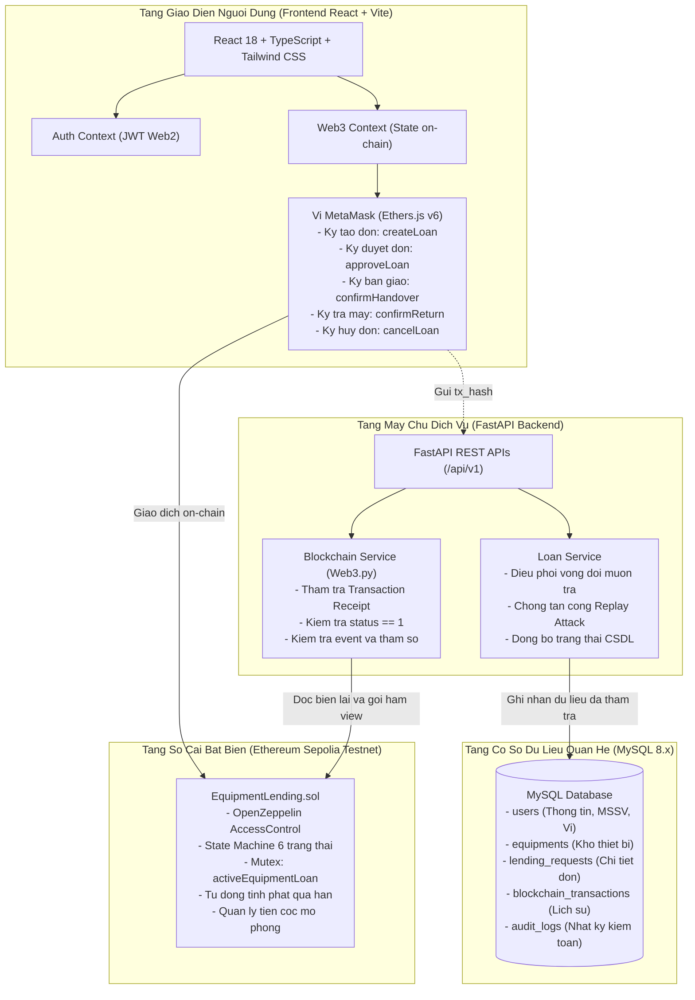

# EduVault - He Thong Quan Ly va Dieu Phoi Muon Tra Thiet Bi Hoc Tap

## Smart Contract-Audited Academic Equipment Lending Platform (Pure Web3 Architecture)

Nen tang quan ly, dieu phoi va kiem toan muon tra trang thiet bi thuc hanh phong thi nghiem dua tren Hop dong thong minh Ethereum (EVM) ket hop he quan tri co so du lieu quan he hieu nang cao MySQL.

---

## 1. Tong Quan va Bai Toan Giai Quyet

Trong cac truong dai hoc va vien nghien cuu, cong tac quan ly muon tra thiet bi thuc hanh gia tri cao (may do xung so, kinh hien vi ky thuat so, kit vi dieu khien IoT/STM32, may chieu, thiet bi mang chuyen dung) thuong gap phai cac van de:

1. **Xung dot dat trung thiet bi (Double-booking):** Nhieu nguoi dung cung dang ky muon mot thiet bi tai cung mot thoi diem dan den tinh trang tranh chap thiet bi.
2. **Du lieu de bi sua doi hoac xoa bo:** Lịch su giao nhan, phat qua han va tinh trang thiet bi luu o co so du lieu truyen thong co the bi can thiep boi nguoi quan tri hoac gap loi dong bo.
3. **Thieu minh bach trong tinh phat va xu ly tien coc:** Khong co co che tu dong tinh thoi gian tre han, ty le phat va quyet toan tien coc mot cach doc lap, khach quan.
4. **Rui ro bao mat cua kien truc Custodial (Luu khoa bi mat tai may chu):** Cac he thong Web2.5 cu thuong luu Private Key cua Admin tren may chu de ky ho giao dich (Relayer). Neu may chu bi tan cong, toan bo quyen quan tri va hop dong thong minh se bi chiem doat.

### Giai phap cua EduVault

EduVault giai quyet triet de cac van de tren bang kien truc **Pure Web3 (Non-Custodial Architecture)**:
- **Client-side Signing (Ky truc tiep tai trinh duyet):** Nguoi dung va Quan tri vien tu ky giao dich bang vi MetaMask ca nhan. May chu backend tuyet doi khong luu tru Private Key.
- **Xac thuc quyen so huu vi chuan EIP-191:** Sinh vien ky thong diep ngau nhien (Personal Sign) de chung minh quyen so huu vi MetaMask truoc khi tao don.
- **Phan quyen AccessControl chuan OpenZeppelin tren chuoi:** Hop dong thong minh su dung `DEFAULT_ADMIN_ROLE`, `ADMIN_ROLE` va `BORROWER_ROLE` de dam bao chi nguoi dung duoc phep moi tuong tac duoc voi hop dong.
- **Khoa giu cho tu dong (On-chain Mutex):** Hop dong thong minh khoa doc quyen thiet bi bang bien `activeEquipmentLoan` ngay khi don duoc duyet, loai bo 100% kha nang dat trung thiet bi.
- **Tu dong tinh toan phat va xu ly coc tren chuoi:** Hop dong tu dong tinh ty le phat dua tren block timestamp va tinh trang thiet bi khi tra, quyet toan coc minh bach.
- **May chu dong vai tro Tham tra bien lai (On-chain Receipt Verifier):** Backend FastAPI doc bien lai tu mang blockchain, kiem tra tinh toan ven va chong tan cong phat lai (Anti-Replay Attack) truoc khi cap nhat vao MySQL.

---

## 2. Kien Truc He Thong

He thong hoat dong theo mo hinh Pure Web3 tach biet ro rang giua tang client, tang may chu backend va tang so cai bat bien on-chain:



---

## 3. Phan Dinh Nguon Du Lieu Chuan (Source of Truth)

He thong phan chia ranh gioi du lieu ro rang nham toi uu hoa hieu nang va dam bao tinh bao mat:

| Nhom du lieu | Nguon chuan (Authoritative) | Luu tru phu | Co che dong bo va rang buoc |
|---|---|---|---|
| Thong tin ca nhan (PII)<br>Ho ten, Email, MSSV, Mat khau hash | MySQL (`users`) | Khong luu on-chain | Bao mat thong tin rieng tu, tranh ro ri du lieu nhay cam tren blockchain. |
| Thong tin chi tiet thiet bi<br>Ten thiet bi, mo ta, cau hinh, anh | MySQL (`equipments`) | Khong luu on-chain | Smart Contract chi luu khoa ngoai `equipmentId` (uint256) de tiet kiem gas. |
| Trang thai don muon (Loan State) | Smart Contract (`loans[loanId].state`) | MySQL (`lending_requests.status`) | Smart Contract la chan ly. MySQL chi doi trang thai khi `verify_transaction_receipt` tra ve hop le (`status == 1`). |
| Trang thai tien coc (Deposit State) | Smart Contract (`depositState`) | MySQL (`deposit_status`) | Quan ly tien coc tren chuoi: `None` (0), `Locked` (1), `Refunded` (2), `Forfeited` (3). |
| Khoa chong muon trung (Mutex) | Smart Contract | MySQL | Smart Contract dung `activeEquipmentLoan[equipmentId]`. MySQL dung khoa dong `SELECT ... FOR UPDATE`. |
| Tinh phat va thoi gian muon | Smart Contract | MySQL | Smart Contract tinh toan tu dong dua tren Unix timestamp cua khoi block. |
| Nhat ky kiem toan giao dich | Blockchain Sepolia | MySQL (`blockchain_transactions`) | Luu tru day du `tx_hash`, `from_address`, `block_number`, `gas_used` de phuc vu doi soat. |

---

## 4. Vong Doi Don Muon Va Quy Tac Phat Tu Dong

### Vong doi 6 buoc chuan Pure Web3

1. **Xac minh vi (EIP-191):** Sinh vien dang nhap web, vao ho so ca nhan va ky thong diep `personal_sign` bang vi MetaMask. Backend xac thuc chu ky va cap nhat `wallet_verified = True`.
2. **Tao yeu cau muon (Submitted):** Sinh vien chon thiet bi va thoi gian muon, MetaMask mo len de sinh vien ky giao dich `createLoan(...)`. Giao dich thanh cong sinh ra ma `loanId` (keccak256). Frontend gui `tx_hash` va `loanId` ve backend de tao don o trang thai `PENDING`.
3. **Duyet don (Approved):** Quan tri vien phong lab dung vi co `ADMIN_ROLE` ky giao dich `approveLoan(loanId)` qua MetaMask. Hợp dong thong minh kiem tra dieu kien, dat khoa Mutex giu cho thiet bi. Backend xac thuc bien lai va cap nhat don sang `APPROVED`.
4. **Ban giao thiet bi (Active):** Khi sinh vien den nhan may, Admin ky giao dich `confirmHandover(loanId)`. Hop dong chuyen trang thai sang `Active` va khoa tien coc mo phong (`DepositState.Locked`). Backend cap nhat trang thai don sang `ACTIVE` va thiet bi sang `IN_USE`.
5. **Nghiem thu va tra may (Returned / Disputed):** Admin kiem tra thiet bi thuc te va ky giao dich `confirmReturn(loanId, returnCondition)`.
   - `returnCondition = 0 (GOOD)`: Thiet bi nguyen ven, hoan tra coc.
   - `returnCondition = 1 (DAMAGED)`: Thiet bi hu hong, tich thu 100% tien coc, don chuyen sang `Disputed`.
   - `returnCondition = 2 (LOST)`: Thiet bi lam mat, tich thu 100% tien coc, don chuyen sang `Disputed`.
   - Hop dong tu dong giai phong khoa Mutex thiet bi tro ve trang thai san sang.
6. **Huy don (Cancelled):** Sinh vien hoac Admin co the ky giao dich `cancelLoan(loanId, reason)` de huy don khi don o trang thai `Submitted` hoac `Approved` (truoc khi ban giao). Khoa Mutex duoc tu dong giai phong neu don da tung duoc duyet.

### Quy tac phat tre han tu dong on-chain

Khi thuc hien tra may (`confirmReturn`), hop dong thong minh tu dong so sanh block timestamp hien tai voi `dueDate`:
- **Dung han:** Ty le phat 0%, hoan tra 100% tien coc.
- **Tre han khong qua 24 gio:** Tu dong phat 10% gia tri tien coc quy dinh.
- **Tre han tren 24 gio:** Tu dong phat 50% gia tri tien coc quy dinh.
- **Hu hong hoac lam mat:** Tich thu 100% tien coc bat ke co tra dung han hay khong.

---

## 5. Cong Nghe Su Dung (Tech Stack)

### Tieu diem cong nghe

| Phan tang | Cong nghe / Thu vien | Phien ban | Vai tro |
|---|---|---|---|
| **Smart Contract** | Solidity | `^0.8.20` | Ngon ngu lap trinh hop dong thong minh tren EVM |
| | OpenZeppelin Contracts | `^5.0.0` | Thu vien AccessControl chuan bao mat phan quyen |
| | Hardhat | `^2.22.x` | Moi truong bien dich, deploy va kiem thu hop dong |
| | Ethereum Sepolia | Chain ID `11155111` | Mang thu nghiem cong khai (Public Testnet) |
| **Backend** | Python | `3.11.x` | Ngon ngu lap trinh may chu |
| | FastAPI | `^0.115.x` | Web framework bat dong bo hieu nang cao, OpenAPI 3.1 |
| | SQLAlchemy | `^2.0.x` | ORM anh xa quan he co so du lieu |
| | Alembic | `^1.13.x` | Cong cu quan ly va thuc thi migration CSDL |
| | Web3.py | `6.20.4` | Thu vien tuong tac node blockchain va tham tra bien lai |
| | PyMySQL | `^1.1.x` | Driver ket noi CSDL MySQL |
| | Bcrypt & Python-Jose | `^4.0.0` / `^3.3.0` | Ma hoa mat khau va xu ly xac thuc JWT |
| | Pytest | `^8.4.x` | Khung kiem thu tu dong (78 test cases) |
| **Frontend** | React | `^18.3.x` | Thu vien xay dung giao dien nguoi dung |
| | TypeScript | `^5.5.x` | Ngon ngu lap trinh an toan kieu du lieu |
| | Vite | `^6.x` | Cong cu dong goi ung dung sieu toc |
| | Tailwind CSS | `^3.4.x` | Framework CSS thiet ke giao dien truc quan |
| | Ethers.js | `^6.13.x` | Thu vien ket noi vi MetaMask va goi Smart Contract |
| | Axios | `^1.7.x` | HTTP Client tuong tac REST API Backend |
| **Database** | MySQL / MariaDB | `8.0 / XAMPP` | He quan tri co so du lieu quan he luu tru chinh |

---

## 6. Cau Truc Thu Muc Du An

```
EduVault/
|-- backend/                                # Ma nguon may chu FastAPI
|   |-- alembic/                            # Cau hinh va tap lenh Migration CSDL
|   |   |-- versions/                       # Cac ban ghi migration
|   |   `-- env.py                          # Cau hinh migration SQLAlchemy
|   |-- app/
|   |   |-- api/                            # Cac tuyen duong API (Endpoints)
|   |   |   |-- deps.py                     # Dependency Injection: Auth, DB, Roles
|   |   |   `-- v1/                         # API Router phien ban 1
|   |   |       |-- auth.py                 # API Dang nhap va xac minh vi EIP-191
|   |   |       |-- users.py                # API Quan ly tai khoan nguoi dung
|   |   |       |-- equipment.py            # API Quan ly kho thiet bi phong lab
|   |   |       |-- loans.py                # API Vong doi muon tra Pure Web3
|   |   |       |-- blockchain.py           # API Kiem tra node va tra cuu on-chain
|   |   |       |-- audit.py                # API Kiem toan va doi soat du lieu
|   |   |       `-- health.py               # API Kiem tra trang thai he thong
|   |   |-- core/                           # Cau hinh loi va bao mat
|   |   |   |-- config.py                   # Doc bien moi truong tu file .env
|   |   |   |-- security.py                 # Bam Bcrypt va xu ly JWT Token
|   |   |   `-- contracts/                  # ABI va dia chi hop dong da deploy
|   |   |-- db/                             # Khoi tao ket noi CSDL MySQL
|   |   |   `-- session.py                  # SQLAlchemy SessionLocal va Base
|   |   |-- models/                         # 5 thuc the bang CSDL MySQL
|   |   |-- schemas/                        # DTO Pydantic schemas (Request/Response)
|   |   |-- services/                       # Xu ly nghiep vu cot loi
|   |   |   |-- blockchain_service.py       # Tham tra bien lai giao dich Web3.py
|   |   |   |-- loan_service.py             # Dieu phoi vong doi muon tra va chong replay
|   |   |   |-- audit_service.py            # Ghi nhat ky kiem toan he thong
|   |   |   `-- equipment_service.py        # Quan ly thiet bi va khoa dong
|   |   `-- main.py                         # File khoi chay ung dung FastAPI
|   |-- tests/                              # Bo 78 bai kiem thu tu dong Pytest
|   |   |-- conftest.py                     # Fixture dung chung cho kiem thu
|   |   |-- test_loans.py                   # Kiem thu vong doi Pure Web3
|   |   |-- test_multi_user_e2e.py          # Kiem thu chu trinh Multi-Admin va Sinh vien
|   |   |-- test_auth.py                    # Kiem thu dang nhap va chu ky vi EIP-191
|   |   |-- test_blockchain.py              # Kiem thu ket noi va xu ly receipt
|   |   |-- test_equipment.py               # Kiem thu kho thiet bi
|   |   |-- test_users.py                   # Kiem thu quan ly nguoi dung
|   |   |-- test_audit.py                   # Kiem thu nhat ky kiem toan
|   |   `-- test_health.py                  # Kiem thu health check
|   `-- requirements.txt                    # Danh sach dependencies Python
|-- contracts/                              # Ma nguon Smart Contract Hardhat
|   |-- contracts/
|   |   `-- EquipmentLending.sol            # Smart contract chinh (OpenZeppelin AccessControl)
|   |-- scripts/
|   |   `-- deploy.cjs                      # Script deploy tu dong xuat ABI sang BE va FE
|   |-- test/
|   |   `-- EquipmentLending.test.cjs       # 31 bai kiem thu Smart Contract (100% pass)
|   |-- hardhat.config.cjs                  # Cau hinh mang Hardhat va Sepolia Testnet
|   `-- package.json                        # Dependencies Node.js Smart Contract
|-- frontend/                               # Giao dien nguoi dung React + TypeScript
|   |-- src/
|   |   |-- components/                     # Components dung chung (Navbar, Modal,...)
|   |   |-- context/                        # AuthContext (JWT) va Web3Context (MetaMask)
|   |   |-- contracts/                      # ABI va dia chi hop dong dong bo tu deploy
|   |   |-- pages/                          # Cac man hinh chuc nang ung dung
|   |   |   |-- EquipmentPage.tsx           # Danh muc thiet bi va dang ky muon
|   |   |   |-- MyLoansPage.tsx             # Quan ly don muon cua sinh vien (huy don)
|   |   |   |-- AdminLoansPage.tsx          # Dieu phoi duyet, ban giao va tra may
|   |   |   |-- AdminInventoryPage.tsx      # Quan ly kho thiet bi danh cho Admin
|   |   |   |-- AdminRolesPage.tsx          # Quan ly phan quyen Multi-Admin tren chuoi
|   |   |   |-- AuditPage.tsx               # Trang kiem toan doi soat Blockchain
|   |   |   `-- LoginPage.tsx               # Trang dang nhap he thong
|   |   |-- services/                       # API client Axios ket noi Backend
|   |   `-- types/                          # Dinh nghia cac interface TypeScript
|   `-- package.json                        # Dependencies Frontend
|-- scripts/                                # Cac tap lenh ho tro kiem thu va khoi dong
|   |-- seed.py                             # Nap du lieu mau vao CSDL MySQL
|   |-- test_phase16_multi_user_e2e.py      # Kiem thu chu trinh 4 vi lien hoan
|   |-- check_wallet_balances.py            # Kiem tra so du va quyen vi tren Sepolia
|   `-- start_all.ps1                       # Khoi dong toan bo he thong bang PowerShell
|-- docs/                                   # Tai lieu ky thuat va huong dan kiem thu
|   |-- HUONG_DAN_KIEM_THU_MULTI_USER.md    # Huong dan kiem thu da vi
|   `-- E2E_MULTI_WALLET_EVIDENCE.md        # Bang chung kiem thu ky thuat
|-- .env                                    # File cau hinh bien moi truong he thong
`-- README.md                               # Tai lieu huong dan du an nay
```

---

## 7. Thong Tin Smart Contract Tren Mang Sepolia

- **Ten hop dong:** EquipmentLending
- **Mang:** Ethereum Sepolia Testnet
- **Chain ID:** `11155111`
- **Dia chi hop dong:** `0xA88De9B00C0F78FF9a162C4f17524ef885169ffd`
- **Trinh tra cuu Etherscan:** https://sepolia.etherscan.io/address/0xA88De9B00C0F78FF9a162C4f17524ef885169ffd
- **Dia chi vi Deployer (Khoi tao ban dau):** `0x6396121f971a55bc844301E039F6C6F472C5CbBB`
- **Tieu chuan phan quyen:** OpenZeppelin AccessControl
  - `DEFAULT_ADMIN_ROLE` (0x00...00): Quyen quan tri cap cao nhat, co quyen them/xoa Admin khac (`addAdmin`, `removeAdmin`).
  - `ADMIN_ROLE`: Quyen quan tri phong lab, co quyen duyet don (`approveLoan`), ban giao (`confirmHandover`), nghiem thu tra may (`confirmReturn`) va cap quyen sinh vien (`registerBorrower`).
  - `BORROWER_ROLE`: Quyen tao don muon tren hop dong thong minh (`createLoan`).

---

## 8. Huong Dan Cai Dat Va Khoi Chay

### Yeu cau moi truong

- **Node.js:** Phien ban 18.x tro len (Khuyen nghi 20.x).
- **Python:** Phien ban 3.11.x (hoac 3.12.x/3.13.x).
- **MySQL:** Phien ban 8.0 hoac MariaDB thong qua XAMPP.
- **Trinh duyet:** Google Chrome hoac Brave co cai san tien ich mo rong **MetaMask**.

---

### Buoc 1: Chuan bi Co so du lieu MySQL

1. Mo **XAMPP Control Panel**, bam **Start** cho phan **MySQL** (cong mac dinh `3306`).
2. Truy cap trinh quan ly phpMyAdmin tai: `http://localhost/phpmyadmin`.
3. Tao co so du lieu moi co ten: `equipment_lending_db` voi bang ma `utf8mb4_unicode_ci`.

---

### Buoc 2: Cai dat Backend FastAPI

Mo cua so Terminal hoac PowerShell tai thu muc goc du an:

```powershell
cd EduVault\backend

# Tao moi truong ao Python
python -m venv .venv

# Kich hoat moi truong ao (Windows PowerShell)
.\.venv\Scripts\Activate.ps1

# Cai dat thu vien can thiet
pip install -r requirements.txt
```

---

### Buoc 3: Cau hinh bien moi truong (.env)

Kiem tra file `.env` tai thu muc goc `EduVault/.env` va `EduVault/backend/.env`:

```env
# Co so du lieu MySQL
DATABASE_URL=mysql+pymysql://root:@localhost:3306/equipment_lending_db

# Bao mat JWT
SECRET_KEY=eduvault_super_secret_jwt_key_2026_sepolia_secure_key
ALGORITHM=HS256
ACCESS_TOKEN_EXPIRE_MINUTES=1440

# Mang Blockchain Sepolia
BLOCKCHAIN_RPC_URL=https://ethereum-sepolia-rpc.publicnode.com
CHAIN_ID=11155111
CONTRACT_ADDRESS=0xA88De9B00C0F78FF9a162C4f17524ef885169ffd

# Cau hinh ung dung
ENVIRONMENT=development
CORS_ORIGINS=["http://localhost:5173", "http://127.0.0.1:5173"]
```

---

### Buoc 4: Thuc thi Migration va Nap du lieu mau

Tu thu muc `EduVault\backend` (khi moi truong ao `.venv` dang duoc kich hoat):

```powershell
# Chay migration tao cac bang CSDL trong MySQL
alembic upgrade head

# Nap du lieu tai khoan va danh muc thiet bi mau
python ..\scripts\seed.py
```

---

### Buoc 5: Cai dat Frontend React Vite

Mo mot cua so Terminal moi:

```powershell
cd EduVault\frontend
npm install
```

---

### Buoc 6: Khoi dong cac dich vu he thong

#### 1. Khoi dong Backend FastAPI
```powershell
cd EduVault
.\backend\.venv\Scripts\python.exe -m uvicorn backend.app.main:app --reload --host 127.0.0.1 --port 8000
```
- Tai lieu OpenAPI Swagger UI: `http://127.0.0.1:8000/docs`
- Kiem tra ket noi: `http://127.0.0.1:8000/api/v1/health`

#### 2. Khoi dong Frontend React Vite
```powershell
cd EduVault\frontend
npm run dev
```
- Giao dien ung dung web: `http://localhost:5173`

---

## 9. Danh Sach Tai Khoan Thu Nghiem Mau

Sau khi chay tap lenh `seed.py`, he thong san sang voi cac tai khoan sau:

| Vai tro | Email dang nhap | Mat khau mac dinh | Ma so (MSSV/Can bo) | Quyen han he thong |
|---|---|---|---|---|
| **Quan tri vien (ADMIN)** | `admin@eduvault.edu.vn` | `admin123456` | `ADMIN001` | Duyet don, ban giao may, nghiem thu tra may, phan quyen Multi-Admin, quan ly kho thiet bi |
| **Sinh vien 1 (BORROWER)** | `sv01@eduvault.edu.vn` | `student123` | `SV2026001` | Tra cuu thiet bi, ky tao don muon bang MetaMask, theo doi don, huy don cho duyet |
| **Sinh vien 2 (BORROWER)** | `sv02@eduvault.edu.vn` | `student123` | `SV2026002` | Tuong tu Sinh vien 1 |
| **Sinh vien 3 (BORROWER)** | `sv03@eduvault.edu.vn` | `student123` | `SV2026003` | Tuong tu Sinh vien 1 |

---

## 10. Ket Qua Kiem Thu Toan Dien (Automated Test Suite)

He thong dat ty le vuot qua kiem thu 100% tren toan bo cac phan tang:

### 1. Kiem thu tu dong Backend Pytest (78/78 Passed)
Bao phu toan bo cac tinh nang:
- Vong doi muon tra Pure Web3 voi ma bam `tx_hash` that.
- Co che chong tan cong Replay Attack va tinh Idempotent cua cac thao tac.
- Kiem tra an toan khi mang RPC offline hoac giao dich bi revert tren blockchain.
- Chu trinh tuong tac giua nhieu Admin va Sinh vien tren cung hop dong (Phase 16).
- Phan quyen RBAC, chong brute-force khoa tai khoan, ma hoa Bcrypt va kiem toan audit log.

Lenh thuc thi:
```powershell
cd EduVault
.\backend\.venv\Scripts\python.exe -m pytest backend/tests/ -v
```
Ket qua: `78 passed in ~29.7s (100% pass rate)`.

### 2. Kiem thu Smart Contract Hardhat (31/31 Passed)
Kiem thu day du cac tinh huong on-chain:
- Phan quyen Multi-Admin (addAdmin, removeAdmin, registerBorrower, revokeBorrower).
- Luong chuan tra dung han voi 0% phat.
- Tu dong tinh phat khi tre han duoi 24 gio (10%) va tren 24 gio (50%).
- Xu ly hu hong hoac lam mat thiet bi tich thu 100% tien coc.
- Khoa Mutex thiet bi chong muon trung.
- Tu choi chuyen trang thai khong hop le va tu choi nguoi goi khong co quyen.

Lenh thuc thi:
```powershell
cd EduVault\contracts
npx hardhat test
```
Ket qua: `31 passing (~2s) (100% pass rate)`.

### 3. Kiem tra Dong goi Frontend (Build & Type Check)
Lenh thuc thi:
```powershell
cd EduVault\frontend
npm run build
```
Ket qua: `tsc -b && vite build` bien dich 0 loi, dong goi thanh cong cac goi bundle production.

---

## 11. Quy Trinh Deploy Lai Smart Contract (Khi Can Thiet)

Trong truong hop can sua doi ma nguon Solidity va deploy hop dong moi len mang Sepolia:

1. Mo file `EduVault/contracts/hardhat.config.cjs` va dam bao da co khoa rieng tu deployer trong `.env`:
   ```env
   SEPOLIA_RPC_URL=https://ethereum-sepolia-rpc.publicnode.com
   SEPOLIA_PRIVATE_KEY=<khoa_rieng_tu_cua_vi_deployer_co_eth_sepolia>
   ```
2. Thuc hien deploy:
   ```powershell
   cd EduVault\contracts
   npx hardhat run scripts/deploy.cjs --network sepolia
   ```
3. Kich ban `deploy.cjs` se tu dong:
   - Trien khai bytecode len Sepolia.
   - Xuat ABI va dia chi hop dong sang `backend/app/core/contracts/`.
   - Xuat ABI va dia chi hop dong sang `frontend/src/contracts/`.
   - Luu thong tin lich su deploy vao `contracts/deployments/sepolia.json`.
4. Cap nhat dia chi contract moi vao bien `CONTRACT_ADDRESS` trong file `.env`.

---

## 12. Tuan Thu Quy Chuan Ky Thuat

- **Tieu chuan Docstring 5 thanh phan:** Toan bo cac ham nghiep vu cua Backend deu co docstring chi tiet: Muc dich, Tham so, Tra ve, Loi (Raises) va Tac dung phu (Side effects).
- **Phan tach kien truc ro rang:** Controller (Router API) chi tiep nhan va xac thuc du lieu dau vao; Service xu ly nghiep vu va xac thuc blockchain; Model dinh nghia cau truc thuc the.
- **Quan ly loi nhat quan:** Xu ly loi dong thoi ca hai tang: ném `HTTPException` voi ma HTTP ro rang tai Backend va giai ma revert reason tieng Viet de hien thi than thien tren Frontend.
- **Bao mat khoa rieng tu tuyet doi:** Khong luu tru khoa rieng tu tren may chu backend, hoan toan khong co rui ro lo Private Key tu phia he thong.

---

EduVault - He Thong Quan Ly Va Kiem Toan Muon Tra Thiet Bi Hoc Tap Chuan Pure Web3.
