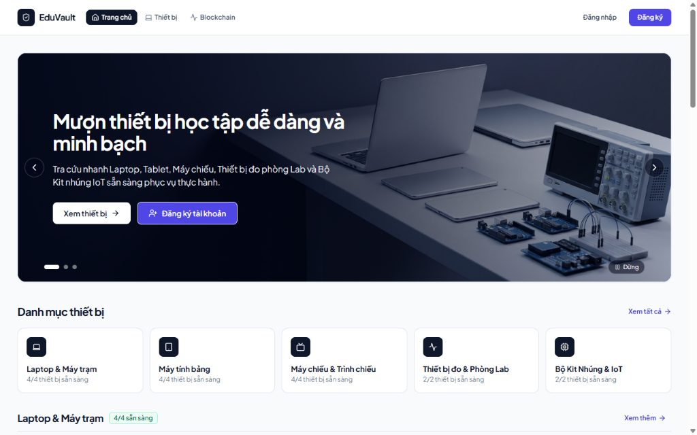
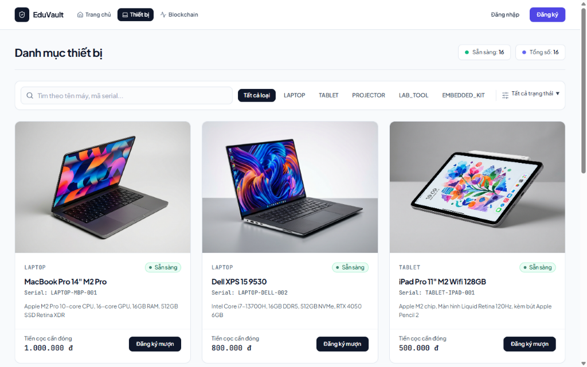
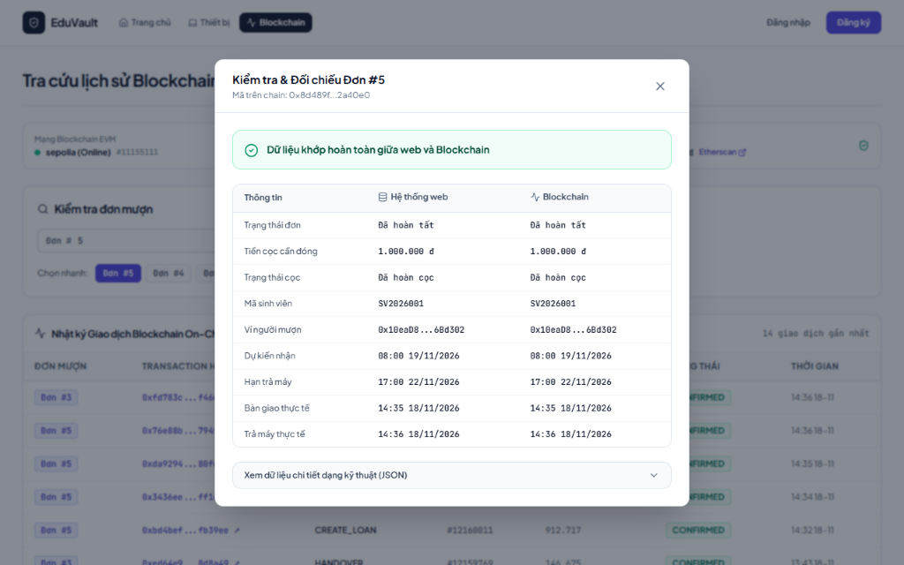
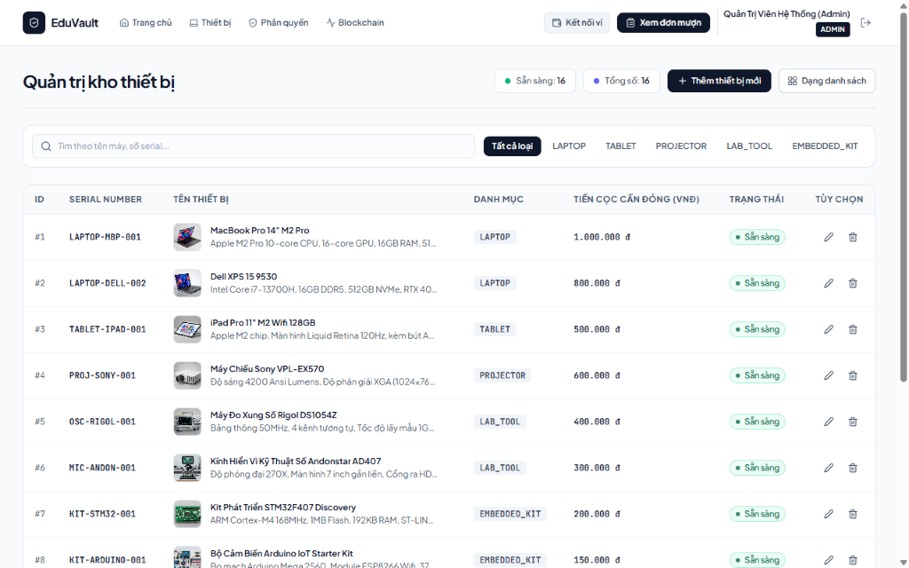
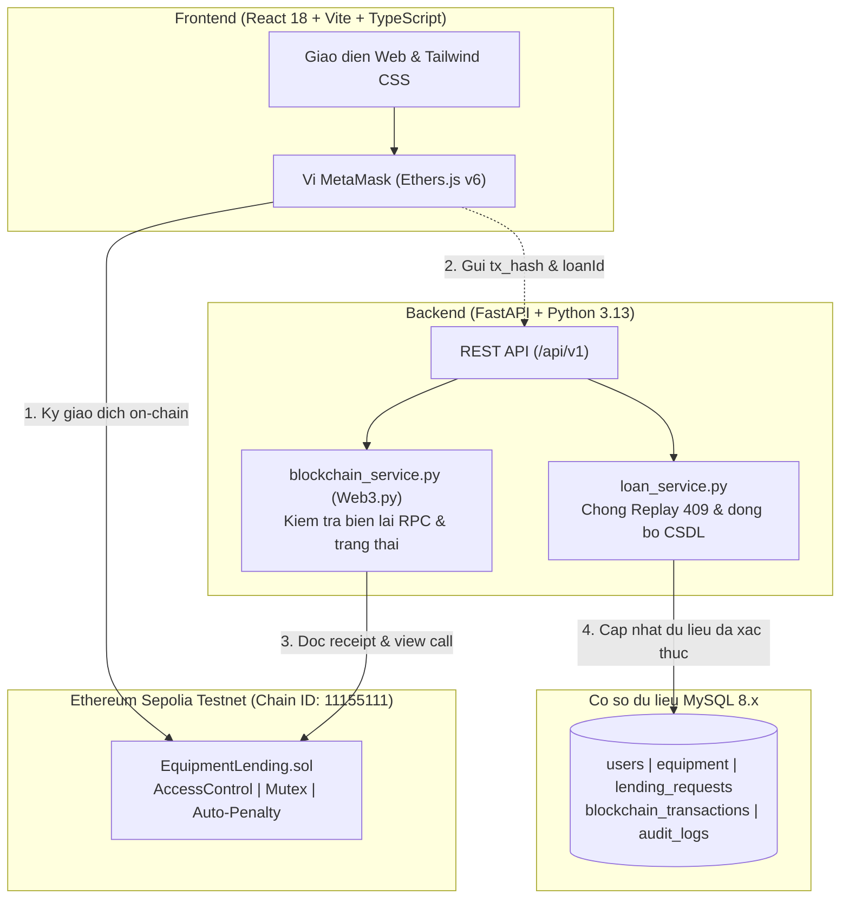

# EduVault

Hệ thống quản lý mượn trả thiết bị học tập và thí nghiệm (phòng lab) theo kiến trúc Pure Web3 trên mạng Ethereum Sepolia Testnet kết hợp FastAPI và MySQL.

Sinh viên và cán bộ phòng lab trực tiếp ký các giao dịch quan trọng bằng ví MetaMask cá nhân. Máy chủ FastAPI không giữ Private Key mà đóng vai trò kiểm chứng biên lai giao dịch từ RPC blockchain, đối chiếu sai lệch và đồng bộ dữ liệu tra cứu trên MySQL.

---

## Giao diện mẫu

| Trang chủ Storefront | Danh mục thiết bị (16 thiết bị mẫu) |
| :---: | :---: |
|  |  |

| Đối soát dữ liệu Web và Sepolia | Quản trị kho thiết bị (Admin) |
| :---: | :---: |
|  |  |

---

## Điểm chính của hệ thống

- **Ký số phía trình duyệt (Non-Custodial Web3):** Backend không lưu `ADMIN_PRIVATE_KEY`. Giao dịch tạo đơn (`createLoan`), duyệt đơn (`approveLoan`), bàn giao (`confirmHandover`), nghiệm thu trả máy (`confirmReturn`) và hủy đơn (`cancelLoan`) đều do người dùng tự ký trên MetaMask.
- **Xác thực sở hữu ví EIP-191:** Sinh viên ký thông điệp ngẫu nhiên dùng một lần (Personal Sign, hết hạn sau 5 phút) để gắn ví MetaMask vào tài khoản trước khi mượn thiết bị.
- **Phân quyền đa vai trò trên chuỗi:** Hợp đồng `EquipmentLending.sol` sử dụng OpenZeppelin `AccessControl` với 3 nhóm quyền (`DEFAULT_ADMIN_ROLE`, `ADMIN_ROLE`, `BORROWER_ROLE`), hỗ trợ quản trị viên thêm hoặc gỡ nhiều tài khoản Admin qua trang `/admin/roles`.
- **Chống đặt trùng thiết bị (Mutex hai lớp):** Smart Contract khóa `activeEquipmentLoan[equipmentId]` ngay khi đơn được duyệt; MySQL sử dụng khóa dòng (`SELECT ... FOR UPDATE`) khi chuyển trạng thái thiết bị.
- **Tự động tính phạt khi trả máy:** Hợp đồng thông minh tính tỷ lệ phạt dựa trên `block.timestamp` thực tế khi gọi `confirmReturn`: đúng hạn 0%, trễ tối đa 24 giờ phạt 10%, trễ trên 24 giờ phạt 50%, hư hỏng hoặc mất thiết bị tịch thu 100% tiền cọc cần đóng.
- **Thẩm tra biên lai và chống phát lại (Anti-Replay):** Backend kiểm tra `status == 1`, địa chỉ hợp đồng đích, `chainId`, ví người gửi, sự kiện phát ra và tự động retry khi node RPC công khai trễ trạng thái block. Chặn gửi trùng `tx_hash` hoặc `on_chain_loan_id` bằng mã HTTP `409`.
- **Giao diện Storefront và đối soát công khai:** Trang chủ hiển thị banner trượt, 5 nhóm danh mục, 16 thiết bị mẫu kèm phân trang (`/equipment`, `/admin/inventory`), bộ chọn hoặc tạo mới danh mục trong kho, bản đồ Trường Đại học Kỹ thuật - Công nghệ Cần Thơ ở chân trang và cửa sổ đối soát trực tiếp MySQL với Smart Contract (`/audit`).

---

## Kiến trúc hệ thống



### Phân chia nguồn dữ liệu

| Dữ liệu | Nguồn chính | Vai trò đồng bộ |
|---|---|---|
| Thông tin cá nhân (họ tên, email, MSSV, mật khẩu băm) | MySQL (`users`) | Lưu off-chain để bảo vệ quyền riêng tư, không đưa lên chuỗi. |
| Thông tin thiết bị (tên, serial, ảnh, cấu hình, tiền cọc) | MySQL (`equipment`) | Smart Contract chỉ tham chiếu khóa `equipmentId` để tiết kiệm phí gas. |
| Trạng thái đơn, trạng thái cọc, tỷ lệ phạt, Mutex | Smart Contract (`loans`, `activeEquipmentLoan`) | MySQL (`lending_requests`) chỉ cập nhật sau khi xác minh biên lai `status == 1`. |
| Nhật ký giao dịch Blockchain | Ethereum Sepolia | MySQL (`blockchain_transactions`) lưu `tx_hash`, `block_number`, `gas_used` để tra cứu nhanh. |

---

## Vòng đời đơn mượn và mức phạt

1. **Đăng ký mượn (`Submitted`):** Sinh viên có `BORROWER_ROLE` ký `createLoan` trên MetaMask. Giao dịch ghi nhận `LoanRecord` và phát sự kiện `LoanCreated`.
2. **Duyệt đơn (`Approved`):** Admin có `ADMIN_ROLE` ký `approveLoan(loanId)`. Hợp đồng đặt Mutex `activeEquipmentLoan[equipmentId]` để không thể duyệt trùng đơn khác cho cùng máy.
3. **Bàn giao máy (`Active`):** Khi sinh viên nhận máy tại phòng lab, Admin ký `confirmHandover(loanId)` để khóa tiền cọc (`DepositState.Locked`).
4. **Nghiệm thu trả máy (`Returned` hoặc `Disputed`):** Admin chọn tình trạng thiết bị (`0: GOOD`, `1: DAMAGED`, `2: LOST`) và ký `confirmReturn(loanId, returnCondition)`:
   - Nguyên vẹn, đúng hạn: phạt `0%`, trạng thái cọc `Refunded`, đơn `Returned`.
   - Nguyên vẹn, trễ tối đa 24 giờ: phạt `10%`, trạng thái cọc `Refunded`, đơn `Returned`.
   - Nguyên vẹn, trễ trên 24 giờ: phạt `50%`, trạng thái cọc `Refunded`, đơn `Returned`.
   - Hư hỏng (`1`) hoặc mất (`2`): tịch thu `100%`, trạng thái cọc `Forfeited`, đơn `Disputed`.
   - Mở khóa Mutex `activeEquipmentLoan` ngay khi hoàn tất.
5. **Hủy đơn (`Cancelled`):** Sinh viên hoặc Admin ký `cancelLoan(loanId, reason)` khi đơn còn ở trạng thái `Submitted` hoặc `Approved` (chưa bàn giao), đồng thời mở khóa Mutex nếu đơn đã từng được duyệt.

---

## Công nghệ sử dụng

| Phân hệ | Công nghệ | Phiên bản / Cấu hình |
|---|---|---|
| Smart Contract | Solidity, OpenZeppelin Contracts, Hardhat | Solidity `^0.8.24`, OpenZeppelin `^5.1.0`, Hardhat `^2.22.18` |
| Mạng Blockchain | Ethereum Sepolia Testnet | Chain ID `11155111` (hỗ trợ chạy cục bộ Hardhat `31337`) |
| Backend | Python, FastAPI, SQLAlchemy, Alembic, Web3.py | Python `3.13`, FastAPI `>=0.115`, SQLAlchemy `>=2.0`, Web3.py `>=6.20` |
| Frontend | React, TypeScript, Vite, Tailwind CSS, Ethers.js | React `18.3`, TypeScript `~5.6`, Vite `^6.0`, Ethers `^6.17` |
| Cơ sở dữ liệu | MySQL / MariaDB (XAMPP) | MySQL `8.x`, charset `utf8mb4_unicode_ci` |

### Thông tin Smart Contract trên Sepolia

- **Tên hợp đồng:** `EquipmentLending`
- **Chain ID:** `11155111` (Ethereum Sepolia Testnet)
- **Địa chỉ hợp đồng:** `0xA88De9B00C0F78FF9a162C4f17524ef885169ffd`
- **Etherscan:** https://sepolia.etherscan.io/address/0xA88De9B00C0F78FF9a162C4f17524ef885169ffd
- **Ví Deployer gốc:** `0x6396121f971a55bc844301E039F6C6F472C5CbBB`

---

## Cấu trúc thư mục

```text
BLockChain/
├── backend/
│   ├── alembic/versions/              # Migration MySQL (head: d4e8f9a1b203)
│   ├── app/
│   │   ├── api/v1/                    # auth, users, equipment, loans, blockchain, audit, health
│   │   ├── core/contracts/            # ABI và địa chỉ hợp đồng đồng bộ từ deploy
│   │   ├── models/                    # users, equipment, lending_requests, blockchain_transactions, audit_logs
│   │   ├── schemas/                   # Pydantic request/response DTO
│   │   ├── services/                  # blockchain_service, loan_service, reconciliation_service, auth, equipment
│   │   └── main.py
│   ├── tests/                         # 81 bài kiểm thử Pytest
│   ├── .env.example
│   └── requirements.txt
├── contracts/
│   ├── contracts/EquipmentLending.sol # Hợp đồng thông minh chính
│   ├── deployments/                   # Metadata deploy Sepolia & localhost
│   ├── scripts/deploy.cjs             # Deploy và tự động đồng bộ ABI sang backend + frontend
│   └── test/EquipmentLending.test.cjs # 31 bài kiểm thử Hardhat
├── frontend/
│   ├── public/images/                 # Ảnh sản phẩm thiết bị và banner trang chủ
│   ├── src/
│   │   ├── components/                # Layout, Navbar, Modal, Pagination, LoanVerifyPanel, StatusBadge
│   │   ├── context/                   # AuthContext (JWT) & Web3Context (MetaMask/Roles)
│   │   ├── contracts/                 # ABI & contractConfig (hỗ trợ Sepolia / Hardhat)
│   │   └── pages/                     # Home, Equipment, Login, Register, MyLoans, AdminLoans, AdminInventory, AdminRoles, Audit
│   └── package.json
├── docs/
│   ├── images/screenshots/            # Ảnh chụp giao diện mẫu cho README
│   ├── TONG_QUAN_HE_THONG_VA_KIEN_THUC_BLOCKCHAIN.html
│   └── README.md
├── scripts/
│   └── seed.py                        # Nạp tài khoản mẫu và 16 thiết bị ban đầu
├── .env.example
├── seed_data.bat                      # Chạy alembic upgrade head + seed.py
├── start_all.bat                      # Khởi động nhanh Hardhat, Backend và Frontend
├── start_backend.bat                  # Chạy Backend FastAPI cổng 8000
└── start_frontend.bat                 # Chạy Frontend Vite cổng 5173
```

---

## Hướng dẫn cài đặt và khởi chạy

### Yêu cầu trước khi cài

- Node.js 18 trở lên (khuyến nghị 20 LTS)
- Python 3.11 đến 3.13
- MySQL 8.x hoặc XAMPP (MariaDB) chạy ở cổng `3306`
- Trình duyệt có tiện ích ví MetaMask

### 1. Tạo cơ sở dữ liệu MySQL

1. Bật dịch vụ MySQL trên XAMPP hoặc MySQL Server (`127.0.0.1:3306`).
2. Tạo database tên `equipment_lending_db` với bảng mã `utf8mb4_unicode_ci`.

### 2. Cấu hình biến môi trường

Sao chép file mẫu và điền khóa bí mật JWT của bạn:

```powershell
copy .env.example .env
copy backend\.env.example backend\.env
```

Tạo chuỗi ngẫu nhiên cho `JWT_SECRET_KEY`:

```powershell
python -c "import secrets; print(secrets.token_hex(32))"
```

Để kết nối mạng Sepolia Testnet mặc định, cập nhật 3 dòng cấu hình mạng trong `backend\.env` và `.env`:

```env
BLOCKCHAIN_RPC_URL=https://ethereum-sepolia-rpc.publicnode.com
CHAIN_ID=11155111
CONTRACT_ADDRESS=0xA88De9B00C0F78FF9a162C4f17524ef885169ffd
```

### 3. Cài đặt Backend và nạp dữ liệu mẫu

```powershell
cd backend
python -m venv .venv
.\.venv\Scripts\python.exe -m pip install -r requirements.txt
.\.venv\Scripts\python.exe -m alembic upgrade head
cd ..
.\backend\.venv\Scripts\python.exe scripts\seed.py
```

Hoặc trên Windows có thể chạy trực tiếp file [seed_data.bat](./seed_data.bat) sau khi đã tạo `.venv`.

### 4. Cài đặt Frontend

```powershell
cd frontend
npm install
cd ..
```

### 5. Khởi chạy hệ thống

Mở 2 cửa sổ terminal riêng:

```powershell
# Terminal 1: Backend FastAPI (http://127.0.0.1:8000/docs)
.\backend\.venv\Scripts\python.exe -m uvicorn backend.app.main:app --reload --host 127.0.0.1 --port 8000
```

```powershell
# Terminal 2: Frontend Vite (http://localhost:5173)
cd frontend
npm run dev
```

Hoặc chạy file [start_backend.bat](./start_backend.bat) và [start_frontend.bat](./start_frontend.bat) (hoặc [start_all.bat](./start_all.bat) nếu cần kèm Hardhat Local EVM).

---

## Tài khoản mẫu (sau khi chạy `seed.py`)

| Vai trò | Email | Mã số | Mật khẩu | Ghi chú |
|---|---|---|---|---|
| Quản trị viên (ADMIN) | `admin@eduvault.edu.vn` | `ADMIN001` | `admin123456` | Duyệt đơn, bàn giao, nhận trả, quản trị kho và phân quyền |
| Sinh viên 1 (BORROWER) | `sv01@eduvault.edu.vn` | `SV2026001` | `student123` | Tìm kiếm, tạo và theo dõi đơn mượn qua MetaMask |
| Sinh viên 2 (BORROWER) | `sv02@eduvault.edu.vn` | `SV2026002` | `student123` | Tài khoản thử nghiệm song song |
| Sinh viên 3 (BORROWER) | `sv03@eduvault.edu.vn` | `SV2026003` | `student123` | Tài khoản thử nghiệm song song |

---

## Kiểm thử và đóng gói

Chạy kiểm thử từ thư mục gốc dự án:

```powershell
# 1. Backend Pytest (81/81 passed)
.\backend\.venv\Scripts\python.exe -m pytest backend/tests/ -v

# 2. Smart Contract Hardhat (31/31 passing)
cd contracts
npx hardhat test

# 3. Kiểm tra kiểu TypeScript và build Frontend
cd ..\frontend
npx tsc --noEmit --incremental false
npm run build
```

---

## Tài liệu tham khảo nội bộ

- Trang HTML tương tác tổng hợp kiến thức Blockchain, kiến trúc và giải thích route: [docs/TONG_QUAN_HE_THONG_VA_KIEN_THUC_BLOCKCHAIN.html](./docs/TONG_QUAN_HE_THONG_VA_KIEN_THUC_BLOCKCHAIN.html)
- Mục lục toàn bộ báo cáo kỹ thuật: [docs/README.md](./docs/README.md)
