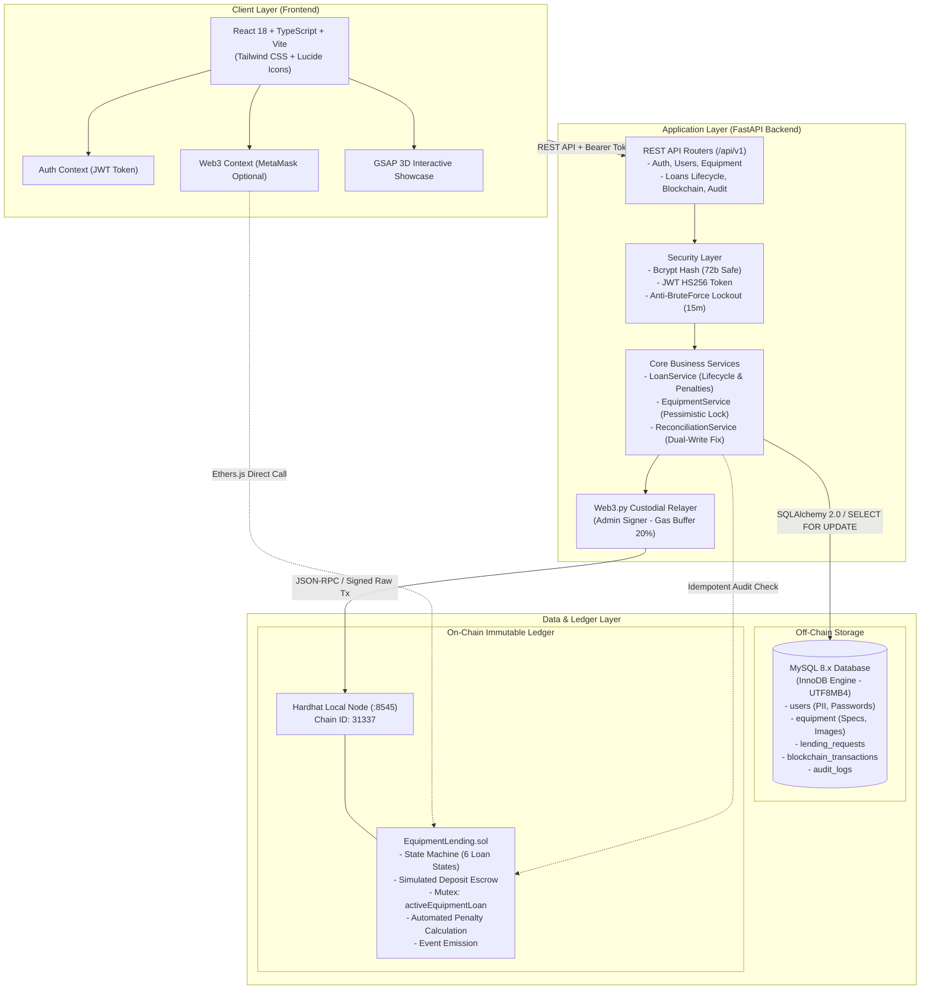

<div align="center">

# 🛡️ EduVault
### Smart Contract-Audited Academic Equipment Lending Platform
**Nền tảng Quản lý và Kiểm toán Mượn trả Thiết bị Đào tạo dựa trên Smart Contract**

[](https://soliditylang.org/)
[](https://fastapi.tiangolo.com/)
[](https://react.dev/)
[](https://www.typescriptlang.org/)
[](https://www.mysql.com/)
[](https://hardhat.org/)
[](https://tailwindcss.com/)
[](https://pytest.org/)
[](https://hardhat.org/)

<p align="center">
  <b>EduVault</b> kết hợp sức mạnh lưu trữ quan hệ hiệu năng cao của <b>MySQL 8.x</b> và tính toàn vẹn bất biến không thể làm giả của <b>Smart Contract EVM</b> theo mô hình kiến trúc <b>Hybrid Web2.5</b>.
</p>

[Tính Năng Chính](#-tính-năng-nổi-bật) •
[Kiến Trúc Hệ Thống](#-kiến-trúc-hệ-thống--mô-hình-web25) •
[Mô Hình Dữ Liệu](#-mô-hình-dữ-liệu-chuẩn-source-of-truth) •
[Cài Đặt & Khởi Động](#-hướng-dẫn-cài-đặt--vận-hành-từ-a-z) •
[Tài Khoản Mẫu](#-tài-khoản-trải-nghiệm-demo) •
[Kiểm Thử Toàn Diện](#-kiểm-thử-toàn-diện)

---

</div>

## 📌 Giới Thiệu & Bài Toán Giải Quyết

Trong các cơ sở đào tạo đại học, việc quản lý và mượn trả trang thiết bị thực hành giá trị cao (MacBook, Laptop cấu hình cao, máy đo xung số, kính hiển vi điện tử, máy chiếu, các bộ kit vi điều khiển IoT/STM32) thường đối mặt với các thách thức:
1. **Xung đột đặt trùng thiết bị (Race-condition / Double-booking):** Nhiều sinh viên cùng đăng ký mượn một thiết bị duy nhất tại cùng một thời điểm.
2. **Thiếu minh bạch & Dễ can thiệp dữ liệu:** Lịch sử mượn trả, nhật ký giao nhận và biên bản xử lý vi phạm trong cơ sở dữ liệu truyền thống có thể bị quản trị viên chỉnh sửa hoặc vô tình làm mất tính toàn vẹn.
3. **Tranh chấp tiền đặt cọc và phạt quá hạn:** Thiếu cơ chế tự động hóa công bằng, bất biến trong việc tính toán thời gian trễ hạn và quyết toán khấu trừ tiền cọc.
4. **Rào cản tiếp cận Web3:** Sinh viên và giảng viên thông thường không sở hữu ví tiền điện tử (MetaMask), không có tiền testnet để trả phí gas cho mỗi thao tác.

### 💡 Giải Pháp Đột Phá Của EduVault:
- **Kiến trúc Kép Hybrid Web2.5 (Dual-State Architecture):**
  - **Tầng Off-Chain (MySQL 8.x):** Lưu trữ thông tin cá nhân (PII), mật khẩu băm bảo mật, hồ sơ thiết bị, ảnh phòng lab, đảm bảo tốc độ phản hồi tính bằng mili-giây và tuân thủ các quy định bảo mật riêng tư.
  - **Tầng On-Chain (Hardhat Local EVM & Solidity Smart Contract):** Lưu trữ máy trạng thái bất biến (State Machine), mốc thời gian Unix timestamp, cơ chế khóa Mutex chống đặt trùng, quản lý ký quỹ mô phỏng (Simulated Deposit Accounting) và tự động tính toán phạt trễ hạn.
- **Backend Custodial Relayer / Admin Signer:** Backend FastAPI đóng vai trò ký thay các giao dịch on-chain bằng ví Admin. Người dùng chỉ cần đăng nhập bằng Email / Mã sinh viên và mật khẩu (JWT Token) mà không cần cài MetaMask.
- **Tích Hợp MetaMask Linh Hoạt (Web3 Optional):** Cung cấp sẵn `Web3Context` để người dùng hoặc kiểm toán viên có thể kết nối ví MetaMask trực tiếp để kiểm tra trạng thái Smart Contract trên giao diện.
- **Tự Phục Hồi Lệch Dữ Liệu (Background Reconciliation Worker):** Giải quyết triệt để vấn đề sai lệch dữ liệu do sự cố mạng hoặc sập nguồn máy chủ (Dual-Write Failure) bằng thuật toán so khớp độc lập lấy dữ liệu on-chain làm chân lý (Source of Truth).

---

## ✨ Tính Năng Nổi Bật

### 1. Dành cho Sinh viên / Giảng viên mượn thiết bị (Borrower)
- 🖥️ **Danh mục thiết bị Bento Grid:** Tra cứu danh mục thiết bị phòng lab trực quan kèm hình ảnh studio thực tế, lọc theo phân loại (Laptop, Thiết bị đo, Kit nhúng...), tìm kiếm mờ tức thì theo tên và số Serial.
- 📝 **Đăng ký mượn máy 1-Click:** Modal đặt lịch mượn với lịch nhận/trả tự động kiểm tra tính hợp lệ và hiển thị tóm tắt chính sách cọc/phạt minh bạch.
- 📊 **Theo dõi đơn mượn cá nhân (`/my-loans`):** Tiến trình mượn 4 bước (Stepper) trực quan, hiển thị cờ cảnh báo quá hạn (`OVERDUE`), tình trạng ký quỹ (`LOCKED`, `REFUNDED`, `FORFEITED`) và cho phép hủy đơn an toàn trước khi bàn giao.

### 2. Dành cho Quản trị viên phòng Lab (Admin)
- 📋 **Trung tâm điều phối mượn trả (`/admin/loans`):** Bảng quản trị phân tab (Chờ duyệt, Đã duyệt, Đang mượn, Đã hoàn tất).
- 🔒 **Duyệt đơn an toàn với MySQL Pessimistic Lock:** Khóa dòng dữ liệu mức CSDL (`SELECT ... FOR UPDATE`), đồng thời ký giao dịch on-chain kích hoạt Mutex `activeEquipmentLoan`.
- 🤝 **Bàn giao máy thực tế:** Xác nhận sinh viên đã nhận máy, chuyển đơn sang `ACTIVE` và khóa tiền cọc mô phỏng trên Smart Contract.
- ⚖️ **Nghiệm thu hoàn trả & Tính phạt tự động:**
  - **Trả đúng hạn, nguyên vẹn:** Hoàn 100% tiền cọc.
  - **Trễ hạn $\le 24$ giờ:** Tự động khấu trừ 10% phí trễ hạn.
  - **Trễ hạn $> 24$ giờ:** Tự động khấu trừ 50% phí trễ hạn.
  - **Hư hỏng / Mất mát:** Tịch thu 100% cọc vào quỹ trường, đánh dấu đơn tranh chấp (`DISPUTED`) và khóa tài khoản vi phạm.
- 📦 **Quản lý kho thiết bị (`/admin/inventory`):** Thêm mới thiết bị, cập nhật mức cọc, chuyển trạng thái bảo trì (`MAINTENANCE`) hoặc thu hồi an toàn (`RETIRED`).

### 3. Công Cụ Kiểm Toán & Trình Diễn Công Nghệ Cao
- 🔍 **Trang kiểm toán Blockchain (`/audit`):**
  - **Dual-State Verification:** Công cụ đối soát tính toàn vẹn độc lập so khớp 100% các trường dữ liệu giữa MySQL và Smart Contract.
  - **Reconciliation Worker:** Nút kích hoạt tiến trình tự động quét và sửa lỗi dữ liệu lệch do server bị crash.
  - **Blockchain Explorer Cục bộ:** Xem danh sách Transaction Hash, số hiệu block, lượng gas tiêu thụ thực tế trên mạng EVM.
- 🌟 **Trang Trình diễn Tổng quan (`/overview`):**
  - **Hero 3D Digital Vault (GSAP Web 3D):** Khối vault tương tác xoay đa chiều theo tọa độ chuột và bộ counter nhảy số động.
  - **Visual Pipeline 4 Trạm:** Mô phỏng dòng chảy nghiệp vụ Web2.5 từ MySQL Lock đến Smart Contract.
  - **Live Transaction Terminal:** Stream lịch sử giao dịch trực tiếp từ blockchain node với giao diện console chuyên nghiệp.
  - **Simulator Playground:** Bảng giả lập thử nghiệm tương tác 5 kịch bản mượn trả khác nhau.

---

## 🏗️ Kiến Trúc Hệ Thống & Mô Hình Web2.5



---

## 📊 Mô Hình Dữ Liệu Chuẩn (Source of Truth)

Để bảo đảm cả hai tiêu chí: **Tốc độ & Bảo mật thông tin riêng tư (GDPR)** và **Tính bất biến chống gian lận**, EduVault phân chia ranh giới dữ liệu rành mạch:

| Thực thể dữ liệu | Nguồn chuẩn (Authoritative) | Lưu trữ phụ | Cơ chế đồng bộ & Ràng buộc |
| :--- | :---: | :---: | :--- |
| **Thông tin cá nhân (PII)**<br>Họ tên, MSSV, Email, Mật khẩu hash, Role | **MySQL** | *Không lưu on-chain* | Bảo mật thông tin riêng tư, tuân thủ pháp lý. |
| **Thông số chi tiết thiết bị**<br>Tên, Cấu hình, Danh mục, Hình ảnh | **MySQL** | *Không lưu on-chain* | Smart Contract chỉ lưu `equipmentId` (uint256). |
| **Trạng thái đơn mượn (Loan State)** | **Smart Contract** | MySQL (`lending_requests.status`) | Smart Contract là chuẩn. MySQL chỉ cập nhật khi nhận Transaction Receipt thành công (`status == 1`). |
| **Trạng thái tiền cọc (Deposit State)** | **Smart Contract** | MySQL (`deposit_status`) | Quản lý ký quỹ mô phỏng trên contract (`LOCKED`, `REFUNDED`, `FORFEITED`). |
| **Khóa chống mượn trùng (Mutex)** | **Smart Contract & MySQL** | Đồng bộ cả hai | MySQL: Khóa dòng `SELECT ... FOR UPDATE`.<br>Contract: `activeEquipmentLoan[equipmentId]`. |
| **Mốc thời gian giao nhận / Hạn trả** | **Smart Contract** | MySQL (`due_date`,...) | Contract lưu Unix timestamp; MySQL lưu `DATETIME`. |
| **Nhật ký kiểm toán giao dịch** | **EVM Ledger** | MySQL (`blockchain_transactions`) | Ghi nhận Transaction Hash, Block Number, Gas Used. |

---

## 🛠️ Ngăn Xếp Công Nghệ (Tech Stack)

| Phân tầng | Công nghệ / Thư viện | Phiên bản | Mục đích sử dụng |
| :--- | :--- | :--- | :--- |
| **Frontend** | React | `^18.3.1` | Xây dựng Single Page Application hiện đại |
| | TypeScript | `^5.5.3` | Định kiểu an toàn, bắt lỗi compile-time |
| | Vite | `^5.4.2` | Công cụ đóng gói bundle siêu tốc, HMR mượt mà |
| | Tailwind CSS | `^3.4.1` | Thiết kế giao diện Clean Corporate Dashboard |
| | Lucide React | `^0.344.0` | Bộ biểu tượng icon chuẩn hóa nhất quán |
| | GSAP & @gsap/react | `^3.14.0` | Diễn hoạt Web 3D khối Vault, counter, terminal |
| | Axios | `^1.7.9` | HTTP Client có interceptor tự động gán Bearer token |
| | Ethers | `^6.13.5` | Thư viện kết nối ví MetaMask và đọc contract |
| **Backend** | Python | `3.11.x / 3.13.x` | Ngôn ngữ phát triển backend chính |
| | FastAPI | `^0.115.0` | Framework API tốc độ cao, hỗ trợ Swagger OpenAPI 3.1 |
| | SQLAlchemy | `^2.0.36` | ORM ánh xạ thực thể CSDL quan hệ |
| | Alembic | `^1.13.3` | Quản lý phiên bản migration cơ sở dữ liệu |
| | PyMySQL | `^1.1.1` | Driver kết nối MySQL thuần Python |
| | Web3.py | `6.20.4` | Tương tác node Blockchain, ký giao dịch Relayer |
| | Bcrypt | `^4.0.0` | Thuật toán băm mật khẩu một chiều có salt |
| | Python-Jose | `^3.3.0` | Ký và giải mã JSON Web Token (HS256) |
| | Pytest | `^8.3.3` | Khung kiểm thử tự động toàn diện |
| **Blockchain**| Solidity | `^0.8.24` | Ngôn ngữ lập trình Smart Contract |
| | Hardhat | `^2.22.18` | Môi trường phát triển và node EVM cục bộ |
| | OpenZeppelin | `^5.0.0` | Thư viện hợp đồng chuẩn bảo mật (Ownable) |
| **Database** | MySQL / MariaDB | `8.0 / XAMPP` | Cơ sở dữ liệu quan hệ lưu trữ chính |

---

## 📁 Cấu Trúc Thư Mục Dự Án

```
EduVault/
├── backend/                              # Mã nguồn Backend FastAPI
│   ├── alembic/                          # Quản lý phiên bản Migration CSDL
│   │   ├── versions/                     # Các file script migration
│   │   └── env.py                        # Cấu hình nạp metadata từ SQLAlchemy
│   ├── app/
│   │   ├── api/                          # Tầng điều phối và định tuyến API
│   │   │   ├── deps.py                   # Dependency Injection: Auth & phân quyền RBAC
│   │   │   └── v1/
│   │   │       ├── health.py             # Health check API & DB connectivity
│   │   │       ├── auth.py               # API Đăng nhập JSON & OAuth2 form
│   │   │       ├── users.py              # API Quản trị người dùng & /users/me
│   │   │       ├── equipment.py          # API Quản lý danh mục thiết bị CRUD
│   │   │       ├── loans.py              # 6 APIs vòng đời mượn trả
│   │   │       ├── blockchain.py         # API Chẩn đoán node Blockchain & số dư ví
│   │   │       └── audit.py              # API Đối soát dữ liệu & Lịch sử kiểm toán
│   │   ├── core/                         # Cấu hình lõi & Bảo mật
│   │   │   ├── config.py                 # Pydantic BaseSettings đọc file .env
│   │   │   ├── security.py               # Băm Bcrypt, cấp phát JWT, khóa brute-force
│   │   │   └── contracts/                # ABI và địa chỉ Smart Contract đã deploy
│   │   ├── db/                           # Tầng kết nối cơ sở dữ liệu
│   │   │   ├── base.py                   # SQLAlchemy Declarative Base
│   │   │   └── session.py                # Engine và SessionLocal kết nối PyMySQL
│   │   ├── models/                       # 5 Thực thể ORM SQLAlchemy (users, equipment,...)
│   │   ├── schemas/                      # DTOs Schema Pydantic v2 (Request/Response)
│   │   ├── services/                     # Tầng xử lý logic nghiệp vụ chính
│   │   │   ├── auth_service.py           # Xác thực & đếm số lần sai khóa 15 phút
│   │   │   ├── user_service.py           # CRUD người dùng, kiểm tra trùng lặp
│   │   │   ├── equipment_service.py      # CRUD thiết bị & MySQL Pessimistic Lock
│   │   │   ├── blockchain_service.py     # Web3.py Custodial Relayer, Keccak256
│   │   │   ├── loan_service.py           # Vòng đời 6 bước mượn trả & tính phạt
│   │   │   └── reconciliation_service.py # Worker đối soát tự phục hồi Dual-write
│   │   └── main.py                       # Khởi tạo FastAPI app, CORS, đăng ký Routers
│   ├── tests/                            # Bộ 56 bài kiểm thử tự động Pytest
│   └── requirements.txt                  # Danh mục dependencies Python
├── contracts/                            # Mã nguồn Smart Contract Hardhat
│   ├── contracts/                        # Mã nguồn hợp đồng Solidity
│   │   └── EquipmentLending.sol          # Smart contract chính quản lý mượn trả & cọc
│   ├── scripts/
│   │   └── deploy.cjs                    # Script deploy lên EVM & tự động xuất ABI
│   ├── test/
│   │   └── EquipmentLending.test.cjs     # 28 bài test bao phủ 100% kịch bản hợp đồng
│   ├── hardhat.config.cjs                # Cấu hình mạng Hardhat local
│   └── package.json                      # Dependencies Smart Contract
├── frontend/                             # Giao diện người dùng React 18 + Vite
│   ├── public/images/equipment/          # Ảnh sản phẩm phòng lab độ nét cao
│   ├── src/
│   │   ├── components/                   # Các component tái sử dụng (Navbar, Modal,...)
│   │   ├── context/                      # AuthContext (JWT) và Web3Context (MetaMask)
│   │   ├── contracts/                    # ABI và Config contract cho Frontend
│   │   ├── pages/                        # 7 màn hình ứng dụng chính
│   │   │   ├── ShowcasePage.tsx          # Trang giới thiệu tổng quan GSAP 3D
│   │   │   ├── LoginPage.tsx             # Trang đăng nhập
│   │   │   ├── EquipmentPage.tsx         # Trang danh mục thiết bị & đăng ký mượn
│   │   │   ├── MyLoansPage.tsx           # Trang quản lý đơn mượn của sinh viên
│   │   │   ├── AdminLoansPage.tsx        # Trang điều phối duyệt/trả máy cho Admin
│   │   │   ├── AdminInventoryPage.tsx    # Trang quản lý kho thiết bị
│   │   │   └── AuditPage.tsx             # Trang kiểm toán đối soát Blockchain
│   │   ├── services/                     # Tầng gọi API Backend (Axios Client)
│   │   └── types/                        # Khai báo TypeScript Interfaces
│   └── package.json                      # Dependencies Frontend
├── docs/                                 # Tài liệu kỹ thuật chi tiết
│   ├── PHASE_5_REPORT.md                 # Báo cáo nghiệm thu chi tiết Phase 5
│   ├── SYSTEM_ANALYSIS_REPORT.md         # Phân tích toàn diện hệ thống (Contract/BE/FE)
│   └── QA_SECURITY_REPORT.md             # Báo cáo kiểm thử & bảo mật
├── scripts/
│   ├── seed.py                           # Script nạp dữ liệu mẫu thực tế vào MySQL
│   └── start_all.ps1                     # 🚀 Script PowerShell khởi động 1 chạm (3 tiến trình song song)
├── backend/
│   └── .env.example                      # File mẫu cấu hình môi trường có chú thích đầy đủ
├── start_all.bat                         # Launcher 1-Click khởi động toàn bộ hệ thống (Windows)
├── start_backend.bat                     # Launcher khởi động riêng Backend
├── start_frontend.bat                    # Launcher khởi động riêng Frontend
├── start_hardhat.bat                     # Launcher khởi động riêng Hardhat Node
├── deploy_contract.bat                   # Launcher deploy Smart Contract
└── seed_data.bat                         # Launcher nạp dữ liệu mẫu
```

---

## 🚀 Hướng Dẫn Cài Đặt & Vận Hành Từ A-Z

### 0. Clone Dự Án (Clean Checkout)

```powershell
git clone https://github.com/NguyenThanhDuy42124/EduVault.git
cd EduVault
```

---

### 1. Yêu Cầu Tiên Quyết

| Phần mềm | Phiên bản | Kiểm tra |
| :--- | :--- | :--- |
| **Node.js** | `v18.x`+ (Khuyến nghị `v20.x`) | `node --version` |
| **Python** | `3.11.x` hoặc `3.13.x` | `python --version` |
| **XAMPP** (MySQL `8.x`) | Bất kỳ | Mở XAMPP Control Panel |
| **Git** | Bất kỳ | `git --version` |

---

### 2. Chuẩn Bị Cơ Sở Dữ Liệu MySQL
1. Mở **XAMPP Control Panel**, bấm **Start** cho module **MySQL**.
2. Mở trình duyệt truy cập: `http://localhost/phpmyadmin`.
3. Bấm **New** ➡️ Điền tên: `equipment_lending_db` ➡️ Bảng mã: `utf8mb4_unicode_ci` ➡️ **Create**.

---

### 3. Cài Đặt Dependencies (Lần đầu tiên)

#### A. Cài đặt Smart Contract (Hardhat)
```powershell
cd EduVault\contracts
npm install
```

#### B. Cài đặt Backend Python
```powershell
cd EduVault\backend
# Tạo và kích hoạt môi trường ảo
python -m venv .venv
.\.venv\Scripts\Activate.ps1
# Cài đặt thư viện
pip install -r requirements.txt
```

#### C. Cấu hình môi trường Backend
```powershell
# Copy file mẫu (đã có sẵn chú thích đầy đủ)
copy .env.example .env
# Mặc định đã đúng cho XAMPP local, không cần sửa
```

#### D. Cài đặt Frontend React
```powershell
cd EduVault\frontend
npm install
```

#### E. Migration & Nạp dữ liệu ban đầu
Từ thư mục `EduVault\backend` (với `.venv` đang active):
```powershell
# Tạo 5 bảng trên MySQL
alembic upgrade head

# Nạp dữ liệu mẫu (1 Admin, 3 Sinh viên, 8 Thiết bị học tập)
python ..\scripts\seed.py
```

---

### 4. Khởi Động Hệ Thống

#### ⚡ Cách 1: Khởi động 1-Click bằng PowerShell (Khuyến nghị)

```powershell
# Từ thư mục gốc EduVault
.\scripts\start_all.ps1
```

Script tự động mở **3 cửa sổ PowerShell song song**:
1. 🟢 **Hardhat Node** (cổng `8545`)
2. 🔵 **FastAPI Backend** (cổng `8000`)
3. 🟣 **Vite Frontend** (cổng `5173`)

> ⚠️ Nếu báo lỗi policy, chạy trước: `Set-ExecutionPolicy -ExecutionPolicy RemoteSigned -Scope CurrentUser`

Hoặc dùng file BAT truyền thống: click đúp **`start_all.bat`** tại thư mục gốc.

---

#### 🛠️ Cách 2: Khởi động thủ công từng phần

**Cửa sổ 1 - Hardhat Blockchain Node:**
```powershell
cd EduVault\contracts
npx hardhat node
```

**Cửa sổ 1b - Deploy Contract** (tab mới, sau khi node đã sẵn sàng):
```powershell
cd EduVault\contracts
npx hardhat run scripts/deploy.cjs --network localhost
```

**Cửa sổ 2 - Backend FastAPI:**
```powershell
cd EduVault
python -m uvicorn backend.app.main:app --reload --host 127.0.0.1 --port 8000
```
→ Swagger UI: `http://127.0.0.1:8000/docs`

**Cửa sổ 3 - Frontend React Vite:**
```powershell
cd EduVault\frontend
npm run dev
```
→ Web Application: `http://localhost:5173`

---

## 👤 Tài Khoản Trải Nghiệm (Demo)

Hệ thống đã nạp sẵn dữ liệu ban đầu qua `scripts/seed.py`:

| Vai trò (Role) | Email đăng nhập | Mật khẩu | Mã SV / Cán bộ | Quyền hạn trong hệ thống |
| :--- | :--- | :--- | :--- | :--- |
| **Quản trị viên (ADMIN)** | `admin@eduvault.edu.vn` | `admin123456` | `ADMIN001` | Duyệt đơn mượn, bàn giao máy, nghiệm thu trả máy, quản trị kho thiết bị, chạy đối soát dữ liệu |
| **Sinh viên 1 (BORROWER)**| `sv01@eduvault.edu.vn` | `student123` | `SV2026001` | Tra cứu thiết bị, đăng ký mượn, theo dõi đơn cá nhân, hủy đơn chờ duyệt |
| **Sinh viên 2 (BORROWER)**| `sv02@eduvault.edu.vn` | `student123` | `SV2026002` | Tương tự SV1 |
| **Sinh viên 3 (BORROWER)**| `sv03@eduvault.edu.vn` | `student123` | `SV2026003` | Tương tự SV1 |

---

## 🧪 Kiểm Thử Toàn Diện

Dự án được xây dựng với phương châm kiểm thử nghiêm ngặt ở mọi phân tầng:

### 1. Kiểm thử Smart Contract (28/28 Tests Passed)
Kiểm thử toàn diện các case: Chuẩn trả đúng hạn 0% phạt, Quá hạn 10% và 50%, Hỏng/Mất tịch thu 100% cọc, Hủy đơn các trạng thái, Mutex chống đặt trùng thiết bị, Revert khi truyền sai quyền hạn:
```powershell
cd EduVault\contracts
npx hardhat test
```
*Kết quả:* `28 passing (~893ms)` ✅

### 2. Kiểm thử Tự động Backend Pytest (56/56 Tests Passed)
Bao phủ toàn bộ các tầng: Health check, Xác thực Bcrypt, Chống brute-force khóa 15 phút, RBAC phân quyền, CRUD Thiết bị, MySQL Pessimistic Lock, Ký Relayer Web3, Vòng đời 6 bước mượn trả, Worker đối soát Dual-write:
```powershell
cd EduVault
.\backend\.venv\Scripts\python.exe -m pytest -v
```
*Kết quả:* `56 passed in ~67s (100% pass rate)` ✅

### 3. Kiểm thử Type & Build Frontend
```powershell
cd EduVault\frontend
npm run build
```
*Kết quả:* TypeScript compile 0 lỗi, Vite bundle production thành công trong ~2.9s ✅

---

## 🛡️ Quy Chuẩn Lập Trình Áp Dụng

Mã nguồn tuân thủ nghiêm ngặt theo quy chuẩn lập trình dự án:
- **Docstring 5 Thành Phần Chuẩn Hóa:** 100% các hàm nghiệp vụ Backend đều có docstring chi tiết gồm: *Mục đích*, *Tham số*, *Trả về*, *Lỗi (Raises)*, *Tác dụng phụ (Side effects)*.
- **Hàm Đơn Nhiệm & Phân Tầng:** Tách biệt tuyệt đối giữa Controller (Router), Service (Nghiệp vụ) và Model (Thực thể CSDL).
- **Xử lý Ngoại lệ Minh bạch:** Tuyệt đối không dùng `except: pass` nuốt lỗi. Mọi lỗi nghiệp vụ đều ném `HTTPException` với mã HTTP chuẩn và thông báo tiếng Việt có nghĩa.
- **Bảo mật:** Không hard-code private key hay thông tin nhạy cảm. Quản lý tập trung qua biến môi trường `.env`.

---

## 👥 Nhóm Tác Giả & Bản Quyền

Dự án được nghiên cứu và phát triển phục vụ đồ án chuyên ngành Công nghệ Thông tin / Kỹ thuật Phần mềm / Ứng dụng Blockchain trong Giáo dục.

- **Đơn vị:** Khoa Công nghệ Thông tin
- **Phiên bản:** `1.0.0` (Tháng 11/2026)
- **Giấy phép:** [MIT License](LICENSE)

---
<div align="center">
  <sub>EduVault - Secure, Transparent, and Immutable Academic Equipment Lending.</sub>
</div>
