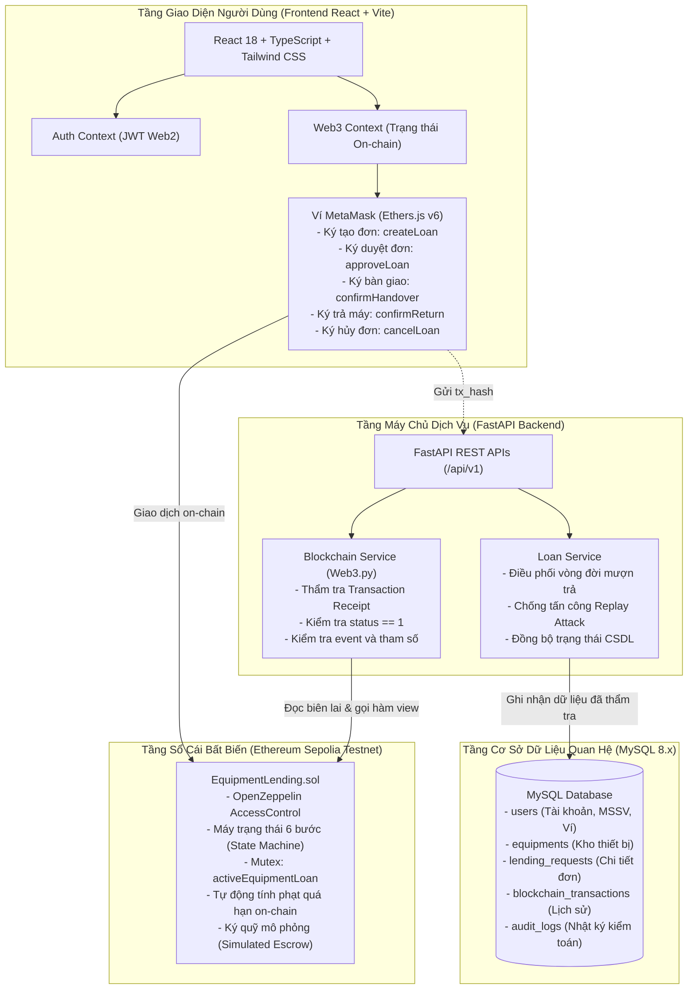

# 🛡️ EduVault - Hệ Thống Quản Lý và Điều Phối Mượn Trả Thiết Bị Học Tập

## Nền tảng Quản lý & Kiểm toán Thiết bị Đào tạo dựa trên Smart Contract (Kiến trúc Pure Web3)

EduVault là nền tảng quản lý, điều phối và kiểm toán quy trình mượn trả trang thiết bị thực hành phòng lab dựa trên Hợp đồng thông minh Ethereum (EVM) kết hợp hệ quản trị cơ sở dữ liệu quan hệ hiệu năng cao MySQL.

---

## 1. 📖 Tổng Quan & Bài Toán Giải Quyết

Trong các cơ sở giáo dục đại học và viện nghiên cứu, việc quản lý mượn trả trang thiết bị thực hành giá trị cao (máy đo xung số, kính hiển vi điện tử, kit vi điều khiển IoT/STM32, máy chiếu, thiết bị mạng chuyên dụng) thường gặp phải các thách thức lớn:

1. **Xung đột đặt trùng thiết bị (Double-booking):** Nhiều sinh viên cùng đăng ký một thiết bị tại cùng một thời điểm dẫn đến tranh chấp và sai lệch điều phối.
2. **Dữ liệu dễ bị can thiệp:** Lịch sử bàn giao, tình trạng thiết bị và biên bản xử lý vi phạm trong cơ sở dữ liệu truyền thống có thể bị chỉnh sửa hoặc vô tình mất tính toàn vẹn.
3. **Thiếu minh bạch trong tính phạt và xử lý tiền cọc:** Thiếu cơ chế độc lập, tự động tính toán thời gian trễ hạn và quyết toán khấu trừ tiền cọc một cách công bằng, khách quan.
4. **Rủi ro bảo mật của kiến trúc Custodial (Lưu khóa bí mật tại máy chủ):** Các mô hình Web2.5 cũ thường lưu Private Key của Quản trị viên tại file cấu hình máy chủ để ký hộ giao dịch (Relayer). Nếu máy chủ bị tấn công, toàn bộ quyền quản trị hợp đồng thông minh sẽ bị chiếm đoạt.

### Giải pháp đột phá của EduVault

EduVault giải quyết triệt để các hạn chế trên bằng kiến trúc **Pure Web3 (Non-Custodial Architecture)**:
- **Ký trực tiếp tại trình duyệt (Client-side Signing):** Sinh viên và Quản trị viên tự ký giao dịch bằng ví MetaMask cá nhân. Máy chủ backend tuyệt đối không lưu trữ khóa riêng tư (Private Key).
- **Xác thực quyền sở hữu ví chuẩn EIP-191:** Sinh viên ký thông điệp ngẫu nhiên (Personal Sign) để chứng minh quyền sở hữu ví MetaMask với mã số sinh viên trước khi tạo đơn.
- **Phân quyền AccessControl chuẩn OpenZeppelin trên chuỗi:** Hợp đồng thông minh sử dụng `DEFAULT_ADMIN_ROLE`, `ADMIN_ROLE` và `BORROWER_ROLE` để kiểm soát chặt chẽ quyền thực thi các hàm nghiệp vụ.
- **Khóa giữ chỗ tự động (On-chain Mutex):** Hợp đồng thông minh kích hoạt khóa độc quyền thiết bị (`activeEquipmentLoan`) ngay khi đơn được duyệt, loại bỏ 100% nguy cơ đặt trùng máy.
- **Tự động tính phạt và xử lý cọc trên chuỗi:** Hợp đồng tự động tính toán tỷ lệ phạt dựa trên block timestamp và tình trạng máy khi trả, quyết toán tiền cọc minh bạch.
- **Máy chủ đóng vai trò Thẩm tra biên lai (On-chain Receipt Verifier):** Backend FastAPI đọc biên lai trực tiếp từ mạng blockchain, kiểm tra tính toàn vẹn và chống tấn công phát lại (Anti-Replay Attack) trước khi cập nhật vào MySQL.

---

## 2. 🏛️ Kiến Trúc Hệ Thống Pure Web3

Hệ thống hoạt động theo mô hình Non-Custodial, tách biệt rõ ràng giữa tầng giao diện người dùng, máy chủ dịch vụ và sổ cái bất biến blockchain:



---

## 3. ⚖️ Phân Định Nguồn Dữ Liệu Chuẩn (Source of Truth)

EduVault phân chia ranh giới lưu trữ dữ liệu rõ ràng nhằm bảo đảm tốc độ phản hồi tính bằng mili-giây, bảo mật quyền riêng tư cá nhân và giữ vững tính bất biến của blockchain:

| Nhóm dữ liệu | Nguồn chuẩn (Authoritative) | Lưu trữ phụ | Cơ chế đồng bộ & Ràng buộc |
|---|---|---|---|
| **Thông tin cá nhân (PII)**<br>Họ tên, Email, MSSV, Mật khẩu hash | **MySQL** (`users`) | Không lưu on-chain | Bảo mật thông tin riêng tư, tránh lộ lọt dữ liệu nhạy cảm lên mạng công khai. |
| **Thông tin chi tiết thiết bị**<br>Tên máy, mô tả cấu hình, ảnh phòng lab | **MySQL** (`equipments`) | Không lưu on-chain | Smart Contract chỉ lưu khóa ngoại `equipmentId` (uint256) nhằm tối ưu chi phí gas. |
| **Trạng thái đơn mượn (Loan State)** | **Smart Contract** (`loans[loanId].state`) | MySQL (`lending_requests.status`) | Smart Contract là chân lý. MySQL chỉ cập nhật trạng thái khi biên lai on-chain hợp lệ (`status == 1`). |
| **Trạng thái tiền cọc (Deposit State)** | **Smart Contract** (`depositState`) | MySQL (`deposit_status`) | Quản lý tiền cọc trên chuỗi: `None` (0), `Locked` (1), `Refunded` (2), `Forfeited` (3). |
| **Khóa chống mượn trùng (Mutex)** | **Smart Contract & MySQL** | Đồng bộ cả hai | Smart Contract dùng `activeEquipmentLoan[equipmentId]`. MySQL dùng khóa dòng `SELECT ... FOR UPDATE`. |
| **Tính toán tiền phạt và hạn trả** | **Smart Contract** | MySQL | Smart Contract tự động tính dựa trên block timestamp thực tế của khối. |
| **Nhật ký kiểm toán giao dịch** | **Blockchain Sepolia** | MySQL (`blockchain_transactions`) | Lưu trữ đầy đủ `tx_hash`, `from_address`, `block_number`, `gas_used` để đối soát độc lập. |

---

## 4. 🔄 Vòng Đời Đơn Mượn & Quy Tắc Phạt Tự Động

### Vòng đời 6 bước chuẩn Pure Web3

1. **Xác minh ví (EIP-191):** Sinh viên đăng nhập vào hệ thống, mở hồ sơ cá nhân và ký thông điệp `personal_sign` qua MetaMask. Backend xác thực chữ ký và cập nhật trạng thái `wallet_verified = True`.
2. **Tạo yêu cầu mượn (Submitted):** Sinh viên chọn thiết bị và thời gian mượn dự kiến, MetaMask mở lên để sinh viên ký giao dịch `createLoan(...)`. Giao dịch sinh ra mã định danh duy nhất `loanId` (keccak256). Frontend gửi `tx_hash` và `loanId` về Backend để tạo đơn ở trạng thái `PENDING`.
3. **Duyệt đơn (Approved):** Quản trị viên phòng lab sử dụng ví có quyền `ADMIN_ROLE` ký giao dịch `approveLoan(loanId)` trên MetaMask. Hợp đồng kiểm tra điều kiện và đặt khóa Mutex giữ chỗ thiết bị. Backend xác thực biên lai và cập nhật trạng thái sang `APPROVED`.
4. **Bàn giao thiết bị (Active):** Khi sinh viên đến phòng lab nhận máy, Quản trị viên ký giao dịch `confirmHandover(loanId)`. Hợp đồng chuyển đơn sang trạng thái `Active` và khóa tiền cọc mô phỏng (`DepositState.Locked`). Backend cập nhật đơn sang `ACTIVE` và thiết bị sang `IN_USE`.
5. **Nghiệm thu và trả máy (Returned / Disputed):** Quản trị viên kiểm tra máy thực tế và ký giao dịch `confirmReturn(loanId, returnCondition)`.
   - `returnCondition = 0 (GOOD)`: Thiết bị nguyên vẹn, tự động hoàn trả cọc.
   - `returnCondition = 1 (DAMAGED)`: Thiết bị hư hỏng, tịch thu 100% tiền cọc, đơn chuyển sang `Disputed`.
   - `returnCondition = 2 (LOST)`: Thiết bị làm mất, tịch thu 100% tiền cọc, đơn chuyển sang `Disputed`.
   - Hợp đồng tự động giải phóng khóa Mutex thiết bị trở về trạng thái sẵn sàng cho lượt mượn tiếp theo.
6. **Hủy đơn (Cancelled):** Sinh viên hoặc Quản trị viên có thể ký giao dịch `cancelLoan(loanId, reason)` để hủy đơn khi đơn đang ở trạng thái `Submitted` hoặc `Approved` (trước khi nhận máy). Khóa Mutex sẽ được tự động giải phóng nếu đơn đã từng được duyệt.

### Quy tắc phạt trễ hạn tự động on-chain

Khi thực hiện trả máy (`confirmReturn`), hợp đồng thông minh tự động so sánh block timestamp hiện tại với thời hạn trả `dueDate`:
- **Đúng hạn:** Tỷ lệ phạt 0%, hoàn trả 100% tiền ký quỹ.
- **Trễ hạn không quá 24 giờ:** Tự động khấu trừ 10% giá trị tiền cọc quy định.
- **Trễ hạn trên 24 giờ:** Tự động khấu trừ 50% giá trị tiền cọc quy định.
- **Hư hỏng hoặc làm mất:** Tịch thu 100% tiền cọc bất kể có trả đúng hạn hay không.

---

## 5. 💻 Ngăn Xếp Công Nghệ (Tech Stack)

| Phân tầng | Công nghệ / Thư viện | Phiên bản | Vai trò kỹ thuật |
|---|---|---|---|
| **Smart Contract** | Solidity | `^0.8.20` | Ngôn ngữ lập trình hợp đồng thông minh trên EVM |
| | OpenZeppelin Contracts | `^5.0.0` | Thư viện AccessControl chuẩn bảo mật phân quyền đa vai trò |
| | Hardhat | `^2.22.x` | Môi trường biên dịch, kiểm thử và deploy hợp đồng |
| | Ethereum Sepolia | Chain ID `11155111` | Mạng thử nghiệm công khai (Public Testnet) |
| **Backend** | Python | `3.11.x` | Ngôn ngữ phát triển máy chủ chính |
| | FastAPI | `^0.115.x` | Web framework bất đồng bộ hiệu năng cao, tự sinh OpenAPI 3.1 |
| | SQLAlchemy | `^2.0.x` | ORM ánh xạ thực thể cơ sở dữ liệu quan hệ |
| | Alembic | `^1.13.x` | Quản lý và thực thi lịch sử migration CSDL |
| | Web3.py | `6.20.4` | Thư viện kết nối node blockchain và thẩm tra biên lai giao dịch |
| | PyMySQL | `^1.1.x` | Driver kết nối CSDL MySQL thuần Python |
| | Bcrypt & Python-Jose | `^4.0.0` / `^3.3.0` | Mã hóa mật khẩu một chiều và xử lý JSON Web Token (JWT) |
| | Pytest | `^8.4.x` | Khung kiểm thử tự động toàn diện (78 bài test) |
| **Frontend** | React | `^18.3.x` | Thư viện xây dựng giao diện Single Page Application |
| | TypeScript | `^5.5.x` | Đảm bảo an toàn kiểu dữ liệu, bắt lỗi lúc biên dịch |
| | Vite | `^6.x` | Công cụ đóng gói ứng dụng siêu tốc với HMR mượt mà |
| | Tailwind CSS | `^3.4.x` | Framework CSS thiết kế giao diện Clean Corporate hiện đại |
| | Ethers.js | `^6.13.x` | Thư viện kết nối ví MetaMask và tương tác hợp đồng thông minh |
| | Axios | `^1.7.x` | HTTP Client có interceptor tự động gắn mã thông báo JWT |
| **Database** | MySQL / MariaDB | `8.0 / XAMPP` | Hệ quản trị cơ sở dữ liệu quan hệ lưu trữ chính |

---

## 6. 📁 Cấu Trúc Thư Mục Dự Án

```
EduVault/
|-- backend/                                # Mã nguồn máy chủ Backend FastAPI
|   |-- alembic/                            # Lịch sử và cấu hình Migration CSDL
|   |   |-- versions/                       # Các tệp kịch bản migration
|   |   `-- env.py                          # Cấu hình nạp metadata từ SQLAlchemy
|   |-- app/
|   |   |-- api/                            # Các tuyến đường API (Endpoints)
|   |   |   |-- deps.py                     # Dependency Injection: Auth, DB, Roles
|   |   |   `-- v1/                         # API Router phiên bản 1
|   |   |       |-- auth.py                 # API Đăng nhập và xác minh ví EIP-191
|   |   |       |-- users.py                # API Quản lý tài khoản người dùng
|   |   |       |-- equipment.py            # API Quản lý danh mục kho thiết bị
|   |   |       |-- loans.py                # API Vòng đời mượn trả Pure Web3
|   |   |       |-- blockchain.py           # API Kiểm tra trạng thái node blockchain
|   |   |       |-- audit.py                # API Kiểm toán và đối soát dữ liệu
|   |   |       `-- health.py               # API Kiểm tra sức khỏe hệ thống
|   |   |-- core/                           # Cấu hình lõi và bảo mật
|   |   |   |-- config.py                   # Đọc biến môi trường từ tệp .env
|   |   |   |-- security.py                 # Băm Bcrypt và cấp phát mã thông báo JWT
|   |   |   `-- contracts/                  # ABI và địa chỉ Smart Contract đã deploy
|   |   |-- db/                             # Khởi tạo kết nối CSDL MySQL
|   |   |   `-- session.py                  # Cấu hình SQLAlchemy SessionLocal
|   |   |-- models/                         # 5 thực thể bảng CSDL MySQL
|   |   |-- schemas/                        # DTO Pydantic schemas (Request/Response)
|   |   |-- services/                       # Xử lý nghiệp vụ cốt lõi
|   |   |   |-- blockchain_service.py       # Thẩm tra biên lai giao dịch qua Web3.py
|   |   |   |-- loan_service.py             # Điều phối vòng đời mượn trả & chống replay
|   |   |   |-- audit_service.py            # Ghi nhật ký kiểm toán hệ thống
|   |   |   `-- equipment_service.py        # Quản lý kho thiết bị & khóa dòng MySQL
|   |   `-- main.py                         # Điểm khởi chạy ứng dụng FastAPI
|   |-- tests/                              # Bộ 78 bài kiểm thử tự động Pytest
|   |   |-- conftest.py                     # Fixture dùng chung cho môi trường test
|   |   |-- test_loans.py                   # Kiểm thử vòng đời mượn trả Pure Web3
|   |   |-- test_multi_user_e2e.py          # Kiểm thử chu trình liên ví Multi-Admin
|   |   |-- test_auth.py                    # Kiểm thử đăng nhập và chữ ký ví EIP-191
|   |   |-- test_blockchain.py              # Kiểm thử kết nối và xử lý receipt
|   |   |-- test_equipment.py               # Kiểm thử kho thiết bị
|   |   |-- test_users.py                   # Kiểm thử quản lý người dùng
|   |   |-- test_audit.py                   # Kiểm thử nhật ký đối soát
|   |   `-- test_health.py                  # Kiểm thử health check
|   `-- requirements.txt                    # Danh sách dependencies Python
|-- contracts/                              # Mã nguồn Smart Contract Hardhat
|   |-- contracts/
|   |   `-- EquipmentLending.sol            # Smart Contract chính (OpenZeppelin AccessControl)
|   |-- scripts/
|   |   `-- deploy.cjs                      # Script deploy tự động xuất ABI sang BE và FE
|   |-- test/
|   |   `-- EquipmentLending.test.cjs       # 31 bài kiểm thử Smart Contract (100% pass)
|   |-- hardhat.config.cjs                  # Cấu hình mạng Hardhat và Sepolia Testnet
|   `-- package.json                        # Dependencies Node.js Smart Contract
|-- frontend/                               # Giao diện người dùng React + TypeScript
|   |-- src/
|   |   |-- components/                     # Components tái sử dụng (Navbar, Modal,...)
|   |   |-- context/                        # AuthContext (JWT) và Web3Context (MetaMask)
|   |   |-- contracts/                      # ABI và địa chỉ hợp đồng đồng bộ từ deploy
|   |   |-- pages/                          # Các màn hình chức năng ứng dụng
|   |   |   |-- EquipmentPage.tsx           # Danh mục thiết bị & đăng ký mượn máy
|   |   |   |-- MyLoansPage.tsx             # Quản lý đơn mượn của sinh viên (hủy đơn)
|   |   |   |-- AdminLoansPage.tsx          # Điều phối duyệt, bàn giao và nhận trả máy
|   |   |   |-- AdminInventoryPage.tsx      # Quản trị danh mục kho thiết bị
|   |   |   |-- AdminRolesPage.tsx          # Quản trị phân quyền Multi-Admin on-chain
|   |   |   |-- AuditPage.tsx               # Trang kiểm toán đối soát Blockchain
|   |   |   `-- LoginPage.tsx               # Trang đăng nhập hệ thống
|   |   |-- services/                       # API client Axios kết nối Backend
|   |   `-- types/                          # Định nghĩa các interface TypeScript
|   `-- package.json                        # Dependencies Frontend
|-- scripts/                                # Các tập lệnh kiểm thử và khởi động hệ thống
|   |-- seed.py                             # Nạp dữ liệu mẫu ban đầu vào MySQL
|   |-- test_phase16_multi_user_e2e.py      # Kiểm thử chu trình 4 ví liên hoàn
|   |-- check_wallet_balances.py            # Kiểm tra số dư và quyền hạn ví trên Sepolia
|   `-- start_all.ps1                       # Khởi động toàn bộ hệ thống bằng PowerShell
|-- docs/                                   # Tài liệu kỹ thuật chi tiết
|   |-- HUONG_DAN_KIEM_THU_MULTI_USER.md    # Hướng dẫn kiểm thử đa người dùng
|   `-- E2E_MULTI_WALLET_EVIDENCE.md        # Bằng chứng kiểm thử kỹ thuật
|-- .env                                    # Tệp cấu hình biến môi trường
`-- README.md                               # Tài liệu hướng dẫn dự án này
```

---

## 7. 🔗 Thông Tin Smart Contract Trên Mạng Sepolia

- **Tên hợp đồng:** `EquipmentLending`
- **Mạng thử nghiệm:** Ethereum Sepolia Testnet
- **Mã nhận diện mạng (Chain ID):** `11155111`
- **Địa chỉ hợp đồng:** `0xA88De9B00C0F78FF9a162C4f17524ef885169ffd`
- **Trình duyệt khối Etherscan:** https://sepolia.etherscan.io/address/0xA88De9B00C0F78FF9a162C4f17524ef885169ffd
- **Địa chỉ ví Deployer (Khởi tạo ban đầu):** `0x6396121f971a55bc844301E039F6C6F472C5CbBB`
- **Các quyền hạn AccessControl trên hợp đồng:**
  - `DEFAULT_ADMIN_ROLE` (`0x00...00`): Quyền quản trị tối cao, có quyền cấp hoặc thu hồi quyền Admin khác (`addAdmin`, `removeAdmin`).
  - `ADMIN_ROLE`: Quyền quản trị phòng lab, có quyền duyệt đơn (`approveLoan`), bàn giao máy (`confirmHandover`), nghiệm thu nhận trả (`confirmReturn`) và cấp quyền mượn cho sinh viên (`registerBorrower`).
  - `BORROWER_ROLE`: Quyen tao don muon truc tiep tren Smart Contract (`createLoan`).

---

## 8. 🛠️ Hướng Dẫn Cài Đặt & Khởi Chạy

### Yêu cầu môi trường tiên quyết

- **Node.js:** Phiên bản 18.x trở lên (Khuyến nghị 20.x LTS).
- **Python:** Phiên bản 3.11.x (hoặc 3.12.x/3.13.x).
- **MySQL:** Phiên bản 8.0 hoặc MariaDB thông qua XAMPP Control Panel.
- **Trình duyệt:** Google Chrome, Brave hoặc Edge có cài sẵn tiện ích mở rộng **MetaMask**.

---

### Bước 1: Chuẩn bị Cơ sở dữ liệu MySQL

1. Mở **XAMPP Control Panel**, bấm **Start** cho mô-đun **MySQL** (cổng mặc định `3306`).
2. Mở trình duyệt truy cập phpMyAdmin tại: `http://localhost/phpmyadmin`.
3. Tạo cơ sở dữ liệu mới với tên: `equipment_lending_db`, lựa chọn bảng mã `utf8mb4_unicode_ci`.

---

### Bước 2: Cài đặt và cấu hình Backend FastAPI

Mở một cửa sổ PowerShell hoặc Terminal tại thư mục gốc dự án:

```powershell
cd EduVault\backend

# Tạo môi trường ảo Python
python -m venv .venv

# Kích hoạt môi trường ảo (Windows PowerShell)
.\.venv\Scripts\Activate.ps1

# Cài đặt danh mục thư viện
pip install -r requirements.txt
```

---

### Bước 3: Cấu hình biến môi trường (.env)

Kiểm tra tệp `.env` tại thư mục gốc `EduVault/.env` và `EduVault/backend/.env`:

```env
# Cơ sở dữ liệu MySQL
DATABASE_URL=mysql+pymysql://root:@localhost:3306/equipment_lending_db

# Bảo mật JWT
SECRET_KEY=eduvault_super_secret_jwt_key_2026_sepolia_secure_key
ALGORITHM=HS256
ACCESS_TOKEN_EXPIRE_MINUTES=1440

# Mạng Blockchain Ethereum Sepolia
BLOCKCHAIN_RPC_URL=https://ethereum-sepolia-rpc.publicnode.com
CHAIN_ID=11155111
CONTRACT_ADDRESS=0xA88De9B00C0F78FF9a162C4f17524ef885169ffd

# Cấu hình ứng dụng
ENVIRONMENT=development
CORS_ORIGINS=["http://localhost:5173", "http://127.0.0.1:5173"]
```

---

### Bước 4: Chạy Migration và Nạp dữ liệu mẫu ban đầu

Từ thư mục `EduVault\backend` (với môi trường ảo `.venv` đang kích hoạt):

```powershell
# Chạy migration tạo các bảng dữ liệu trong MySQL
alembic upgrade head

# Nạp dữ liệu tài khoản và danh mục thiết bị mẫu
python ..\scripts\seed.py
```

---

### Bước 5: Cài đặt Frontend React Vite

Mở một cửa sổ Terminal mới:

```powershell
cd EduVault\frontend
npm install
```

---

### Bước 6: Khởi động hệ thống

#### 1. Khởi động Backend FastAPI
```powershell
cd EduVault
.\backend\.venv\Scripts\python.exe -m uvicorn backend.app.main:app --reload --host 127.0.0.1 --port 8000
```
- Tài liệu kiểm thử API tương tác (Swagger UI): `http://127.0.0.1:8000/docs`
- Kiểm tra trạng thái máy chủ: `http://127.0.0.1:8000/api/v1/health`

#### 2. Khởi động Frontend React Vite
```powershell
cd EduVault\frontend
npm run dev
```
- Giao diện ứng dụng web: `http://localhost:5173`

---

## 9. 👥 Danh Sách Tài Khoản Thử Nghiệm Mẫu

Sau khi chạy lệnh `python ..\scripts\seed.py`, hệ thống đã sẵn sàng các tài khoản thử nghiệm sau:

| Vai trò | Email đăng nhập | Mật khẩu mặc định | Mã số (MSSV/Cán bộ) | Quyền hạn trong hệ thống |
|---|---|---|---|---|
| **Quản trị viên (ADMIN)** | `admin@eduvault.edu.vn` | `admin123456` | `ADMIN001` | Duyệt đơn on-chain, bàn giao máy, nghiệm thu nhận trả, quản lý kho thiết bị và phân quyền Multi-Admin |
| **Sinh viên 1 (BORROWER)** | `sv01@eduvault.edu.vn` | `student123` | `SV2026001` | Tra cứu danh mục, ký tạo đơn mượn qua MetaMask, theo dõi đơn và hủy đơn chờ duyệt |
| **Sinh viên 2 (BORROWER)** | `sv02@eduvault.edu.vn` | `student123` | `SV2026002` | Tương tự Sinh viên 1 |
| **Sinh viên 3 (BORROWER)** | `sv03@eduvault.edu.vn` | `student123` | `SV2026003` | Tương tự Sinh viên 1 |

---

## 10. 🧪 Kết Quả Kiểm Thử Toàn Diện (Automated Test Suite)

Dự án đạt tỷ lệ vượt qua kiểm thử tự động **100% trên toàn bộ các phân tầng (109 bài test thành công)**:

### 1. Kiểm thử tự động Backend Pytest (78/78 Tests Passed)
Bao phủ toàn bộ các tình huống kiểm thử:
- Vòng đời mượn trả Pure Web3 với biên lai `tx_hash` thực tế.
- Cơ chế chống tấn công Replay Attack và tính Idempotent của các thao tác duyệt/trả máy.
- Khả năng xử lý an toàn khi mất kết nối RPC hoặc giao dịch bị revert on-chain.
- Chu trình tương tác liên ví giữa nhiều Quản trị viên và Sinh viên (Multi-Admin E2E).
- Phân quyền RBAC, cơ chế khóa tài khoản khi nhập sai mật khẩu quá 5 lần, mã hóa Bcrypt và ghi nhật ký kiểm toán.

Lệnh thực thi:
```powershell
cd EduVault
.\backend\.venv\Scripts\python.exe -m pytest backend/tests/ -v
```
Kết quả: `78 passed in ~29.7s (100% pass rate)`.

### 2. Kiểm thử Smart Contract Hardhat (31/31 Tests Passed)
Kiểm thử toàn diện các tình huống hợp đồng thông minh:
- Phân quyền Multi-Admin (`addAdmin`, `removeAdmin`, `registerBorrower`, `revokeBorrower`).
- Luồng chuẩn trả máy đúng hạn với 0% phí phạt.
- Tự động phạt trễ hạn dưới 24 giờ (10%) và trên 24 giờ (50%).
- Xử lý hư hỏng hoặc làm mất thiết bị tịch thu 100% tiền ký quỹ.
- Khóa Mutex thiết bị loại bỏ hoàn toàn khả năng đặt trùng.
- Kiểm tra tính toàn vẹn chữ ký hàm và từ chối chuyển trạng thái bất hợp lệ.

Lệnh thực thi:
```powershell
cd EduVault\contracts
npx hardhat test
```
Kết quả: `31 passing (~2s) (100% pass rate)`.

### 3. Kiểm tra Đóng gói Frontend (Build & Type Check)
Lệnh thực thi:
```powershell
cd EduVault\frontend
npm run build
```
Kết quả: Lệnh `tsc -b && vite build` biên dịch thành công với 0 lỗi kiểu dữ liệu (0 type errors), đóng gói bundle production tối ưu.

---

## 11. 🚀 Quy Trình Triển Khai Lại Smart Contract (Deploy)

Khi có nhu cầu nâng cấp mã nguồn Solidity và triển khai phiên bản hợp đồng mới lên mạng Sepolia:

1. Đảm bảo file `contracts/hardhat.config.cjs` và file `.env` đã có khóa riêng tư của ví Deployer:
   ```env
   SEPOLIA_RPC_URL=https://ethereum-sepolia-rpc.publicnode.com
   SEPOLIA_PRIVATE_KEY=<khoa_rieng_tu_vi_deployer_co_eth_sepolia>
   ```
2. Thực thi lệnh triển khai:
   ```powershell
   cd EduVault\contracts
   npx hardhat run scripts/deploy.cjs --network sepolia
   ```
3. Tập lệnh `deploy.cjs` sẽ tự động thực hiện:
   - Triển khai bytecode lên mạng Ethereum Sepolia Testnet.
   - Tự động xuất file ABI và địa chỉ hợp đồng mới sang `backend/app/core/contracts/`.
   - Tự động xuất file ABI và địa chỉ hợp đồng mới sang `frontend/src/contracts/`.
   - Ghi lại thông tin lịch sử triển khai tại `contracts/deployments/sepolia.json`.
4. Cập nhật địa chỉ hợp đồng mới vào biến `CONTRACT_ADDRESS` trong tệp `.env`.

---

## 12. 📋 Quy Chuẩn Lập Trình & Bảo Mật

- **Tiêu chuẩn Docstring 5 thành phần:** 100% các hàm nghiệp vụ Backend tuân thủ cấu trúc docstring đầy đủ: Mục đích, Tham số, Trả về, Lỗi (Raises) và Tác dụng phụ (Side effects).
- **Phân tầng kiến trúc rõ ràng:** Tách biệt độc lập giữa tầng Controller (Router API), tầng Service (Nghiệp vụ & Blockchain) và tầng Model (Cơ sở dữ liệu).
- **Quản lý lỗi minh bạch:** Không nuốt lỗi ngầm. Mọi ngoại lệ đều được chuyển hóa thành mã lỗi HTTP chuẩn mực kèm thông báo tiếng Việt có nghĩa.
- **Bảo mật Non-Custodial tuyệt đối:** Máy chủ không lưu trữ khóa riêng tư của người dùng, triệt tiêu hoàn toàn nguy cơ bị lộ khóa bí mật từ phía hệ thống.

---

EduVault - Hệ Thống Quản Lý Và Kiểm Toán Mượn Trả Thiết Bị Học Tập Chuẩn Pure Web3.
