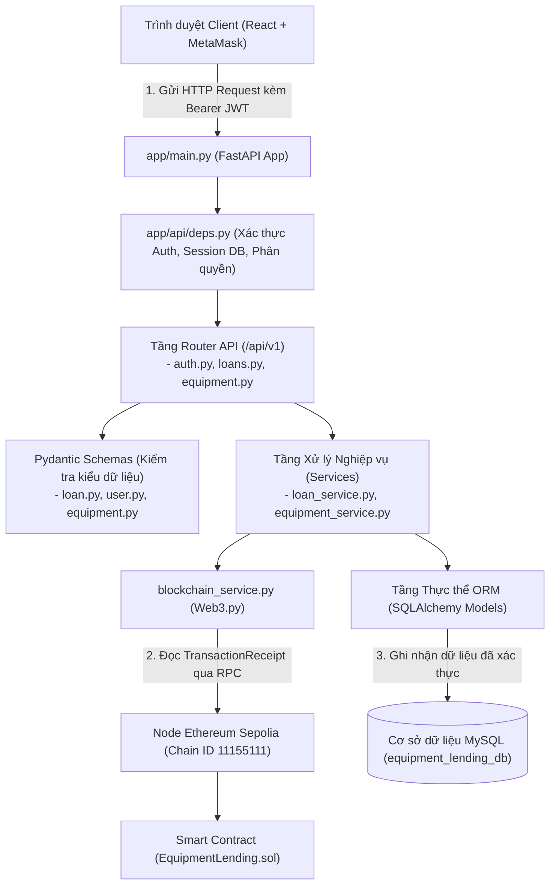

# Tài Liệu Báo Cáo: Hệ Thống Backend & Deploy Smart Contract (EduVault)

Tài liệu này được biên soạn cho buổi báo cáo và phản biện đồ án với Giảng viên, bao gồm hai nội dung trọng tâm:
1. Kiến trúc, cấu trúc tệp tin và vai trò của từng thành phần trong máy chủ Backend (FastAPI).
2. Quy trình và cơ chế triển khai tự động Hợp đồng thông minh (Smart Contract Deploy) lên mạng Ethereum Sepolia Testnet.

---

## PHẦN 1: KIẾN TRÚC VÀ CHI TIẾT CÁC TỆP TIN BACKEND

### 1. Sơ Đồ Luồng Hoạt Động (Architecture Flow)



---

### 2. Bảng Tra Cứu Toàn Bộ Tệp Tin Backend

| Tên tệp tin | Vị trí thư mục | Chức năng chính |
|---|---|---|
| `main.py` | `backend/app/` | Điểm khởi chạy ứng dụng FastAPI, cấu hình CORS và kiểm tra kết nối khi bật server |
| `config.py` | `backend/app/core/` | Đọc và quản lý tập trung các biến môi trường từ tệp `.env` |
| `security.py` | `backend/app/core/` | Băm mật khẩu Bcrypt, cấp phát và giải mã JSON Web Token (JWT) |
| `session.py` | `backend/app/db/` | Cấu hình Engine kết nối MySQL và Connection Pool chống ngắt kết nối |
| `user.py` (Model) | `backend/app/models/` | Thực thể bảng `users`: lưu tài khoản, vai trò, địa chỉ ví và trạng thái xác minh ví |
| `equipment.py` (Model) | `backend/app/models/` | Thực thể bảng `equipments`: lưu thông tin thiết bị, số serial, mức cọc quy định |
| `lending_request.py` (Model) | `backend/app/models/` | Thực thể bảng `lending_requests`: lưu chi tiết đơn mượn và mã `on_chain_loan_id` |
| `blockchain_tx.py` (Model) | `backend/app/models/` | Thực thể bảng `blockchain_transactions`: lưu lịch sử mã giao dịch `tx_hash` on-chain |
| `audit_log.py` (Model) | `backend/app/models/` | Thực thể bảng `audit_logs`: lưu toàn bộ nhật ký kiểm toán hệ thống |
| `loan.py` (Schema) | `backend/app/schemas/` | DTO Pydantic: kiểm tra tính hợp lệ dữ liệu tạo đơn, duyệt, bàn giao, nhận trả |
| `user.py` (Schema) | `backend/app/schemas/` | DTO Pydantic: kiểm tra dữ liệu đăng nhập, đăng ký và chữ ký ví EIP-191 |
| `equipment.py` (Schema) | `backend/app/schemas/` | DTO Pydantic: kiểm tra dữ liệu thêm, sửa thiết bị phòng lab |
| `blockchain_service.py` | `backend/app/services/` | Kết nối RPC Sepolia, thẩm tra biên lai on-chain, kiểm tra quyền hạn `hasRole` |
| `loan_service.py` | `backend/app/services/` | Điều phối vòng đời mượn trả, chống Replay Attack, đồng bộ trạng thái CSDL |
| `auth_service.py` | `backend/app/services/` | Kiểm tra đăng nhập, đếm số lần sai để khóa tài khoản tự động 15 phút |
| `equipment_service.py` | `backend/app/services/` | Quản lý kho máy, áp dụng khóa dòng `SELECT ... FOR UPDATE` tránh đặt trùng |
| `reconciliation_service.py` | `backend/app/services/` | Tiến trình tự động đối soát và sửa lệch dữ liệu giữa MySQL và Smart Contract |
| `deps.py` | `backend/app/api/` | Dependency Injection: cấp DB session, xác thực token JWT và kiểm tra quyền RBAC |
| `auth.py` (Endpoint) | `backend/app/api/v1/` | REST API đăng nhập (`/login`), cấp nonce và xác minh chữ ký ví EIP-191 |
| `loans.py` (Endpoint) | `backend/app/api/v1/` | REST API vòng đời: tạo đơn, duyệt đơn, bàn giao máy, nhận trả và hủy đơn |
| `equipment.py` (Endpoint) | `backend/app/api/v1/` | REST API danh mục thiết bị, tìm kiếm, thêm mới và đổi trạng thái bảo trì |
| `users.py` (Endpoint) | `backend/app/api/v1/` | REST API xem thông tin cá nhân và danh sách sinh viên đã liên kết ví |
| `blockchain.py` (Endpoint) | `backend/app/api/v1/` | REST API kiểm tra trạng thái node blockchain và tra cứu giao dịch on-chain |
| `audit.py` (Endpoint) | `backend/app/api/v1/` | REST API xem nhật ký kiểm toán và kích hoạt đối soát dữ liệu |
| `conftest.py` | `backend/tests/` | Cấu hình fixture SQLite in-memory và tài khoản mẫu cho bộ kiểm thử Pytest |
| `test_loans.py` | `backend/tests/` | Kiểm thử tự động vòng đời Pure Web3, chống Replay Attack và xử lý lỗi on-chain |
| `test_multi_user_e2e.py` | `backend/tests/` | Kiểm thử tích hợp chu trình liên ví giữa nhiều Quản trị viên và Sinh viên |

---

### 3. Chi Tiết Các Tệp Tin Nghiệp Vụ Trọng Yếu

#### A. Khởi chạy và Cấu hình
* **`backend/app/main.py`:**
  - Khởi tạo đối tượng `FastAPI` kèm tài liệu tương tác Swagger UI tại `/docs`.
  - Cấu hình `CORSMiddleware` cho phép ứng dụng Frontend (React Vite port 5173) gọi API an toàn.
  - Sử dụng sự kiện `lifespan`: Tự động kiểm tra kết nối tới MySQL và node Sepolia khi máy chủ bật, cảnh báo nếu node offline hoặc sai Chain ID.
* **`backend/app/core/config.py`:**
  - Đọc các biến từ tệp `.env`: chuỗi kết nối MySQL (`DATABASE_URL`), khóa bí mật JWT (`SECRET_KEY`), địa chỉ node RPC Sepolia (`BLOCKCHAIN_RPC_URL`), mã mạng (`CHAIN_ID=11155111`) và địa chỉ Smart Contract (`CONTRACT_ADDRESS`).
* **`backend/app/core/security.py`:**
  - `verify_password(plain, hashed)`: So khớp mật khẩu đăng nhập với chuỗi băm Bcrypt.
  - `get_password_hash(password)`: Băm mật khẩu bằng thuật toán Bcrypt kèm salt ngẫu nhiên.
  - `create_access_token(data, expires_delta)`: Tạo mã thông báo JWT mang thông tin ID và vai trò của người dùng.

#### B. Cơ sở dữ liệu và Thực thể (Database & Models)
* **`backend/app/db/session.py`:**
  - Khởi tạo SQLAlchemy Engine với `pool_pre_ping=True` và `pool_recycle=3600`, tự động phục hồi kết nối bị đứt quãng trên môi trường XAMPP.
* **`backend/app/models/user.py`:**
  - Quản lý tài khoản: mã số sinh viên/cán bộ (`student_staff_id`), email, mật khẩu băm, vai trò (`ADMIN` hoặc `BORROWER`), địa chỉ ví MetaMask (`wallet_address`), trạng thái xác minh ví (`wallet_verified`), bộ đếm số lần đăng nhập sai (`failed_login_count`) và thời gian tạm khóa tài khoản (`locked_until`).
* **`backend/app/models/equipment.py`:**
  - Quản lý thiết bị: số serial định danh duy nhất, tên thiết bị, danh mục phân loại, mức tiền cọc quy định và trạng thái kho (`AVAILABLE`, `RESERVED`, `IN_USE`, `MAINTENANCE`, `RETIRED`).
* **`backend/app/models/lending_request.py`:**
  - Quản lý đơn mượn: liên kết người mượn và thiết bị, mã định danh trên blockchain `on_chain_loan_id` (dạng `bytes32`), trạng thái đơn (`PENDING`, `APPROVED`, `ACTIVE`, `RETURNED`, `CANCELLED`, `REJECTED`, `DISPUTED`) và trạng thái tiền cọc (`NONE`, `LOCKED`, `REFUNDED`, `FORFEITED`).
* **`backend/app/models/blockchain_tx.py`:**
  - Lưu toàn bộ lịch sử các giao dịch blockchain đã được thẩm tra thành công: mã băm `tx_hash`, loại hành động, địa chỉ gửi, địa chỉ nhận, số hiệu block và lượng gas tiêu thụ.

#### C. Tầng Nghiệp vụ (Services)
* **`backend/app/services/blockchain_service.py`:**
  - `verify_transaction_receipt()`: Nhận `tx_hash` từ client gửi về, gọi RPC `eth_getTransactionReceipt` lên mạng Sepolia. Kiểm tra: `status == 1` (giao dịch thành công, không revert), gửi đúng địa chỉ hợp đồng của trường, phát đúng sự kiện (`LoanApproved`, `HandoverConfirmed`...) và khớp chính xác các tham số `loanId`, `equipmentId`.
  - `has_role(role_name, account)`: Đọc hàm view `hasRole()` trên Smart Contract để kiểm tra ví có sở hữu quyền `ADMIN_ROLE` hay không.
  - `get_loan(loan_id)`: Đọc trực tiếp bản ghi đơn mượn từ Smart Contract (trạng thái, mốc thời gian, tiền cọc).
* **`backend/app/services/loan_service.py`:**
  - Điều phối toàn bộ 6 bước mượn trả: Tiếp nhận tạo đơn, duyệt đơn, bàn giao thiết bị, nhận trả máy, từ chối và hủy đơn.
  - Cơ chế chống Replay Attack: Hàm `_check_tx_idempotency_or_replay()` tra cứu bảng giao dịch, ngăn chặn tuyệt đối việc sử dụng lại một mã `tx_hash` cũ.
  - Phân quyền Admin mở: Đối với Quản trị viên, backend không ép buộc tài khoản web phải xác minh ví từ trước mà thẩm tra trực tiếp quyền hạn trên biên lai on-chain thông qua modifier `onlyRole(ADMIN_ROLE)` của Smart Contract.

---

## PHẦN 2: QUY TRÌNH VÀ CƠ CHẾ DEPLOY SMART CONTRACT

### 1. Thông Tin Hợp Đồng Trên Mạng Sepolia

* **Mạng thử nghiệm:** Ethereum Sepolia Testnet (Mã mạng Chain ID: `11155111`).
* **Hợp đồng thông minh:** `EquipmentLending.sol` (kế thừa chuẩn OpenZeppelin `AccessControl`).
* **Địa chỉ hợp đồng chính thức:** `0xA88De9B00C0F78FF9a162C4f17524ef885169ffd`
* **Trình tra cứu Etherscan:** https://sepolia.etherscan.io/address/0xA88De9B00C0F78FF9a162C4f17524ef885169ffd
* **Địa chỉ ví Deployer khởi tạo:** `0x6396121f971a55bc844301E039F6C6F472C5CbBB`

---

### 2. Phân Tích Kịch Bản Triển Khai Tự Động (`contracts/scripts/deploy.cjs`)

Kịch bản `deploy.cjs` được xây dựng theo mô hình **Đường ống tự động đồng bộ (Auto-Sync Pipeline)**:

1. **Kiểm tra số dư:** Đo lường số dư Sepolia ETH của ví Deployer (cần tối thiểu `0.01 ETH` để trả phí gas).
2. **Khởi tạo Smart Contract:** Gọi lệnh `Factory.deploy(deployer.address)`. Constructor của hợp đồng tự động cấp quyền `DEFAULT_ADMIN_ROLE` và `ADMIN_ROLE` cho ví Deployer.
3. **Chờ xác thực khối:** Lệnh `await contract.waitForDeployment()` bảo đảm giao dịch khởi tạo đã được đào vào khối block chính thức trên Sepolia.
4. **Lưu vết triển khai:** Ghi lại lịch sử triển khai vào tệp `contracts/deployments/sepolia.json`.
5. **Tự động xuất sang Backend:** Trích xuất tệp ABI và địa chỉ hợp đồng mới vào thư mục `backend/app/core/contracts/`.
6. **Tự động xuất sang Frontend:** Trích xuất tệp ABI và địa chỉ hợp đồng mới vào thư mục `frontend/src/contracts/`.
   - Nhờ cơ chế này, Frontend và Backend nhận diện địa chỉ hợp đồng mới ngay tức thì mà lập trình viên không phải chỉnh sửa thủ công.

---

### 3. Lệnh Thực Thi Triển Khai

* Triển khai lên mạng Sepolia Testnet:
  ```bash
  cd contracts
  npx hardhat run scripts/deploy.cjs --network sepolia
  ```

* Cấu hình mạng tại `contracts/hardhat.config.cjs`:
  Đọc biến `SEPOLIA_RPC_URL` và `SEPOLIA_PRIVATE_KEY` từ tệp `.env`.

---

## PHẦN 3: BỘ CÂU HỎI BÁO CÁO VÀ PHẢN BIỆN VỚI GIẢNG VIÊN

### Câu hỏi 1: Tại sao hệ thống chuyển sang mô hình Pure Web3 thay vì lưu Private Key trên Backend để ký hộ (Relayer)?
* **Trả lời:** Mô hình Backend giữ Private Key (Relayer) rất nguy hiểm vì nếu máy chủ bị xâm nhập, kẻ tấn công sẽ có toàn quyền kiểm soát Smart Contract. Kiến trúc Pure Web3 loại bỏ hoàn toàn rủi ro này: toàn bộ giao dịch on-chain đều do người dùng và Admin tự ký trực tiếp bằng ví cá nhân MetaMask ở trình duyệt, máy chủ hoàn toàn không giữ Private Key.

### Câu hỏi 2: Backend có vai trò gì nếu người dùng đã tự ký giao dịch lên Blockchain?
* **Trả lời:** Backend đóng 3 vai trò then chốt:
  1. Thẩm tra biên lai giao dịch on-chain (`verify_transaction_receipt`): Đọc trực tiếp từ node Sepolia để bảo đảm giao dịch đã thành công (`status == 1`), đúng địa chỉ hợp đồng, đúng loại sự kiện và đúng tham số trước khi cập nhật CSDL.
  2. Chống tấn công gửi lại (Anti-Replay Attack): Đảm bảo mỗi mã `tx_hash` chỉ được chấp nhận duy nhất một lần.
  3. Quản lý dữ liệu mở rộng: Lưu trữ thông tin cá nhân (MSSV, mật khẩu hash), hình ảnh và nhật ký kiểm toán, giúp hệ thống phản hồi cực nhanh mà không tốn chi phí gas đắt đỏ trên blockchain.

### Câu hỏi 3: Cơ chế phân quyền trên Smart Contract hoạt động như thế nào?
* **Trả lời:** Hợp đồng kế thừa chuẩn `AccessControl` của OpenZeppelin với 3 vai trò phân tầng:
  1. `DEFAULT_ADMIN_ROLE`: Quyền quản trị tối cao, có thẩm quyền thêm (`addAdmin`) hoặc bãi nhiệm (`removeAdmin`) các Admin khác.
  2. `ADMIN_ROLE`: Dành cho Quản trị viên phòng lab, có quyền duyệt đơn (`approveLoan`), bàn giao máy (`confirmHandover`), nghiệm thu nhận trả (`confirmReturn`) và cấp quyền mượn cho sinh viên (`registerBorrower`).
  3. `BORROWER_ROLE`: Cấp cho sinh viên đã được xác minh để được phép tạo đơn mượn (`createLoan`) trên hợp đồng.

---

EduVault - Tài Liệu Kỹ Thuật Chuyên Sâu Dành Cho Báo Cáo & Phản Biện Đồ Án.
