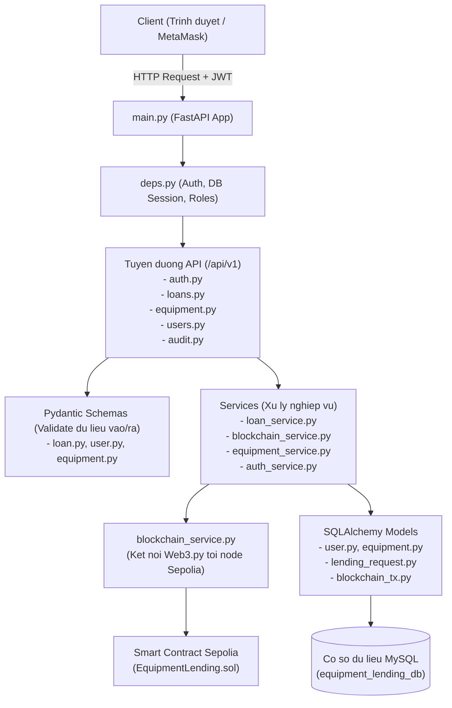

# Tai Lieu Giai Thich Chi Tiet Cac Tep Tin Backend EduVault

Tai lieu nay mo ta toan dien cau truc, vai tro va nguyen ly hoat dong cua tung tep tin trong phan May chu (Backend) cua he thong EduVault theo kien truc Pure Web3.

---

## 1. Bang Tra Cuu Nhanh Cac Tep Tin Backend

| Nhom chuc nang | Duong dan tep tin | Vai tro cot loi |
|---|---|---|
| Khoi chay ung dung | [main.py](file:///c:/Users/phucd/OneDrive/Desktop/Blockchain/EduVault/backend/app/main.py) | Diem khoi dong FastAPI, dang ky router, CORS, bat dong bo khoi dong |
| Cau hinh moi truong | [config.py](file:///c:/Users/phucd/OneDrive/Desktop/Blockchain/EduVault/backend/app/core/config.py) | Doc va nap cac bien moi truong tu file .env |
| An toan & Mat khau | [security.py](file:///c:/Users/phucd/OneDrive/Desktop/Blockchain/EduVault/backend/app/core/security.py) | Bam mat khau Bcrypt, tao va giai ma JWT Token |
| ABI Smart Contract | [EquipmentLending.json](file:///c:/Users/phucd/OneDrive/Desktop/Blockchain/EduVault/backend/app/core/contracts/EquipmentLending.json) | Dinh nghia giao dien ABI cua hop dong de Web3.py giai ma |
| Dia chi Smart Contract | [contract_address.json](file:///c:/Users/phucd/OneDrive/Desktop/Blockchain/EduVault/backend/app/core/contracts/contract_address.json) | Luu tru dia chi hop dong Sepolia va Chain ID |
| Ket noi CSDL | [session.py](file:///c:/Users/phucd/OneDrive/Desktop/Blockchain/EduVault/backend/app/db/session.py) | Khoi tao SQLAlchemy Engine va phien lam viec SessionLocal |
| Bang nguoi dung | [user.py (Model)](file:///c:/Users/phucd/OneDrive/Desktop/Blockchain/EduVault/backend/app/models/user.py) | Dinh nghia bang users, luu MSSV, mat khau, vi va trang thai xac minh |
| Bang kho thiet bi | [equipment.py (Model)](file:///c:/Users/phucd/OneDrive/Desktop/Blockchain/EduVault/backend/app/models/equipment.py) | Dinh nghia bang equipments, luu danh muc, serial, tien coc quy dinh |
| Bang don muon | [lending_request.py (Model)](file:///c:/Users/phucd/OneDrive/Desktop/Blockchain/EduVault/backend/app/models/lending_request.py) | Dinh nghia bang lending_requests, lien ket nguoi muon, thiet bi, on_chain_loan_id |
| Bang lich su tx | [blockchain_tx.py (Model)](file:///c:/Users/phucd/OneDrive/Desktop/Blockchain/EduVault/backend/app/models/blockchain_tx.py) | Dinh nghia bang blockchain_transactions, luu tx_hash, block, gas |
| Bang nhat ky | [audit_log.py (Model)](file:///c:/Users/phucd/OneDrive/Desktop/Blockchain/EduVault/backend/app/models/audit_log.py) | Dinh nghia bang audit_logs, ghi vet moi thao tac cua nguoi dung |
| DTO Don muon | [loan.py (Schema)](file:///c:/Users/phucd/OneDrive/Desktop/Blockchain/EduVault/backend/app/schemas/loan.py) | Pydantic schema kiem hop le du lieu tao, duyet, ban giao, tra don |
| DTO Nguoi dung | [user.py (Schema)](file:///c:/Users/phucd/OneDrive/Desktop/Blockchain/EduVault/backend/app/schemas/user.py) | Pydantic schema dang ky, cap nhat ho so, xac minh vi EIP-191 |
| DTO Thiet bi | [equipment.py (Schema)](file:///c:/Users/phucd/OneDrive/Desktop/Blockchain/EduVault/backend/app/schemas/equipment.py) | Pydantic schema tao moi, cap nhat thong tin thiet bi phong lab |
| Dich vu Blockchain | [blockchain_service.py](file:///c:/Users/phucd/OneDrive/Desktop/Blockchain/EduVault/backend/app/services/blockchain_service.py) | Ket noi Web3 RPC, tham tra bien lai on-chain, doc du lieu hop dong |
| Dich vu Don muon | [loan_service.py](file:///c:/Users/phucd/OneDrive/Desktop/Blockchain/EduVault/backend/app/services/loan_service.py) | Xu ly nghiep vu vong doi muon tra, chong Replay Attack, dong bo CSDL |
| Dich vu Xac thuc | [auth_service.py](file:///c:/Users/phucd/OneDrive/Desktop/Blockchain/EduVault/backend/app/services/auth_service.py) | Kiem tra dang nhap, dem so lan sai de khoa tai khoan 15 phut |
| Dich vu Kho | [equipment_service.py](file:///c:/Users/phucd/OneDrive/Desktop/Blockchain/EduVault/backend/app/services/equipment_service.py) | Xu ly logic them/sua/xoa thiet bi, khoa dong SELECT FOR UPDATE |
| Dich vu Doi soat | [reconciliation_service.py](file:///c:/Users/phucd/OneDrive/Desktop/Blockchain/EduVault/backend/app/services/reconciliation_service.py) | Quet va tu phuc hoi trang thai lech giua MySQL va Smart Contract |
| Dependency Injection | [deps.py](file:///c:/Users/phucd/OneDrive/Desktop/Blockchain/EduVault/backend/app/api/deps.py) | Cung cap Session DB, xac thuc JWT va phan quyen Role-based |
| Router Xac thuc | [auth.py (Endpoint)](file:///c:/Users/phucd/OneDrive/Desktop/Blockchain/EduVault/backend/app/api/v1/auth.py) | REST API dang nhap, cap nonce va xac thuc chu ky vi EIP-191 |
| Router Don muon | [loans.py (Endpoint)](file:///c:/Users/phucd/OneDrive/Desktop/Blockchain/EduVault/backend/app/api/v1/loans.py) | REST API tao don, duyet, ban giao, tra may, tu choi, huy don |
| Router Thiet bi | [equipment.py (Endpoint)](file:///c:/Users/phucd/OneDrive/Desktop/Blockchain/EduVault/backend/app/api/v1/equipment.py) | REST API tra cuu, them, sua, khoa bao tri thiet bi |
| Router Nguoi dung | [users.py (Endpoint)](file:///c:/Users/phucd/OneDrive/Desktop/Blockchain/EduVault/backend/app/api/v1/users.py) | REST API xem thong tin ca nhan, danh sach sinh vien da lien ket vi |
| Router Blockchain | [blockchain.py (Endpoint)](file:///c:/Users/phucd/OneDrive/Desktop/Blockchain/EduVault/backend/app/api/v1/blockchain.py) | REST API kiem tra suc khoe node blockchain va tra cuu on-chain |
| Router Kiem toan | [audit.py (Endpoint)](file:///c:/Users/phucd/OneDrive/Desktop/Blockchain/EduVault/backend/app/api/v1/audit.py) | REST API xem nhat ky kiem toan va chay worker doi soat |
| Kiem thu Fixture | [conftest.py](file:///c:/Users/phucd/OneDrive/Desktop/Blockchain/EduVault/backend/tests/conftest.py) | Cau hinh CSDL SQLite mock va tai khoan mau cho Pytest |
| Kiem thu Don muon | [test_loans.py](file:///c:/Users/phucd/OneDrive/Desktop/Blockchain/EduVault/backend/tests/test_loans.py) | 10 bai test vong doi Pure Web3, chong replay, revert on-chain |
| Kiem thu Da vi | [test_multi_user_e2e.py](file:///c:/Users/phucd/OneDrive/Desktop/Blockchain/EduVault/backend/tests/test_multi_user_e2e.py) | Kiem thu chu trinh Multi-Admin va Sinh vien tuong tac cheo |

---

## 2. So Do Tuong Tac Giua Cac Tang Backend

---

## 3. Chi Tiet Tung Tang Kien Truc

### 3.1. Tang Khoi Chay va Cau Hinh (Entrypoint & Core)

#### [backend/app/main.py](file:///c:/Users/phucd/OneDrive/Desktop/Blockchain/EduVault/backend/app/main.py)
- **Muc dich:** Khoi tao phien ban FastAPI ung dung, thiet lap middleware va dieu phoi tuyen duong.
- **Cac thanh phan chinh:**
  - `FastAPI(title="EduVault API", ...)`: Khoi tao ung dung kem Swagger UI tai `/docs`.
  - `CORSMiddleware`: Cho phep Frontend (cong `5173`) gui yeu cau toi Backend (cong `8000`) kem Authorization header.
  - Event `lifespan`: Khi server bat, tu dong kiem tra ket noi toi MySQL va node Blockchain Sepolia, canh bao neu sai Chain ID hoac node offline.
  - Dang ky toan bo router `/api/v1` tu thu muc `app/api/v1`.

#### [backend/app/core/config.py](file:///c:/Users/phucd/OneDrive/Desktop/Blockchain/EduVault/backend/app/core/config.py)
- **Muc dich:** Quan ly tap trung toan bo thong so cau hinh he thong bang thu vien `pydantic-settings`.
- **Cac bien moi truong quan trong:**
  - `DATABASE_URL`: Chuoi ket noi CSDL MySQL (`mysql+pymysql://root:@localhost:3306/equipment_lending_db`).
  - `SECRET_KEY`, `ALGORITHM`: Chia khoa ky va thuat toan sinh ma thong bao JWT (HS256).
  - `BLOCKCHAIN_RPC_URL`: Dia chi node RPC mang Sepolia (`https://ethereum-sepolia-rpc.publicnode.com`).
  - `CHAIN_ID`: Ma mang blockchain (`11155111` cho Sepolia Testnet).
  - `CONTRACT_ADDRESS`: Dia chi Smart Contract dang trien khai (`0xA88De9B00C0F78FF9a162C4f17524ef885169ffd`).

#### [backend/app/core/security.py](file:///c:/Users/phucd/OneDrive/Desktop/Blockchain/EduVault/backend/app/core/security.py)
- **Muc dich:** Cung cap cac tien ich mat ma va xac thuc an toan.
- **Cac ham chinh:**
  - `verify_password(plain, hashed)`: So khop mat khau nguoi dung nhap voi chuoi bam Bcrypt trong CSDL.
  - `get_password_hash(password)`: Bam mat khau moi bang thuat toan Bcrypt kem salt ngau nhien (an toan voi chuoi toi da 72 byte).
  - `create_access_token(data, expires_delta)`: Dong goi thong tin nguoi dung (ID, vai tro) va thoi han het han thanh chuoi JWT Bearer Token.

#### [backend/app/core/contracts/](file:///c:/Users/phucd/OneDrive/Desktop/Blockchain/EduVault/backend/app/core/contracts/)
- `EquipmentLending.json`: Tep chua ma ABI day du cua Smart Contract duoc trinh bien dich Hardhat xuat ra. Web3.py can tep nay de hieu duoc chu ky ham (`createLoan`, `approveLoan`,...) va cau truc su kien (`LoanCreated`, `LoanApproved`,...).
- `contract_address.json`: Tep luu dia chi hop dong hien tai, ten mang va thoi diem deploy gan nhat.

---

### 3.2. Tang Co So Du Lieu va Thuc The (Database & Models)

#### [backend/app/db/session.py](file:///c:/Users/phucd/OneDrive/Desktop/Blockchain/EduVault/backend/app/db/session.py)
- **Muc dich:** Thiet lap ket noi co so du lieu quan he MySQL bang SQLAlchemy Engine.
- **Cac thanh phan chinh:**
  - `engine = create_engine(DATABASE_URL, pool_pre_ping=True, pool_recycle=3600)`: Tao connection pool, tu dong kiem tra song sot cua ket noi truoc khi thuc thi cau lenh de tranh loi timeout tren MySQL XAMPP.
  - `SessionLocal`: Factory tao cac session doc lap cho tung HTTP Request.
  - `Base = declarative_base()`: Lop cha cho toan bo cac model ORM.

#### [backend/app/models/user.py](file:///c:/Users/phucd/OneDrive/Desktop/Blockchain/EduVault/backend/app/models/user.py)
- **Bang:** `users`
- **Cac cot chinh:**
  - `student_staff_id`: Ma so dinh danh (MSSV nhu `SV2026001` hoac Ma can bo `ADMIN001`), duy nhat (`unique=True`).
  - `email`: Dia chi thu dien tu dung de dang nhap.
  - `password_hash`: Chuoi mat khau da bam bang Bcrypt.
  - `role`: Vai tro nguoi dung (`UserRole.ADMIN` hoac `UserRole.BORROWER`).
  - `wallet_address`: Dia chi vi Ethereum MetaMask (42 ky tu `0x...`), duy nhat.
  - `wallet_verified`: Co Boolean xac nhan vi da duoc chu ky EIP-191 xac minh hay chua.
  - `failed_login_count`, `locked_until`: Co che chong tan cong vet can (Brute-force) - tu dong khoa tai khoan 15 phut neu go sai mat khau qua 5 lan.

#### [backend/app/models/equipment.py](file:///c:/Users/phucd/OneDrive/Desktop/Blockchain/EduVault/backend/app/models/equipment.py)
- **Bang:** `equipments`
- **Cac cot chinh:**
  - `serial_number`: So seri thiet bi phong lab (vi du `OSC-RIGOL-001`), duy nhat.
  - `name`, `category`: Ten thiet bi va danh muc (Laptop, May do xung, Kinh hien vi, Kit nhung).
  - `deposit_amount`: So tien ky quy mo phong quy dinh (VND).
  - `status`: Trang thai thiet bi (`AVAILABLE`, `RESERVED`, `IN_USE`, `MAINTENANCE`, `RETIRED`).

#### [backend/app/models/lending_request.py](file:///c:/Users/phucd/OneDrive/Desktop/Blockchain/EduVault/backend/app/models/lending_request.py)
- **Bang:** `lending_requests`
- **Cac cot chinh:**
  - `user_id`, `equipment_id`: Khoa ngoai tham chieu toi nguoi muon va thiet bi.
  - `on_chain_loan_id`: Ma băm `bytes32` (chuoi hex 66 ky tu bat dau bang `0x...`) duy nhat tren Smart Contract.
  - `status`: Trang thai don muon trong CSDL (`PENDING`, `APPROVED`, `ACTIVE`, `RETURNED`, `CANCELLED`, `REJECTED`, `DISPUTED`).
  - `deposit_status`: Tinh trang tien coc (`NONE`, `LOCKED`, `REFUNDED`, `FORFEITED`).
  - `expected_handover_date`, `due_date`, `actual_handover_date`, `actual_return_date`: Cac moc thoi gian muon tra.

#### [backend/app/models/blockchain_tx.py](file:///c:/Users/phucd/OneDrive/Desktop/Blockchain/EduVault/backend/app/models/blockchain_tx.py)
- **Bang:** `blockchain_transactions`
- **Muc dich:** Luu nhat ky moi giao dich on-chain ma Backend da tham tra thanh cong.
- **Cac cot chinh:** `tx_hash` (khoa chinh, unique), `action_type` (`CREATE_LOAN`, `APPROVE_LOAN`, `HANDOVER`, `RETURN_LOAN`, `CANCEL_LOAN`), `from_address`, `to_address`, `block_number`, `gas_used`, `status` (`CONFIRMED`).

#### [backend/app/models/audit_log.py](file:///c:/Users/phucd/OneDrive/Desktop/Blockchain/EduVault/backend/app/models/audit_log.py)
- **Bang:** `audit_logs`
- **Muc dich:** Ghi vet kiem toan toan dien moi hanh dong he thong (ai lam gi, luc nao, thong so truoc va sau khi sua doi).

---

### 3.3. Tang Xu Ly Nghiep Vu (Services)

#### [backend/app/services/blockchain_service.py](file:///c:/Users/phucd/OneDrive/Desktop/Blockchain/EduVault/backend/app/services/blockchain_service.py)
Day la trai tim cua phan ket noi Web3 tren Backend.
- **Cac ham then chot:**
  - `verify_transaction_receipt(tx_hash, expected_event, expected_loan_id, expected_sender, expected_args)`:
    1. Goi RPC `eth_getTransactionReceipt(tx_hash)` len mang Sepolia.
    2. Kiem tra `status == 1`: Neu status = 0, nem loi bao giao dich da bi revert tren chuoi.
    3. Kiem tra `to_address`: Phai gui den dung dia chi `CONTRACT_ADDRESS` he thong.
    4. Giai ma nhat ky su kien (`receipt.logs`) thong qua ABI de tim dung su kien yeu cau (vi du `LoanApproved`).
    5. So sanh doi so su kien: Ma `loanId`, `equipmentId` va dia chi vi phai khop chinh xac 100%.
  - `has_role(role_name, account_address)`: Doc ham view `hasRole()` tren hop dong de kiem tra xem dia chi vi do co nam giu `ADMIN_ROLE` hoac `DEFAULT_ADMIN_ROLE` hay khong.
  - `get_loan(loan_id)`: Doc ban ghi truc tiep tu hop dong thong minh, tra ve dictionary gom trang thai, thoi gian, so tien coc on-chain.
  - `is_overdue(loan_id)`: Kiem tra xem don muon da bi qua han so voi block timestamp hien tai hay chua.
  - `calculate_penalty(loan_id, return_condition)`: Tinh truoc tien phat va trang thai coc on-chain.

#### [backend/app/services/loan_service.py](file:///c:/Users/phucd/OneDrive/Desktop/Blockchain/EduVault/backend/app/services/loan_service.py)
Chiu trach nhiem dieu phoi nghiep vu muon tra va dam bao tinh nhat quan giua CSDL va Blockchain.
- **Cac ham then chot:**
  - `_verify_and_record_lifecycle_tx()`: Ham kiem tra chung cho tat ca cac buoc vong doi. Kiem tra tinh Idempotent, dam bao mot `tx_hash` khong the bi gui lai hai lan (chong Replay Attack).
  - `create_loan_request()`: Tao don muon moi sau khi xac thuc giao dich `createLoan` cua sinh vien.
  - `approve_loan_request()`: Quan tri vien duyet don sau khi da ky `approveLoan` thanh cong on-chain.
  - `handover_loan_equipment()`: Chuyen don sang `ACTIVE`, khoa tien coc sau khi Admin ky `confirmHandover`.
  - `return_loan_equipment()`: Thu hoi thiet bi, dong bo ty le phat va giai phong Mutex sau khi Admin ky `confirmReturn`.
  - `reject_loan_request()` / `cancel_loan_request()`: Tu choi hoac huy don, xu ly dong bo mem neu tren blockchain don da o trang thai `Cancelled` tu truoc.

#### [backend/app/services/auth_service.py](file:///c:/Users/phucd/OneDrive/Desktop/Blockchain/EduVault/backend/app/services/auth_service.py)
- **Muc dich:** Xu ly xac thuc nguoi dung, kiem tra mat khau, xu ly co che khoa tai khoan tu dong neu dang nhap sai lien tiep, sinh ma ngau nhien (Nonce) cho chu ky vi.

#### [backend/app/services/equipment_service.py](file:///c:/Users/phucd/OneDrive/Desktop/Blockchain/EduVault/backend/app/services/equipment_service.py)
- **Muc dich:** Quan ly danh muc thiet bi phong lab. Su dung co che khoa dong bi quan `SELECT ... FOR UPDATE` trong MySQL de dam bao khong xay ra xung dot khi nhieu nguoi cung xem va dat mot thiet bi.

#### [backend/app/services/reconciliation_service.py](file:///c:/Users/phucd/OneDrive/Desktop/Blockchain/EduVault/backend/app/services/reconciliation_service.py)
- **Muc dich:** Tien trinh doi soat doc lap. Tu dong quet tat ca cac don muon va so sanh trang thai trong MySQL voi trang thai tren Smart Contract. Neu phat hien lech du lieu (vi du do may chu backend gap su co mang luc sinh vien dang ky), he thong se lay du lieu tren blockchain lam chan ly de sua lai CSDL MySQL.

---

### 3.4. Tang Dinh Nghia Du Lieu DTO (Schemas)

Su dung Pydantic v2 de kiem tra tinh hop le cua du lieu dau vao va dinh dang du lieu tra ve truoc khi gui den Client:

- **[schemas/loan.py](file:///c:/Users/phucd/OneDrive/Desktop/Blockchain/EduVault/backend/app/schemas/loan.py):** Dinh nghia `LoanCreateRequest` (yeu cau tao don kem `tx_hash` va `on_chain_loan_id`), `LoanApproveRequest`, `LoanHandoverRequest`, `LoanReturnRequest` (kem tinh trang may: 0=GOOD, 1=DAMAGED, 2=LOST), va `LoanResponse`.
- **[schemas/user.py](file:///c:/Users/phucd/OneDrive/Desktop/Blockchain/EduVault/backend/app/schemas/user.py):** Dinh nghia du lieu dang nhap `LoginRequest`, du lieu xac minh vi `WalletVerifyRequest` (dia chi vi, thong diep, chu ky EIP-191) va du lieu tra ve ho so nguoi dung.
- **[schemas/equipment.py](file:///c:/Users/phucd/OneDrive/Desktop/Blockchain/EduVault/backend/app/schemas/equipment.py):** Dinh nghia du lieu tao moi va cap nhat thong tin thiet bi trong kho.
- **[schemas/token.py](file:///c:/Users/phucd/OneDrive/Desktop/Blockchain/EduVault/backend/app/schemas/token.py):** Dinh nghia cau truc ma thong bao JWT tra ve cho trinh duyet sau khi dang nhap thanh cong.
- **[schemas/audit.py](file:///c:/Users/phucd/OneDrive/Desktop/Blockchain/EduVault/backend/app/schemas/audit.py):** Dinh nghia cau truc ban ghi nhat ky doi soat.

---

### 3.5. Tang Dinh Tuyen REST API (Endpoints)

#### [backend/app/api/deps.py](file:///c:/Users/phucd/OneDrive/Desktop/Blockchain/EduVault/backend/app/api/deps.py)
- **`get_db()`:** Cung cap phien lam viec SQLAlchemy Session cho moi request va tu dong dong session sau khi phan hoi xong.
- **`get_current_user()`:** Doc header `Authorization: Bearer <token>`, giai ma token JWT va lay thong tin nguoi dung tu CSDL.
- **`require_role([UserRole.ADMIN])`:** Kiem tra quyen han cua nguoi dung, tra ve ma HTTP 403 neu khong du tham quyen.

#### [backend/app/api/v1/auth.py](file:///c:/Users/phucd/OneDrive/Desktop/Blockchain/EduVault/backend/app/api/v1/auth.py)
- `POST /api/v1/auth/login`: Dang nhap bang email hoac ma so (MSSV) va mat khau.
- `GET /api/v1/auth/wallet-nonce`: Lay thong diep ngau nhien chua moc thoi gian de sinh vien chuan bi ky bang MetaMask.
- `POST /api/v1/auth/verify-wallet`: Thu vien `eth_account.messages.encode_defunct` giai ma chu ky EIP-191 cua MetaMask. Neu dia chi phuc hoi khop voi dia chi gui len, he thong se gan vi nay vao tai khoan sinh vien.

#### [backend/app/api/v1/loans.py](file:///c:/Users/phucd/OneDrive/Desktop/Blockchain/EduVault/backend/app/api/v1/loans.py)
- `POST /api/v1/loans/request`: Sinh vien gui don muon kem bien lai `createLoan`.
- `POST /api/v1/loans/{id}/approve`: Quan tri vien duyet don kem bien lai `approveLoan`.
- `POST /api/v1/loans/{id}/handover`: Quan tri vien ban giao may kem bien lai `confirmHandover`.
- `POST /api/v1/loans/{id}/return`: Quan tri vien nghiem thu tra may kem bien lai `confirmReturn`.
- `POST /api/v1/loans/{id}/reject`: Tu choi don muon.
- `POST /api/v1/loans/{id}/cancel`: Sinh vien hoac Admin huy don truoc khi ban giao.
- `GET /api/v1/loans`: Xem danh sach don (sinh vien chi thay don cua minh, Admin xem toan truong).

#### [backend/app/api/v1/equipment.py](file:///c:/Users/phucd/OneDrive/Desktop/Blockchain/EduVault/backend/app/api/v1/equipment.py)
- `GET /api/v1/equipment`: Tra cuu danh muc thiet bi phong lab ho tro loc va tim kiem.
- `POST /api/v1/equipment`: Them thiet bi moi vao kho (yeu cau quyen ADMIN).
- `PATCH /api/v1/equipment/{id}/status`: Chuyen trang thai thiet bi sang bao tri hoac thanh ly.

#### [backend/app/api/v1/users.py](file:///c:/Users/phucd/OneDrive/Desktop/Blockchain/EduVault/backend/app/api/v1/users.py)
- `GET /api/v1/users/me`: Xem thong tin ho so ca nhan va trang thai vi da lien ket.
- `GET /api/v1/users/verified-borrowers`: Danh sach sinh vien da xac minh vi de Admin cap quyen on-chain.

#### [backend/app/api/v1/blockchain.py](file:///c:/Users/phucd/OneDrive/Desktop/Blockchain/EduVault/backend/app/api/v1/blockchain.py)
- `GET /api/v1/blockchain/status`: Kiem tra tinh trang song/chet cua node Sepolia, so hieu block moi nhat.
- `GET /api/v1/blockchain/tx/{tx_hash}`: Tra cuu chi tiet bien lai giao dich tu mang blockchain.

#### [backend/app/api/v1/audit.py](file:///c:/Users/phucd/OneDrive/Desktop/Blockchain/EduVault/backend/app/api/v1/audit.py)
- `GET /api/v1/audit/logs`: Truy van nhat ky thao tac nguoi dung phuc vu thanh tra.
- `POST /api/v1/audit/reconcile`: Kich hoat tien trinh tu dong doi soat giua MySQL va Smart Contract.

---

### 3.6. Tang Kiem Thu Tu Dong (Automated Tests)

Thu muc `backend/tests/` chua **78 bai kiem thu tu dong** dat ty le vuot qua 100%:

- **[conftest.py](file:///c:/Users/phucd/OneDrive/Desktop/Blockchain/EduVault/backend/tests/conftest.py):** Tao phien CSDL SQLite ao trong bo nho RAM, tao tai khoan quan tri vien va sinh vien mau cho moi phien test de khong anh huong den du lieu MySQL that.
- **[test_loans.py](file:///c:/Users/phucd/OneDrive/Desktop/Blockchain/EduVault/backend/tests/test_loans.py):** Kiem thu toan bo cac tinh huong muon tra Pure Web3: xac thuc chu ky vi hop le, chan vi chua xac minh, kiem tra giao dich bi revert on-chain thi backend tu choi, kiem tra chan dung tan cong Replay Attack.
- **[test_multi_user_e2e.py](file:///c:/Users/phucd/OneDrive/Desktop/Blockchain/EduVault/backend/tests/test_multi_user_e2e.py):** Kiem thu chu trinh lien vi da nguoi dung: Sinh vien tao don -> Admin 2 duyet tren vi rieng -> Admin 3 ban giao -> Admin 1 thu hoi may tren vi cua minh.
- **[test_auth.py](file:///c:/Users/phucd/OneDrive/Desktop/Blockchain/EduVault/backend/tests/test_auth.py):** Kiem thu co che dang nhap, khoa tai khoan 15 phut khi nhap sai 5 lan, va giai ma chu ky EIP-191.
- **[test_blockchain.py](file:///c:/Users/phucd/OneDrive/Desktop/Blockchain/EduVault/backend/tests/test_blockchain.py):** Kiem thu cac ham doc so cai, tinh toan phat, va bat loi mat ket noi node RPC.
- **[test_equipment.py](file:///c:/Users/phucd/OneDrive/Desktop/Blockchain/EduVault/backend/tests/test_equipment.py):** Kiem thu quan ly danh muc thiet bi va co che khoa dong tranh dat trung.

---

## 4. Quy Trinh Xu Ly Mot Giao Dich Mau (Vi du: Duyet Don)

1. Quản trị viên bấm nút **Duyệt** trên giao diện `/admin/loans`.
2. Trình duyệt gọi MetaMask, yêu cầu Quản trị viên ký thực thi hàm `approveLoan(loanId)` trên Smart Contract Sepolia.
3. MetaMask phát giao dịch lên mạng Ethereum Sepolia Testnet. Sau khi giao dịch được đào vào khối (Mined), MetaMask trả về biên lai giao dịch có chứa mã băm `receipt.hash`.
4. Frontend gửi yêu cầu HTTP: `POST /api/v1/loans/5/approve` kèm body `{"tx_hash": receipt.hash}` về Backend.
5. `loans.py` chuyển yêu cầu tới `loan_service.py`.
6. `loan_service.py` gọi `blockchain_service.verify_transaction_receipt(receipt.hash)`:
   - Web3.py kết nối tới node Sepolia đọc biên lai giao dịch.
   - Kiểm tra `receipt.status == 1` (giao dịch thành công, không bị revert do thiếu quyền).
   - Kiểm tra phát đúng sự kiện `LoanApproved` với đúng mã `loanId`.
7. `loan_service.py` kiểm tra mã băm chưa từng được dùng (chống Replay Attack), sau đó cập nhật bản ghi trong bảng `lending_requests` thành `APPROVED`, lưu lịch sử vào `blockchain_transactions` và ghi nhật ký vào `audit_logs`.
8. Backend trả về mã HTTP 200 OK kèm dữ liệu đơn mượn đã cập nhật cho Frontend.

---

EduVault - Tai Lieu Huong Dan Va Giai Thich Ma Nguon Backend.
