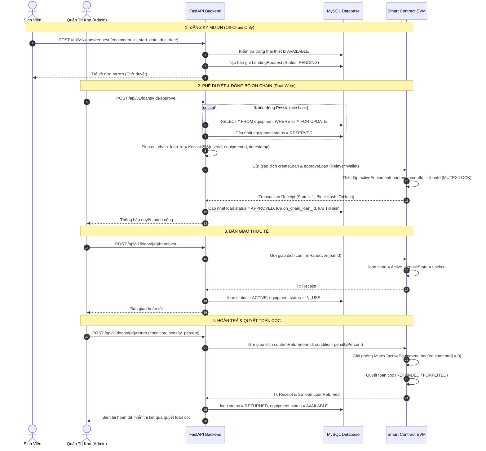
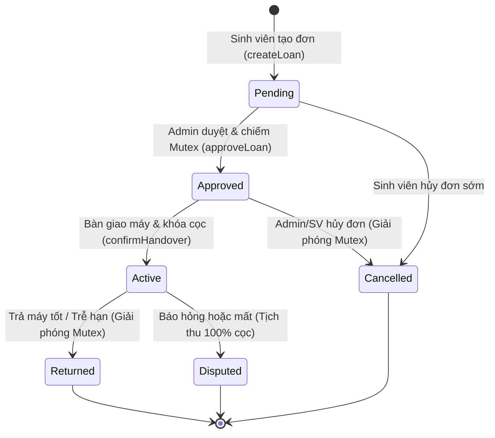

# BẢN THUYẾT MINH ĐỒ ÁN TỐNG HỢP: EDUVAULT
## HỆ THỐNG QUẢN LÝ MƯỢN TRẢ THIẾT BỊ HỌC TẬP VÀ ĐÀO TẠO ỨNG DỤNG SMART CONTRACT TRÊN NỀN TẢNG HYBRID WEB2.5

---

> **Tên đề tài:** Hệ thống Quản lý Mượn trả Thiết bị Học tập & Đào tạo Ứng dụng Smart Contract (EduVault)  
> **Chuyên ngành:** Kỹ thuật Phần mềm / Công nghệ Thông tin / Mạng máy tính & An toàn thông tin  
> **Kiến trúc cốt lõi:** Hybrid Web2.5 (Dual-State Architecture: MySQL 8.x + Solidity Smart Contract trên EVM)  
> **Phiên bản:** v1.1.0-phase7a  
> **Năm hoàn thành:** 2026  

---

## MỤC LỤC TỔNG QUAN

- [CHƯƠNG 1: TỔNG QUAN ĐỀ TÀI & TÍNH CẤP THIẾT](#chương-1-tổng-quan-đề-tài--tính-cấp-thiết)
  - [1.1. Đặt vấn đề và Thực trạng](#11-đặt-vấn-đề-và-thực-trạng)
  - [1.2. Mục tiêu nghiên cứu và Phạm vi giải pháp](#12-mục-tiêu-nghiên-cứu-và-phạm-vi-giải-pháp)
  - [1.3. Phương pháp tiếp cận: Mô hình Hybrid Web2.5](#13-phương-pháp-tiếp-cận-mô-hình-hybrid-web25)
  - [1.4. Đối tượng sử dụng và Giá trị thực tiễn](#14-đối-tượng-sử-dụng-và-giá-trị-thực-tiễn)
- [CHƯƠNG 2: KIẾN TRÚC HỆ THỐNG VÀ LUỒNG DỮ LIỆU](#chương-2-kiến-trúc-hệ-thống-và-luồng-dữ-liệu)
  - [2.1. Kiến trúc phân tầng Clean Architecture](#21-kiến-trúc-phân-tầng-clean-architecture)
  - [2.2. Phân định ranh giới On-Chain vs. Off-Chain (Source of Truth)](#22-phân-định-ranh-giới-on-chain-vs-off-chain-source-of-truth)
  - [2.3. Mô hình Hybrid Wallet Binding (EIP-191) & Custodial Relayer](#23-mô-hình-hybrid-wallet-binding-eip-191--custodial-relayer)
  - [2.4. Cơ chế xử lý nhất quán Dual-Write & Đối soát chủ động (Manual Reconciliation)](#24-cơ-chế-xử-lý-nhất-quán-dual-write--đối-soát-chủ-động-manual-reconciliation)
  - [2.5. Sơ đồ dòng chảy dữ liệu toàn trình (End-to-End Pipeline)](#25-sơ-đồ-dòng-chảy-dữ-liệu-toàn-trình-end-to-end-pipeline)
- [CHƯƠNG 3: THIẾT KẾ CƠ SỞ DỮ LIỆU & SMART CONTRACT](#chương-3-thiết-kế-cơ-sở-dữ-liệu--smart-contract)
  - [3.1. Thiết kế Cơ sở Dữ liệu Quan hệ Off-Chain (MySQL DDL)](#31-thiết-kế-cơ-sở-dữ-liệu-quan-hệ-off-chain-mysql-ddl)
  - [3.2. Thiết kế Smart Contract EquipmentLending.sol](#32-thiết-kế-smart-contract-equipmentlendingsol)
  - [3.3. Cơ chế Ký quỹ Mô phỏng (Simulated Deposit Accounting)](#33-cơ-chế-ký-quỹ-mô-phỏng-simulated-deposit-accounting)
  - [3.4. Cơ chế Mutex Chống Đặt Trùng Thiết Bị (On-Chain Lock)](#34-cơ-chế-mutex-chống-đặt-trùng-thiết-bị-on-chain-lock)
  - [3.5. Máy trạng thái (State Machine) & Công thức Phạt Tự động](#35-máy-trạng-thái-state-machine--công-thức-phạt-tự-động)
- [CHƯƠNG 4: PHÂN TÍCH TÍNH AN TOÀN VÀ BẢO MẬT HỆ THỐNG](#chương-4-phân-tích-tính-an-toàn-và-bảo-mật-hệ-thống)
  - [4.1. An toàn tầng ứng dụng (Application Security)](#41-an-toàn-tầng-ứng-dụng-application-security)
  - [4.2. Chống tranh chấp đồng thời (Concurrency Control: Pessimistic Lock)](#42-chống-tranh-chấp-đồng-thời-concurrency-control-pessimistic-lock)
  - [4.3. An toàn Smart Contract (EVM Security & AccessControl)](#43-an-toàn-smart-contract-evm-security--accesscontrol)
  - [4.4. Bảo vệ dữ liệu định danh cá nhân (Data Privacy)](#44-bảo-vệ-dữ-liệu-định-danh-cá-nhân-data-privacy)
- [CHƯƠNG 5: ĐÁNH GIÁ THỰC NGHIỆM VÀ KẾT QUẢ ĐẠT ĐƯỢC](#chương-5-đánh-giá-thực-nghiệm-và-kết-quả-đạt-được)
  - [5.1. Thống kê kết quả kiểm thử tự động (Phase 7A QA Summary)](#51-thống-kê-kết-quả-kiểm-thử-tự-động-phase-7a-qa-summary)
  - [5.2. Đánh giá ưu điểm và hạn chế của giải pháp](#52-đánh-giá-ưu-điểm-và-hạn-chế-của-giải-pháp)
  - [5.3. Hướng phát triển và mở rộng trong tương lai](#53-hướng-phát-triển-và-mở-rộng-trong-tương-lai)

---

## CHƯƠNG 1: TỔNG QUAN ĐỀ TÀI & TÍNH CẤP THIẾT

### 1.1. Đặt vấn đề và Thực trạng
Trong môi trường giáo dục đại học và viện nghiên cứu, việc quản lý mượn trả các thiết bị thực hành có giá trị cao (như laptop chuyên dụng, kit thí nghiệm IoT/vi điều khiển, kính thực tế ảo VR/AR, máy hiện sóng, máy đo phổ, máy bay không người lái drone...) đóng vai trò cốt lõi trong công tác đào tạo. Tuy nhiên, quy trình quản lý hiện nay tại hầu hết các đơn vị vẫn đối mặt với những bất cập nghiêm trọng:

1. **Rủi ro chỉnh sửa và thiếu minh bạch (Data Tampering):** Các phần mềm quản lý kho truyền thống sử dụng CSDL tập trung (MySQL, PostgreSQL, SQL Server). Quản trị viên hệ thống (DBA hoặc cán bộ quản lý kho) có toàn quyền sửa chữa trực tiếp bảng dữ liệu: xóa dấu vết mượn trả, thay đổi thời gian bàn giao/trả máy, làm sai lệch biên bản phạt hỏng hóc hoặc miễn trừ tiền phạt cho người quen. Khi xảy ra thất thoát tài sản công, việc quy trách nhiệm gặp nhiều tranh cãi do nhật ký kiểm toán (audit logs) trong DB tập trung hoàn toàn có thể bị can thiệp.
2. **Tranh chấp tiền đặt cọc và tiền phạt trễ hạn:** Sinh viên mượn thiết bị thường phải ký quỹ cọc hoặc chịu phạt trễ hạn theo quy chế. Các khiếu nại về việc "đã trả đúng hạn nhưng thủ kho ghi nhận trễ", hoặc "tình trạng thiết bị ban đầu đã cũ nhưng bị tính phí hỏng hóc" diễn ra thường xuyên do thiếu chứng chỉ số bất biến ghi nhận hiện trạng.
3. **Cạnh tranh tài nguyên đồng thời (Resource Race Condition):** Vào các tuần cao điểm đồ án tốt nghiệp, hàng chục sinh viên cùng lúc truy cập hệ thống để mượn các bộ kit số lượng có hạn, dẫn tới xung đột đặt trùng (double-booking) nếu hệ thống không có cơ chế khóa tài nguyên nghiêm ngặt.
4. **Rào cản tiếp cận của Web3 thuần túy (Pure Web3 UX Friction):** Nếu chuyển đổi toàn bộ sang ứng dụng phi tập trung thuần túy (dApp), sinh viên buộc phải cài ví MetaMask, sở hữu tiền điện tử để trả phí gas cho mỗi thao tác, và chịu độ trễ block confirmation kéo dài. Hơn nữa, việc lưu trữ thông tin cá nhân sinh viên (họ tên, email, mã số sinh viên) trực tiếp trên Blockchain công khai sẽ vi phạm nghiêm trọng các quy định về bảo vệ quyền riêng tư dữ liệu cá nhân (GDPR/Luật Bảo vệ Dữ liệu Cá nhân).

### 1.2. Mục tiêu nghiên cứu và Phạm vi giải pháp
Đề tài **EduVault** được nghiên cứu và xây dựng nhằm giải quyết triệt để các bài toán trên thông qua việc kết hợp có chọn lọc những ưu điểm vượt trội của hai thế giới công nghệ:
- **Tốc độ và trải nghiệm mượt mà của Web2:** Sinh viên đăng nhập bằng tài khoản nội bộ (Email/Mã sinh viên), giao diện đồ họa trực quan, tốc độ truy vấn mili-giây, hỗ trợ tìm kiếm và lọc danh mục thiết bị linh hoạt.
- **Tính bất biến, minh bạch và khả năng kiểm toán độc lập của Web3:** Mọi sự kiện then chốt trong vòng đời thiết bị (duyệt đơn, khóa cọc, bàn giao máy, hoàn trả, xử phạt, giải phóng tài nguyên) đều được đóng dấu mật mã (cryptographic hash) và xác thực bởi Smart Contract trên EVM Blockchain. Không một cá nhân hay quản trị viên nào có thể đơn phương sửa đổi lịch sử một khi khối giao dịch đã được đào.

### 1.3. Phương pháp tiếp cận: Mô hình Hybrid Web2.5
EduVault áp dụng kiến trúc **Web2.5 Dual-State**:
- Tách biệt ranh giới lưu trữ: Dữ liệu nghiệp vụ phong phú và thông tin định danh cá nhân chi tiết (họ tên, email, mật khẩu) được lưu trữ tại MySQL 8.x. Dữ liệu trạng thái pháp lý, mô phỏng kế toán tiền cọc bằng đơn vị VND (`depositAmount` dạng số nguyên, không giữ ETH thật/escrow native), `studentId` nội bộ và bằng chứng kiểm toán được ghi nhận bất biến trên Smart Contract `EquipmentLending.sol`.
- Cầu nối **Hybrid Wallet Binding (EIP-191) & Custodial Relayer**: Sinh viên có thể xác minh sở hữu ví MetaMask qua chữ ký `personal_sign` challenge-response (nonce dùng một lần có hạn 5 phút) để tự gửi `createLoan` trực tiếp on-chain; nếu chưa liên kết/xác minh ví, Backend FastAPI sử dụng ví Custodial Relayer (`ADMIN_ROLE`) làm đại lý ký thay hợp lệ cho các bước duyệt, bàn giao, hoàn trả và hủy đơn.
- **On-Demand Reconciliation Service (`/api/v1/audit/reconcile`):** Dịch vụ đối soát kích hoạt chủ động theo yêu cầu của Quản trị viên nhằm đồng bộ trạng thái giữa MySQL và Smart Contract (kèm cập nhật biên lai giao dịch `PENDING`/`FAILED`), khắc phục sai lệch khi gặp sự cố mạng hoặc crash server mà không cần chạy tiến trình cron ngầm tự động trong API.

### 1.4. Đối tượng sử dụng và Giá trị thực tiễn
Hệ thống được thiết kế phục vụ hai nhóm đối tượng chính:
- **Cán bộ quản lý kho / Ban quản trị phòng Lab (Role: ADMIN):** Quản lý danh mục thiết bị, phê duyệt/từ chối đơn mượn, xác nhận bàn giao thực tế, thẩm định tình trạng máy khi hoàn trả, kích hoạt quyết toán tiền cọc/phạt on-chain, tra cứu hồ sơ kiểm toán độc lập.
- **Sinh viên / Nghiên cứu sinh (Role: BORROWER):** Tra cứu thông số và tình trạng sẵn sàng của thiết bị, đăng ký mượn với lịch trình cụ thể, theo dõi tiến trình đơn mượn qua Stepper trực quan, hủy đơn khi chưa bàn giao, và xác minh tính toàn vẹn của giao dịch trên Blockchain.

---

## CHƯƠNG 2: KIẾN TRÚC HỆ THỐNG VÀ LUỒNG DỮ LIỆU

### 2.1. Kiến trúc phân tầng Clean Architecture
EduVault tuân thủ nghiêm ngặt nguyên lý thiết kế phân tầng (Layered Architecture):

```
+-------------------------------------------------------------------------+
|                          TẦNG TRÌNH DIỄN (FRONTEND)                    |
|    React 18 + TypeScript + Vite + Tailwind CSS + Lucide Icons + GSAP   |
|   - Catalog / Dashboard    - My Loans (Stepper)   - Admin Dispatcher    |
|   - Inventory Management   - Audit Blockchain     - Showcase 3D Vault   |
+-------------------------------------------------------------------------+
                                    | (HTTPS / REST JSON API / Bearer JWT)
+-------------------------------------------------------------------------+
|                       TẦNG ỨNG DỤNG & DỊCH VỤ (BACKEND)                 |
|               FastAPI (Python 3.13) + Pydantic v2 + SQLAlchemy          |
|   - AuthService (Bcrypt + JWT)           - EquipmentService (Locking)   |
|   - LoanService (Lifecycle State)        - AuditService & Reconciler    |
|   - Web3Service (Custodial Relayer / Contract Transactor / Event Parser)|
+-------------------------------------------------------------------------+
                 |                                      |
                 | (SQLAlchemy / PyMySQL)               | (Web3.py JSON-RPC)
+----------------------------------+  +-----------------------------------+
|      CƠ SỞ DỮ LIỆU (OFF-CHAIN)   |  |     SMART CONTRACT (ON-CHAIN)     |
|             MySQL 8.x            |  |      Solidity ^0.8.24 (EVM)       |
|  - Users (Credentials, PII, Role)|  |  - AccessControl (RBAC on-chain)  |
|  - Equipment (Catalog, Specs)    |  |  - Simulated Deposit Accounting   |
|  - LendingRequests (Off-chain)   |  |  - Equipment Mutex (Anti-overlap) |
|  - BlockchainTransactions (Hash) |  |  - State Machine & Penalty Engine |
|  - AuditLogs (Admin Operations)  |  |  - Immutability Event Emission    |
+----------------------------------+  +-----------------------------------+
```

### 2.2. Phân định ranh giới On-Chain vs. Off-Chain (Source of Truth)
Để tối ưu hóa chi phí gas, đảm bảo tốc độ phản hồi cao và tuân thủ nguyên tắc bảo mật thông tin riêng tư, hệ thống phân định rạch ròi nguồn dữ liệu chuẩn:

| Tiêu chí | CSDL MySQL (Off-Chain) | Smart Contract (On-Chain) | Lý do kiến trúc |
| :--- | :--- | :--- | :--- |
| **Thông tin cá nhân & định danh** | Họ tên, Email, Hash mật khẩu, thông số cá nhân nhạy cảm | Chỉ lưu **mã sinh viên nội bộ (`string studentId`)**, địa chỉ ví `borrower`, `bytes32 loanId`, `uint256 equipmentId` | Dữ liệu nhạy cảm (họ tên, email, mật khẩu) ở ngoài chain; chỉ mã định danh nghiệp vụ `studentId` và địa chỉ ví được neo trên `LoanRecord` để truy vết kiểm toán. |
| **Dữ liệu danh mục thiết bị** | Tên thiết bị, số serial, hãng sản xuất, hình ảnh, thông số kỹ thuật chi tiết | Chỉ lưu trữ `uint256 equipmentId` liên kết Mutex | Chi phí lưu trữ text/image trên Blockchain cực kỳ đắt đỏ và không cần thiết. |
| **Trạng thái pháp lý đơn mượn** | Bản sao đồng bộ phục vụ truy vấn UI nhanh | **Nguồn chân lý gốc (Ground Truth)** cho trạng thái `Submitted`, `Approved`, `Active`, `Returned`, `Disputed` | Chống gian lận: nếu DB bị DBA can thiệp sửa trạng thái, đối soát on-chain sẽ phát hiện ngay lập tức. |
| **Quyết toán tiền cọc & phạt (Mô phỏng VND)** | Bảng ghi chú số tiền hiển thị và xử lý thanh toán thực tế ngoài hệ thống | **Kế toán mô phỏng (Simulated Deposit Accounting)** lưu `depositAmount` (VND), `penaltyPercent` và `depositState` | Hợp đồng tính tỷ lệ phạt trễ hạn theo `block.timestamp`; việc thẩm định tình trạng vật lý (`GOOD`/`DAMAGED`/`LOST`) và hoàn/thu tiền thật ngoài đời phụ thuộc vào thẩm quyền cán bộ `ADMIN`. |
| **Lịch sử thao tác** | Bảng `audit_logs` phục vụ tra cứu nghiệp vụ | Các sự kiện EVM (`LoanApproved`, `HandoverConfirmed`, `LoanReturned`...) | Bằng chứng mã hóa bất biến không thể bị xóa bởi bất kỳ ai. |

### 2.3. Mô hình Hybrid Wallet Binding (EIP-191) & Custodial Relayer
Hệ thống kết hợp xác thực ví Web3 cá nhân với dịch vụ Relayer quản trị:
1. **Liên kết và xác minh ví sinh viên (EIP-191):** Trước khi sử dụng MetaMask tạo đơn trực tiếp, sinh viên lấy thử thách ký (`POST /api/v1/users/wallet/challenge`) và ký thông điệp `personal_sign` chứa nonce dùng một lần (hiệu lực 5 phút), gửi về `POST /api/v1/users/wallet/verify` để gắn cờ `wallet_verified = true` và chống giả mạo ví.
2. **Xác minh giao dịch MetaMask (`createLoan`):** Khi sinh viên gửi `(on_chain_loan_id, client_tx_hash)` từ MetaMask, Backend kiểm tra giao dịch đã đào thành công (`status == 1`), khớp `chainId`, địa chỉ hợp đồng, người gửi khớp ví đã xác minh và giải mã sự kiện `LoanCreated`. Khi Admin duyệt sau đó, hệ thống chỉ gọi `approveLoan` (không ghi đè lại ví `borrower`).
3. **Custodial Relayer (Gas Buffer 20%) & Fail-Closed:** Với các đơn không có ví MetaMask xác minh hoặc các bước quản trị (`approveLoan`, `confirmHandover`, `confirmReturn`, `cancelLoan`), `BlockchainService` kiểm tra RPC/Contract pre-flight (`ensure_ready`, lỗi mạng trả về `HTTP 503`), tự động ước lượng gas cộng **20% biên an toàn**, ghi `BlockchainTransaction` trạng thái `PENDING` ngay khi broadcast và chỉ chốt CSDL sau khi có receipt `status == 1`.

### 2.4. Cơ chế xử lý nhất quán Dual-Write & Đối soát chủ động (Manual Reconciliation)
Thách thức lớn nhất trong kiến trúc Web2.5 là bài toán **Dual-Write**: dữ liệu cần được ghi đồng thời vào hai kho lưu trữ độc lập (MySQL và EVM Blockchain). Nếu một trong hai bên gặp lỗi hoặc mạng bị đứt giữa chừng, trạng thái hệ thống có nguy cơ bị lệch (Split-brain).

EduVault xử lý bài toán này qua cơ chế phối hợp hai bước:
1. **Idempotent Hash Key (`on_chain_loan_id`) & Fail-Closed Check:**
   Mỗi đơn mượn được cấp một mã băm Keccak256 duy nhất (`keccak256(abi.encodePacked(userId, equipmentId, timestamp))`) lưu trong `lending_requests.on_chain_loan_id` (checkpoint trước khi phát sóng) kèm cơ chế fail-closed (nếu node RPC offline, từ chối bằng `HTTP 503` trước khi làm bẩn trạng thái CSDL) và Crash Recovery kiểm tra `getLoan()` trước khi phát sóng lại.
2. **Dịch vụ Đối soát chủ động (`POST /api/v1/audit/reconcile`):**
   Cơ chế đối soát được kích hoạt thủ công qua API quản trị (chưa chạy worker cron ngầm tự động). Khi Admin gọi `/api/v1/audit/reconcile`, dịch vụ thực hiện:
   - Đọc trạng thái on-chain từ Smart Contract qua hàm `getLoan(on_chain_loan_id)` và đối soát đồng thời khóa Mutex `activeEquipmentLoan`.
   - Không ghi đè dữ liệu MySQL nếu `getLoan()` trả về bản ghi rỗng trên chain (`request_time == 0`).
   - Nếu phát hiện độ lệch (ví dụ: giao dịch on-chain đã chuyển trạng thái nhưng MySQL chưa kịp cập nhật do sập server), hệ thống tự động đồng bộ `lending_requests`, `equipment`, `deposit_status`, `blockchain_transactions` và ghi `AuditLog` (`RECONCILIATION_FIX`).

### 2.5. Sơ đồ dòng chảy dữ liệu toàn trình (End-to-End Pipeline)



---

## CHƯƠNG 3: THIẾT KẾ CƠ SỞ DỮ LIỆU & SMART CONTRACT

### 3.1. Thiết kế Cơ sở Dữ liệu Quan hệ Off-Chain (MySQL DDL)
Hệ thống sử dụng MySQL 8.x với 5 bảng nghiệp vụ được thiết kế chuẩn hóa bậc 3 (3NF), định cấu hình khóa ngoại và chỉ mục phục vụ truy vấn tốc độ cao:

#### 1. Bảng `users` (Quản lý tài khoản & phân quyền)
```sql
CREATE TABLE users (
    id INT AUTO_INCREMENT PRIMARY KEY,
    student_id VARCHAR(50) UNIQUE NULL,
    full_name VARCHAR(100) NOT NULL,
    email VARCHAR(100) NOT NULL UNIQUE,
    hashed_password VARCHAR(255) NOT NULL,
    role ENUM('ADMIN', 'BORROWER') NOT NULL DEFAULT 'BORROWER',
    is_active BOOLEAN NOT NULL DEFAULT TRUE,
    failed_login_count INT NOT NULL DEFAULT 0,
    locked_until DATETIME NULL,
    created_at DATETIME NOT NULL DEFAULT CURRENT_TIMESTAMP,
    updated_at DATETIME NOT NULL DEFAULT CURRENT_TIMESTAMP ON UPDATE CURRENT_TIMESTAMP,
    INDEX idx_user_email (email),
    INDEX idx_user_student_id (student_id)
) ENGINE=InnoDB DEFAULT CHARSET=utf8mb4 COLLATE=utf8mb4_unicode_ci;
```

#### 2. Bảng `equipment` (Quản lý kho thiết bị)
```sql
CREATE TABLE equipment (
    id INT AUTO_INCREMENT PRIMARY KEY,
    name VARCHAR(150) NOT NULL,
    code VARCHAR(50) NOT NULL UNIQUE,
    category VARCHAR(50) NOT NULL,
    description TEXT NULL,
    specifications JSON NULL,
    deposit_amount DECIMAL(15, 2) NOT NULL DEFAULT 0.00,
    daily_late_fee DECIMAL(15, 2) NOT NULL DEFAULT 0.00,
    status ENUM('AVAILABLE', 'RESERVED', 'IN_USE', 'MAINTENANCE') NOT NULL DEFAULT 'AVAILABLE',
    created_at DATETIME NOT NULL DEFAULT CURRENT_TIMESTAMP,
    updated_at DATETIME NOT NULL DEFAULT CURRENT_TIMESTAMP ON UPDATE CURRENT_TIMESTAMP,
    INDEX idx_equipment_status (status),
    INDEX idx_equipment_category (category)
) ENGINE=InnoDB DEFAULT CHARSET=utf8mb4 COLLATE=utf8mb4_unicode_ci;
```

#### 3. Bảng `lending_requests` (Vòng đời đơn mượn)
```sql
CREATE TABLE lending_requests (
    id INT AUTO_INCREMENT PRIMARY KEY,
    user_id INT NOT NULL,
    equipment_id INT NOT NULL,
    on_chain_loan_id VARCHAR(66) UNIQUE NULL,
    status ENUM('PENDING', 'APPROVED', 'REJECTED', 'ACTIVE', 'RETURNED', 'OVERDUE', 'CANCELLED', 'DISPUTED') NOT NULL DEFAULT 'PENDING',
    borrow_date DATETIME NOT NULL,
    due_date DATETIME NOT NULL,
    handover_date DATETIME NULL,
    return_date DATETIME NULL,
    deposit_amount DECIMAL(15, 2) NOT NULL DEFAULT 0.00,
    penalty_amount DECIMAL(15, 2) NOT NULL DEFAULT 0.00,
    refund_amount DECIMAL(15, 2) NOT NULL DEFAULT 0.00,
    equipment_condition ENUM('GOOD', 'DAMAGED', 'LOST') NULL,
    notes TEXT NULL,
    created_at DATETIME NOT NULL DEFAULT CURRENT_TIMESTAMP,
    updated_at DATETIME NOT NULL DEFAULT CURRENT_TIMESTAMP ON UPDATE CURRENT_TIMESTAMP,
    FOREIGN KEY (user_id) REFERENCES users(id) ON DELETE RESTRICT,
    FOREIGN KEY (equipment_id) REFERENCES equipment(id) ON DELETE RESTRICT,
    INDEX idx_loan_status (status),
    INDEX idx_loan_user (user_id),
    INDEX idx_loan_equipment (equipment_id)
) ENGINE=InnoDB DEFAULT CHARSET=utf8mb4 COLLATE=utf8mb4_unicode_ci;
```

#### 4. Bảng `blockchain_transactions` (Sổ cái liên kết giao dịch EVM)
```sql
CREATE TABLE blockchain_transactions (
    id INT AUTO_INCREMENT PRIMARY KEY,
    loan_request_id INT NOT NULL,
    transaction_hash VARCHAR(66) NOT NULL UNIQUE,
    action_type ENUM('CREATE_LOAN', 'APPROVE_LOAN', 'CONFIRM_HANDOVER', 'CONFIRM_RETURN', 'CANCEL_LOAN') NOT NULL,
    block_number BIGINT NOT NULL,
    block_hash VARCHAR(66) NOT NULL,
    gas_used BIGINT NOT NULL,
    status ENUM('SUCCESS', 'FAILED') NOT NULL DEFAULT 'SUCCESS',
    created_at DATETIME NOT NULL DEFAULT CURRENT_TIMESTAMP,
    FOREIGN KEY (loan_request_id) REFERENCES lending_requests(id) ON DELETE CASCADE,
    INDEX idx_tx_hash (transaction_hash)
) ENGINE=InnoDB DEFAULT CHARSET=utf8mb4 COLLATE=utf8mb4_unicode_ci;
```

#### 5. Bảng `audit_logs` (Nhật ký kiểm toán hệ thống)
```sql
CREATE TABLE audit_logs (
    id INT AUTO_INCREMENT PRIMARY KEY,
    user_id INT NULL,
    action VARCHAR(100) NOT NULL,
    entity_name VARCHAR(50) NOT NULL,
    entity_id INT NULL,
    details JSON NULL,
    ip_address VARCHAR(45) NULL,
    created_at DATETIME NOT NULL DEFAULT CURRENT_TIMESTAMP,
    FOREIGN KEY (user_id) REFERENCES users(id) ON DELETE SET NULL,
    INDEX idx_audit_action (action),
    INDEX idx_audit_created (created_at)
) ENGINE=InnoDB DEFAULT CHARSET=utf8mb4 COLLATE=utf8mb4_unicode_ci;
```

---

### 3.2. Thiết kế Smart Contract EquipmentLending.sol
Hợp đồng thông minh được viết bằng ngôn ngữ **Solidity ^0.8.24**, kế thừa module chuẩn OpenZeppelin `AccessControl`.

#### Cấu trúc dữ liệu chính (Structs & Enums)
```solidity
enum LoanStatus { None, Pending, Approved, Active, Returned, Cancelled, Disputed }
enum DepositStatus { None, Pending, Locked, Refunded, Forfeited }

struct Loan {
    bytes32 loanId;           // Mã băm định danh duy nhất (Keccak256)
    uint256 userId;           // ID sinh viên tương ứng trên MySQL
    uint256 equipmentId;      // ID thiết bị trong kho
    uint256 depositAmount;    // Số tiền ký quỹ mô phỏng (Quy đổi đơn vị wei hoặc đơn vị tiền)
    uint256 dueDate;          // Thời điểm hết hạn trả (Unix timestamp)
    uint256 returnDate;       // Thời điểm trả máy thực tế
    LoanStatus status;        // Trạng thái đơn mượn
    DepositStatus depositStatus; // Trạng thái tiền ký quỹ
    uint8 equipmentCondition; // 0: Tốt (GOOD), 1: Hỏng (DAMAGED), 2: Mất (LOST)
    uint256 penaltyAmount;    // Số tiền phạt tính toán
}
```

#### Phân quyền RBAC trên Smart Contract
Hợp đồng hiện tại (`EquipmentLending.sol` Phase 7A) định nghĩa các vai trò trên OpenZeppelin `AccessControl`:
- `DEFAULT_ADMIN_ROLE`: Quyền quản trị tối cao (Deployer), có thể cấp phát hoặc thu hồi quyền.
- `ADMIN_ROLE`: Vai trò gán cho ví Custodial Relayer của Backend FastAPI, cho phép thực thi các tác vụ: `approveLoan`, `confirmHandover`, `confirmReturn`, `cancelLoan`.
- `BORROWER_ROLE`: Đã khai báo vai trò trong hợp đồng để chuẩn bị cho nâng cấp bảo mật; trong phạm vi Phase 7A giữ nguyên ABI ổn định, việc xác minh quyền sở hữu ví sinh viên thực hiện qua EIP-191 ở Backend, còn siết chặt đăng ký và kiểm tra `BORROWER_ROLE` trực tiếp trong `createLoan()` thuộc kế hoạch nâng cấp hợp đồng ở Phase 13.

---

### 3.3. Cơ chế Ký quỹ Mô phỏng (Simulated Deposit Accounting)
Một quyết định thiết kế then chốt của EduVault là áp dụng **Simulated Deposit Accounting (Kế toán ký quỹ mô phỏng)** thay vì bắt buộc người dùng nạp native ETH trực tiếp vào hợp đồng:
- **Nguyên nhân kỹ thuật:** Nếu nhận native ETH qua hàm `payable`, hợp đồng phải lưu trữ số dư thực, mở ra vector tấn công tái nhập (Reentrancy Attacks) khi rút tiền, phát sinh rủi ro kẹt quỹ test ETH khi có lỗi logic, và buộc sinh viên phải tự nạp ETH qua ví Web3 cá nhân.
- **Giải pháp EduVault:** Số tiền cọc được lưu trữ dưới dạng biến số kế toán trên Blockchain (`loan.depositAmount`). Hợp đồng mô phỏng chính xác chu trình luân chuyển tài chính:
  $$\text{depositStatus}: \text{Pending} \xrightarrow{\text{Handover}} \text{Locked} \xrightarrow{\text{Return}} \text{Refunded / Forfeited}$$
  Phương pháp này vẫn đảm bảo tính minh bạch, bất biến của các phán quyết tài chính, ghi nhận rõ ràng số tiền phạt và hoàn cọc, trong khi loại bỏ hoàn toàn các rủi ro bảo mật tài sản số.

---

### 3.4. Cơ chế Mutex Chống Đặt Trùng Thiết Bị (On-Chain Lock)
Để đảm bảo một thiết bị phần cứng không bao giờ bị bàn giao cho hai người cùng lúc, Smart Contract triển khai bảng ánh xạ Mutex:
```solidity
// Ánh xạ từ equipmentId sang loanId đang chiếm giữ
mapping(uint256 => bytes32) public activeEquipmentLoan;
```

**Nguyên lý hoạt động:**
1. Khi đơn mượn được duyệt (`approveLoan`), hợp đồng kiểm tra điều kiện tiên quyết:
   ```solidity
   require(activeEquipmentLoan[equipmentId] == bytes32(0), "Equipment already reserved or in use");
   activeEquipmentLoan[equipmentId] = loanId;
   ```
2. Nếu có một giao dịch khác cố tình duyệt đơn mượn cho cùng `equipmentId` này, EVM sẽ lập tức kích hoạt `revert` với mã lỗi trên, giao dịch bị từ chối và trạng thái được giữ nguyên.
3. Khi sinh viên trả máy thành công (`confirmReturn`) hoặc đơn mượn bị hủy (`cancelLoan`), Mutex được giải phóng:
   ```solidity
   delete activeEquipmentLoan[equipmentId]; // Đưa về bytes32(0)
   ```

---

### 3.5. Máy trạng thái (State Machine) & Công thức Phạt Tự động



**Quy tắc phạt và quyết toán tiền cọc mô phỏng:**
Khi cán bộ kho tiếp nhận trả máy thông qua hàm `confirmReturn(loanId, condition, penaltyPercent)` (Lưu ý: Smart Contract không thể tự quan sát tình trạng vật lý của thiết bị nên phụ thuộc vào thẩm định trung thực từ tài khoản có `ADMIN_ROLE`; trong Phase 7A, giao diện và Backend chặn ghi đè `manual_penalty_percent = 0` khi đơn đã quá hạn ở tình trạng `GOOD`, còn việc loại bỏ hẳn tham số ghi đè khỏi ABI thuộc Phase 13):
1. **Trả đúng hạn & Máy tốt (`condition == GOOD`, `block.timestamp <= dueDate`):**
   - Phạt: $0\%$.
   - Hoàn trả: $100\%$ tiền cọc (`depositStatus = Refunded`).
   - Trạng thái: `LoanStatus = Returned`.
2. **Trả trễ hạn $\le 24$ giờ (`condition == GOOD`, trễ $\le 86,400$s):**
   - Khấu trừ phạt tự động: $10\%$ tiền cọc.
   - Hoàn trả: $90\%$ tiền cọc cho sinh viên.
3. **Trả trễ hạn $> 24$ giờ (`condition == GOOD`, trễ $> 86,400$s):**
   - Khấu trừ phạt tự động: $50\%$ tiền cọc.
   - Hoàn trả: $50\%$ tiền cọc cho sinh viên.
4. **Thiết bị bị hư hỏng (`condition == DAMAGED`):**
   - Tịch thu toàn bộ $100\%$ tiền cọc (`depositStatus = Forfeited`).
   - Trạng thái: `LoanStatus = Disputed`.
5. **Làm mất thiết bị (`condition == LOST`):**
   - Tịch thu toàn bộ $100\%$ tiền cọc (`depositStatus = Forfeited`).
   - Trạng thái: `LoanStatus = Disputed`.

---

## CHƯƠNG 4: PHÂN TÍCH TÍNH AN TOÀN VÀ BẢO MẬT HỆ THỐNG

### 4.1. An toàn tầng ứng dụng (Application Security)
1. **Mã hóa mật khẩu bằng thuật toán Bcrypt:** Mật khẩu người dùng được băm bằng thuật toán `bcrypt` với cost factor tiêu chuẩn công nghiệp (salt ngẫu nhiên 12 vòng lặp). Hệ thống không bao giờ lưu trữ mật khẩu ở dạng plain-text.
2. **Cơ chế xác thực phân tán JWT (JSON Web Tokens):**
   - Sử dụng thuật toán ký `HS256` với `JWT_SECRET_KEY` cấu hình từ biến môi trường.
   - Thời hạn hiệu lực của access token cấu hình theo `ACCESS_TOKEN_EXPIRE_MINUTES` (hiện đặt `1440` phút trong `.env` phát triển và `30` phút theo mặc định an toàn trong `config.py`).
   - Tích hợp middleware xác thực và phân quyền RBAC dựa trên Dependency Injection (`Depends(require_role("ADMIN"))`), ngăn chặn triệt để lỗ hổng leo thang đặc quyền (Privilege Escalation).
3. **Cơ chế chống tấn công dò mật khẩu (Brute-Force Protection):**
   - Theo dõi số lần đăng nhập thất bại liên tiếp qua cột `users.failed_login_count`.
   - Nếu nhập sai mật khẩu 5 lần liên tiếp, tài khoản tự động bị khóa trong vòng 15 phút (`locked_until = now + 15m`).
   - Mọi yêu cầu đăng nhập trong thời gian khóa đều bị từ chối với mã lỗi `HTTP 423 Locked`.
   - Khi đăng nhập thành công, biến đếm `failed_login_count` lập tức được reset về 0.

### 4.2. Chống tranh chấp đồng thời (Concurrency Control: Pessimistic Lock)
Tại tầng CSDL quan hệ MySQL, khi hai sinh viên hoặc hai quản trị viên cùng thao tác trên một thiết bị, kỹ thuật **MySQL Pessimistic Lock (Khóa dòng bi quan)** được áp dụng:
```python
# Đoạn mã thực thi trong backend/app/services/loan_service.py
equipment = (
    db.query(Equipment)
    .filter(Equipment.id == request_in.equipment_id)
    .with_for_update()  # Kích hoạt cú pháp SELECT ... FOR UPDATE
    .first()
)
if equipment.status != EquipmentStatus.AVAILABLE:
    raise HTTPException(status_code=409, detail="Thiết bị hiện không khả dụng để mượn")
```
- Khi câu lệnh `with_for_update()` được gọi trong transaction, MySQL sẽ đặt một Exclusive Row Lock trên bản ghi thiết bị.
- Bất kỳ transaction đồng thời nào khác cố gắng đọc để cập nhật thiết bị này đều phải xếp hàng chờ cho đến khi transaction đầu tiên commit hoặc rollback, ngăn chặn tuyệt đối tình trạng Overbooking.

### 4.3. An toàn Smart Contract (EVM Security & AccessControl)
1. **Kiểm soát truy cập nghiêm ngặt (AccessControl & Thẩm quyền Admin):** Tất cả các hàm quản trị chuyển trạng thái pháp lý (`approveLoan`, `confirmHandover`, `confirmReturn`, `cancelLoan`) đều được bảo vệ bởi modifier `onlyRole(ADMIN_ROLE)`. Tuy nhiên, hợp đồng tin tưởng cán bộ giữ `ADMIN_ROLE` khi nhập kết quả nghiệm thu vật lý (`GOOD`/`DAMAGED`/`LOST`).
2. **Phòng chống tấn công tái nhập (Reentrancy Protection):** Do sử dụng mô hình kế toán ký quỹ mô phỏng theo đơn vị VND (không phải ETH escrow), Smart Contract không giữ native token hay thực hiện lời gọi ngoài (`transfer/call.value`), qua đó triệt tiêu hoàn toàn vector tấn công Reentrancy.
3. **Bảo vệ chống tràn số (Overflow/Underflow):** Hợp đồng được biên dịch bằng Solidity 0.8.24, tích hợp sẵn cơ chế kiểm tra tràn số học ở cấp độ trình biên dịch.

### 4.4. Bảo vệ dữ liệu định danh cá nhân (Data Privacy)
Một nguyên tắc quan trọng khi ứng dụng Blockchain vào quản lý hồ sơ sinh viên là phân tách thông tin định danh cá nhân (PII):
- **Dữ liệu nhạy cảm ngoài chuỗi:** Tuyệt đối không lưu trữ Họ tên đầy đủ, Email, Số CMND/CCCD hay Mật khẩu lên Blockchain.
- **Định danh nghiệp vụ tối thiểu on-chain:** `LoanRecord` chỉ lưu **mã sinh viên nội bộ (`string studentId`)**, địa chỉ ví `borrower`, mã đơn `bytes32 loanId` và `uint256 equipmentId` nhằm bảo đảm khả năng kiểm toán và giải mã minh bạch giữa MySQL và Smart Contract mà vẫn giữ các thông tin cá nhân nhạy cảm hoàn toàn off-chain.

---

## CHƯƠNG 5: ĐÁNH GIÁ THỰC NGHIỆM VÀ KẾT QUẢ ĐẠT ĐƯỢC

### 5.1. Thống kê kết quả kiểm thử tự động (Phase 7A QA Summary)
Hệ thống EduVault đã trải qua quy trình kiểm thử tự động đa tầng và xác minh E2E trên Hardhat EVM cục bộ:

| Phân hệ kiểm thử | Bộ công cụ thực thi | Số ca kiểm thử | Kết quả | Ghi chú kỹ thuật |
| :--- | :--- | :---: | :---: | :--- |
| **Smart Contract** | Hardhat, Chai, Ethers.js | 28 tests | **28/28 PASS** | Kiểm tra 100% các nhánh: Vòng đời chuẩn, phạt trễ 10%/50%, hỏng/mất, Mutex on-chain, AccessControl. |
| **Backend REST API** | Pytest, AnyIO, SQLAlchemy | 65 tests | **65/65 PASS** | Kiểm tra Auth/RBAC, CRUD & Pessimistic Lock, EIP-191 wallet verify, MetaMask receipt/idempotency, fail-closed 503, Reconcile. |
| **Frontend Build** | TypeScript (`tsc`) + Vite | Typecheck + Build | **PASS (Exit 0)** | Biên dịch production sạch lỗi TypeScript và bundler Vite (`npx tsc --noEmit --incremental false` & `npx vite build`). |
| **E2E Happy Path** | Python Web3 Integration | 1 kịch bản | **PASS** | Sinh viên tạo đơn $\to$ Duyệt $\to$ Bàn giao $\to$ Trả đúng hạn hoàn 100% cọc trên Hardhat EVM. |
| **E2E Penalties** | Python Web3 Integration | 4 kịch bản | **PASS** | Kiểm tra khấu trừ 10%, 50% cọc và tịch thu 100% cọc khi hỏng/mất. |
| **E2E Concurrency & Recovery** | Python Web3 Integration | 3 kịch bản | **PASS** | Chống mượn trùng thiết bị, giải phóng Mutex khi hủy đơn, tự phục hồi qua `POST /audit/reconcile`. |
| **E2E MetaMask EIP-191 & Offline Guard** | Python Web3 Multi-Account | 5 bước xác minh | **PASS** | Xác minh `personal_sign` nonce 1 lần, Account #1 `createLoan` + `approve`-only, chặn replay `409`, offline RPC trả `503`. |

### 5.2. Đánh giá ưu điểm và hạn chế của giải pháp

#### Ưu điểm vượt trội:
1. **Tính bất biến và chống chối bỏ (Non-repudiation):** Nhật ký mượn trả, phán quyết cọc mô phỏng VND và lịch sử bàn giao một khi đã ghi nhận on-chain thì không một cá nhân nào có thể xóa hoặc sửa.
2. **Trải nghiệm người dùng linh hoạt (Hybrid Web2.5 UX):** Hỗ trợ đồng thời luồng MetaMask xác minh EIP-191 (sinh viên tự ký `createLoan`) và luồng Custodial Relayer khi sinh viên chưa dùng ví Web3.
3. **Tính toàn vẹn và phục hồi theo yêu cầu (Fail-Closed + On-Demand Reconcile):** Mọi thao tác on-chain thất bại khi node offline (`HTTP 503`) hoặc revert (`HTTP 502`) không làm bẩn trạng thái CSDL; công cụ `/api/v1/audit/reconcile` hỗ trợ Admin quét và đồng bộ lại trạng thái khi xảy ra sự cố.
4. **Kiểm soát xung đột hai tầng:** Kết hợp chặt chẽ giữa Khóa dòng bi quan (MySQL Pessimistic Lock) ở tầng dữ liệu nhanh và Mutex mapping ở tầng hợp đồng thông minh.

#### Hạn chế hiện tại:
1. **Phụ thuộc vào Custodial Wallet & Thẩm quyền Admin:** Private Key của Relayer quản trị thao tác cần bảo vệ bằng HSM/KMS trong môi trường thật; ngoài ra Smart Contract chưa thể tự kiểm tra tình trạng vật lý thiết bị (`GOOD`/`DAMAGED`/`LOST`) nên vẫn tin cậy xác nhận từ `ADMIN_ROLE`.
2. **Chưa có tiến trình đối soát định kỳ tự động & `BORROWER_ROLE` trên chain:** Việc đối soát hiện kích hoạt thủ công qua API `/audit/reconcile`; việc bắt buộc `BORROWER_ROLE` trực tiếp trong `EquipmentLending.createLoan` và loại bỏ tham số `manual_penalty_percent` on-chain thuộc phạm vi nâng cấp Smart Contract ở Phase 13.
3. **Chi phí gas trên mạng công khai:** Khi triển khai lên Mainnet/Testnet công khai cần tối ưu chi phí gas (Layer 2 hoặc Private EVM).

### 5.3. Hướng phát triển và mở rộng trong tương lai
1. **Nâng cấp tích hợp Account Abstraction (ERC-4337):** Cho phép sinh viên đăng nhập bằng giao thức WebAuthn/Passkey (vân tay, FaceID) và sử dụng Paymaster tài trợ gas mà không cần phụ thuộc hoàn toàn vào Custodial Relayer tập trung.
2. **Tích hợp IoT Smart Lockers (Tủ khóa thông minh tự động):** Kết nối Smart Contract với tủ khóa phần cứng qua giao thức Oracle/MQTT. Khi cán bộ duyệt đơn và sinh viên quét mã QR tại tủ, khóa tủ tự động mở để nhận thiết bị mà không cần sự hiện diện trực tiếp của thủ kho.
3. **Mở rộng mô hình liên kết đào tạo liên trường (Inter-University Resource Sharing):** Ứng dụng Blockchain liên kết kho thiết bị giữa các trường đại học thành viên, cho phép sinh viên trường đối tác mượn thiết bị chéo với sự bảo chứng bằng danh tính số phân tán (DID - Decentralized Identifiers).

---
*Tài liệu được biên soạn và chuẩn hóa phục vụ Hội đồng Đánh giá & Nghiệm thu Đồ án Tốt nghiệp.*
