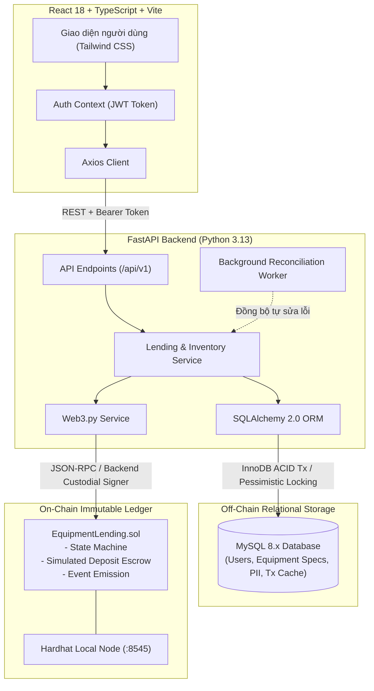

# Findings & Technical Knowledge Base

## 1. Môi trường & Khảo sát ban đầu (Environment Discovery)

| Thành phần | Phiên bản / Trạng thái | Quyết định kỹ thuật |
| :--- | :--- | :--- |
| **Hệ điều hành** | Windows x64 | PowerShell |
| **Node.js & npm** | Node `v24.15.0` / npm `11.15.0` | Dùng cho Vite (React + TS) và Hardhat local EVM |
| **Python** | Python `3.13.13` (`py -3.13`) / pip `26.0.1` | Dùng cho FastAPI, SQLAlchemy 2.0, Alembic, Web3.py |
| **Cơ sở dữ liệu** | **MySQL 8.x (MySQL80 service)** | Host `127.0.0.1:3306`, User `root`, DB `equipment_lending_db` đã tạo và kết nối thành công! |
| **Blockchain** | Hardhat Local EVM (`http://127.0.0.1:8545`) | Chain ID `31337`, Solidity ^0.8.24, Hardhat Toolbox |
| **Frontend UI Stack** | React 18 + TS + Tailwind + Lucide | Thư viện icon chuẩn `lucide-react`, tiện ích `clsx`, `tailwind-merge` |

---

## 2. Phát hiện Kỹ thuật Mới trong Phase 3 (Dependencies & Compatibility)

1. **Khả năng tương thích Web3.py trên Python 3.13 (Windows)**:
   - Trên Python 3.13 Windows, `ckzg` (dùng cho EIP-4844 blobs trong `eth-account>=0.11.0`) chưa có prebuilt C wheel và yêu cầu MSVC compiler (`cl.exe`).
   - *Giải pháp*: Ghim `eth-account<0.11.0` (phiên bản `0.10.0`), `eth-typing<5.0.0` và `eth-utils<5.0.0`. Web3.py 6.20.4 khởi tạo thành công 100% trên Python 3.13 không cần trình biên dịch C.
2. **Kết nối MySQL trên Windows (`localhost` vs `127.0.0.1`)**:
   - MySQL 8.x mặc định lắng nghe IPv4 (`127.0.0.1:3306`). Trên Windows, chuỗi kết nối `localhost` có thể ưu tiên IPv6 `::1` dẫn tới lỗi kết nối.
   - *Giải pháp*: Cấu hình chuẩn `127.0.0.1` trong `.env`. Đã tạo thành công database `equipment_lending_db`.
3. **Thư viện UI/Icon**:
   - Sử dụng `lucide-react` cho toàn bộ hệ thống icon trực quan.
   - Kết hợp `tailwindcss` cùng `tailwind-merge` và `clsx` để tạo giao diện hiện đại, tối ưu trải nghiệm (anti-slop, clean typography, status badges).

---

## 2. Kiến trúc hệ thống tổng thể (System Architecture)



---

## 3. Ranh giới dữ liệu & Nguồn dữ liệu chuẩn (Source of Truth)

| Thực thể dữ liệu | Nơi lưu trữ chuẩn (Authoritative) | Bộ nhớ đệm / Lưu phụ | Chiến lược đồng bộ |
| :--- | :--- | :--- | :--- |
| **Thông tin cá nhân (PII)**: Tên, MSSV, Email, Password Hash, Vai trò | **MySQL** | Không lưu on-chain (Bảo mật & GDPR) | Quản lý độc quyền bởi MySQL. |
| **Thông số thiết bị**: Tên, Cấu hình, Serial, Ảnh, Danh mục | **MySQL** | Contract chỉ lưu `equipmentId` (uint256) | MySQL lưu chi tiết; ID truyền vào Smart Contract. |
| **Trạng thái mượn (Loan State)**: Submitted, Approved, Active, Returned, Cancelled, Disputed | **Smart Contract** | MySQL (`lending_requests.status`) | Smart Contract là chuẩn (canonical). MySQL cập nhật khi tx receipt `status == 1`. |
| **Trạng thái tiền cọc**: None, Locked, Refunded, Forfeited | **Smart Contract** | MySQL (`lending_requests.deposit_status`) | Smart Contract là chuẩn. |
| **Mốc thời gian**: Hạn trả (`dueDate`), Bàn giao thực tế, Trả thực tế | **Smart Contract** | MySQL (`lending_requests.*_date`) | Contract lưu Unix timestamp; MySQL lưu `DATETIME`. |
| **Nhật ký kiểm toán**: `tx_hash`, `block_number`, `gas_used` | **EVM Block Header** | MySQL (`blockchain_transactions`) | Ghi nhận từ transaction receipt sau khi đào vào block. |

---

## 4. Mô hình Ký giao dịch & Phân quyền (Web2.5 Custodial Relayer)

- **Vấn đề**: Sinh viên và giảng viên không có ví Web3 (MetaMask) và không có ETH để trả phí gas.
- **Giải pháp**: Backend FastAPI đóng vai trò **Custodial Relayer / Admin Signer**:
  - Backend nắm giữ private key của tài khoản Admin/Operator (Hardhat Account #0: `0xf39Fd6e51aad88F6F4ce6aB8827279cffFb92266`) cấu hình trong `.env`.
  - Sinh viên đăng nhập vào Web UI bằng Email/Password $\rightarrow$ Nhận JWT Bearer Token (`role: BORROWER`).
  - Khi sinh viên bấm "Mượn thiết bị": Backend xác thực JWT, tạo bản ghi `PENDING` trong MySQL và dùng tài khoản Relayer ký gửi giao dịch `createLoan` lên Smart Contract thay mặt sinh viên (kèm mã định danh sinh viên).
  - Khi Quản lý kho (Admin) đăng nhập $\rightarrow$ Nhận JWT (`role: ADMIN`). Các thao tác Duyệt (`approveLoan`), Bàn giao (`confirmHandover`), Trả máy (`confirmReturn`) được Backend kiểm tra quyền `ADMIN` và ký gửi lên contract.
  - **Bảo mật**: Private key nằm hoàn toàn ở backend, tuyệt đối không lộ ở frontend hay commit lên Git.

---

## 5. Tiền cọc mô phỏng & Quy tắc phạt quá hạn (Simulated Deposit & Penalty Rules)

- **Thiết kế tiền cọc**: Hợp đồng **không giữ ETH thật hay test ETH** để loại bỏ hoàn toàn rủi ro tấn công Reentrancy và lỗi kẹt tiền khi hoàn cọc. Thay vào đó, hợp đồng quản lý **Simulated Deposit Accounting** (lưu số tiền cọc dưới dạng số nguyên điểm/VND và quản lý trạng thái `LOCKED`, `REFUNDED`, `FORFEITED`). Vừa đảm bảo tính bất biến minh bạch trên blockchain, vừa an toàn tuyệt đối.
- **Quy tắc phạt & Trạng thái quá hạn (`OVERDUE`)**:
  - `OVERDUE` là **điều kiện suy luận (derived condition)**: Xảy ra khi trạng thái hợp đồng là `Active` và thời gian hiện tại `block.timestamp > dueDate`.
  - **Bảng quy tắc khấu trừ khi hoàn trả:**
    - Đúng hạn & Thiết bị nguyên vẹn (`GOOD`): Phạt 0%, hoàn cọc 100% (`Refunded`).
    - Trễ $\le 24$ giờ & Thiết bị nguyên vẹn: Khấu trừ 10% phí trễ hạn, hoàn trả 90% cọc.
    - Trễ $> 24$ giờ & Thiết bị nguyên vẹn: Khấu trừ 50% phí trễ hạn, hoàn trả 50% cọc.
    - Thiết bị hỏng (`DAMAGED`): Thu hồi 100% cọc (`Forfeited`) chuyển vào quỹ sửa chữa.
    - Thiết bị mất (`LOST`): Thu hồi 100% cọc (`Forfeited`) + Khóa tài khoản sinh viên trên MySQL.

---

## 6. Xử lý cạnh tranh & Chống đặt trùng (Concurrency & Double-Booking Prevention)

- **Tại tầng MySQL**: Khi Admin duyệt đơn mượn, sử dụng khóa dòng bị động (Pessimistic Locking):
  ```sql
  SELECT id, status FROM equipment WHERE id = :equipment_id FOR UPDATE;
  ```
  Nếu `status == 'AVAILABLE'`, cập nhật `equipment.status = 'RESERVED'` và gửi giao dịch lên blockchain. Đơn cạnh tranh cùng thời điểm sẽ bị chặn lại và báo lỗi `409 Conflict`.
- **Tại tầng Smart Contract**: Mapping `mapping(uint256 => bytes32) public activeEquipmentLoan` đóng vai trò Mutex khóa thiết bị trên blockchain, từ chối bất kỳ giao dịch duyệt trùng lặp nào.

---

## 7. Xử lý Dual-Write & Cơ chế tự sửa lỗi (Reconciliation & Idempotency)

- **Nguyên tắc ghi**: Backend chỉ cập nhật trạng thái MySQL sang `ACTIVE` hoặc `RETURNED` khi receipt blockchain trả về `status == 1`.
- **Khóa chống trùng lặp (Idempotency)**:
  - Bảng `blockchain_transactions` có ràng buộc `UNIQUE(tx_hash)`.
  - Mã đơn `on_chain_loan_id` được băm bằng `keccak256(userId, equipmentId, requestTime)` và có ràng buộc `UNIQUE` trên MySQL và Smart Contract.
- **Worker tự phục hồi (Background Reconciliation Worker)**:
  - Nếu blockchain thực thi thành công nhưng server bị sập trước khi MySQL kịp ghi: Khi khởi động lại, worker quét các đơn có `status == PENDING` hoặc `tx.status == PENDING`, truy vấn trực tiếp trạng thái trên Smart Contract và sự kiện (`LoanApproved`, `HandoverConfirmed`, `LoanReturned`), sau đó đồng bộ lại MySQL mà không làm nhân bản dữ liệu.

---

## 8. Cấu trúc CSDL MySQL (Relational Schema)

```sql
-- 1. Bảng Người dùng
CREATE TABLE users (
    id INT AUTO_INCREMENT PRIMARY KEY,
    student_staff_id VARCHAR(50) NOT NULL UNIQUE,
    full_name VARCHAR(150) NOT NULL,
    email VARCHAR(150) NOT NULL UNIQUE,
    password_hash VARCHAR(255) NOT NULL,
    role ENUM('ADMIN', 'BORROWER') NOT NULL DEFAULT 'BORROWER',
    wallet_address VARCHAR(42) NULL,
    is_active BOOLEAN NOT NULL DEFAULT TRUE,
    created_at TIMESTAMP DEFAULT CURRENT_TIMESTAMP,
    INDEX idx_user_role (role)
) ENGINE=InnoDB DEFAULT CHARSET=utf8mb4 COLLATE=utf8mb4_unicode_ci;

-- 2. Bảng Thiết bị
CREATE TABLE equipment (
    id INT AUTO_INCREMENT PRIMARY KEY,
    serial_number VARCHAR(100) NOT NULL UNIQUE,
    name VARCHAR(200) NOT NULL,
    category VARCHAR(100) NOT NULL,
    specifications TEXT NULL,
    status ENUM('AVAILABLE', 'RESERVED', 'IN_USE', 'MAINTENANCE', 'RETIRED') NOT NULL DEFAULT 'AVAILABLE',
    deposit_amount DECIMAL(15, 2) NOT NULL DEFAULT 0.00,
    image_url VARCHAR(500) NULL,
    created_at TIMESTAMP DEFAULT CURRENT_TIMESTAMP,
    INDEX idx_equipment_status (status)
) ENGINE=InnoDB DEFAULT CHARSET=utf8mb4 COLLATE=utf8mb4_unicode_ci;

-- 3. Bảng Yêu cầu mượn
CREATE TABLE lending_requests (
    id INT AUTO_INCREMENT PRIMARY KEY,
    user_id INT NOT NULL,
    equipment_id INT NOT NULL,
    request_date TIMESTAMP DEFAULT CURRENT_TIMESTAMP,
    expected_handover_date DATETIME NOT NULL,
    due_date DATETIME NOT NULL,
    actual_handover_date DATETIME NULL,
    actual_return_date DATETIME NULL,
    status ENUM('PENDING', 'APPROVED', 'REJECTED', 'ACTIVE', 'RETURNED', 'OVERDUE', 'CANCELLED') NOT NULL DEFAULT 'PENDING',
    return_condition ENUM('GOOD', 'DAMAGED', 'LOST') NULL,
    deposit_amount DECIMAL(15, 2) NOT NULL DEFAULT 0.00,
    deposit_status ENUM('PENDING', 'LOCKED', 'REFUNDED', 'FORFEITED') NOT NULL DEFAULT 'PENDING',
    on_chain_loan_id VARCHAR(66) NULL UNIQUE,
    admin_notes TEXT NULL,
    created_at TIMESTAMP DEFAULT CURRENT_TIMESTAMP,
    FOREIGN KEY (user_id) REFERENCES users(id),
    FOREIGN KEY (equipment_id) REFERENCES equipment(id),
    INDEX idx_request_status (status)
) ENGINE=InnoDB DEFAULT CHARSET=utf8mb4 COLLATE=utf8mb4_unicode_ci;

-- 4. Bảng Giao dịch Blockchain
CREATE TABLE blockchain_transactions (
    id INT AUTO_INCREMENT PRIMARY KEY,
    request_id INT NULL,
    tx_hash VARCHAR(66) NOT NULL UNIQUE,
    action_type ENUM('CREATE_LOAN', 'APPROVE_LOAN', 'REJECT_LOAN', 'HANDOVER', 'RETURN_LOAN', 'CANCEL_LOAN') NOT NULL,
    from_address VARCHAR(42) NOT NULL,
    to_address VARCHAR(42) NOT NULL,
    block_number BIGINT NULL,
    gas_used INT NULL,
    status ENUM('PENDING', 'CONFIRMED', 'FAILED') NOT NULL DEFAULT 'PENDING',
    error_message TEXT NULL,
    created_at TIMESTAMP DEFAULT CURRENT_TIMESTAMP,
    FOREIGN KEY (request_id) REFERENCES lending_requests(id) ON DELETE SET NULL,
    INDEX idx_tx_hash (tx_hash)
) ENGINE=InnoDB DEFAULT CHARSET=utf8mb4 COLLATE=utf8mb4_unicode_ci;

-- 5. Bảng Nhật ký kiểm toán
CREATE TABLE audit_logs (
    id INT AUTO_INCREMENT PRIMARY KEY,
    user_id INT NULL,
    action VARCHAR(100) NOT NULL,
    entity_name VARCHAR(100) NOT NULL,
    entity_id INT NOT NULL,
    details_json JSON NULL,
    created_at TIMESTAMP DEFAULT CURRENT_TIMESTAMP,
    FOREIGN KEY (user_id) REFERENCES users(id) ON DELETE SET NULL
) ENGINE=InnoDB DEFAULT CHARSET=utf8mb4 COLLATE=utf8mb4_unicode_ci;
```

---

## 9. Đặc tả Smart Contract (`EquipmentLending.sol`)

- **Enums**:
  - `LoanState`: `Submitted` (0), `Approved` (1), `Active` (2), `Returned` (3), `Cancelled` (4), `Disputed` (5).
  - `DepositState`: `None` (0), `Locked` (1), `Refunded` (2), `Forfeited` (3).
- **Functions chính**:
  1. `createLoan(bytes32 loanId, uint256 equipmentId, string studentId, address borrower, uint256 expectedHandover, uint256 dueDate, uint256 depositAmount) external onlyAdminOrRelayer`
  2. `approveLoan(bytes32 loanId) external onlyAdmin`
  3. `confirmHandover(bytes32 loanId) external onlyAdmin`
  4. `confirmReturn(bytes32 loanId, uint8 returnCondition, uint8 penaltyPercent) external onlyAdmin`
  5. `cancelLoan(bytes32 loanId, string reason) external`
- **Events**: `LoanCreated`, `LoanApproved`, `HandoverConfirmed`, `LoanReturned`, `LoanCancelled`.

---

## 10. Danh mục API REST cốt lõi

| Method | Endpoint | Quyền | Mô tả |
| :--- | :--- | :--- | :--- |
| `POST` | `/api/v1/auth/login` | Public | Đăng nhập trả về JWT token |
| `GET` | `/api/v1/equipment` | All | Danh sách thiết bị (lọc theo danh mục, trạng thái) |
| `POST` | `/api/v1/equipment` | `ADMIN` | Thêm thiết bị mới |
| `POST` | `/api/v1/loans/request` | `BORROWER` | Sinh viên gửi yêu cầu mượn máy |
| `POST` | `/api/v1/loans/{id}/approve` | `ADMIN` | Duyệt đơn & khóa giữ thiết bị |
| `POST` | `/api/v1/loans/{id}/reject` | `ADMIN` | Từ chối đơn |
| `POST` | `/api/v1/loans/{id}/handover` | `ADMIN` | Xác nhận bàn giao thực tế & khóa cọc on-chain |
| `POST` | `/api/v1/loans/{id}/return` | `ADMIN` | Nhận lại máy, kiểm tra tình trạng, xử lý cọc/phạt |
| `POST` | `/api/v1/loans/{id}/cancel` | `BORROWER` / `ADMIN` | Hủy đơn trước khi bàn giao |
| `GET` | `/api/v1/audit/transactions` | Authenticated | Danh sách các transaction hash trên local EVM |
| `GET` | `/api/v1/audit/loans/{id}/verify` | Authenticated | Đối soát trực tiếp giữa dữ liệu MySQL và Smart Contract |
