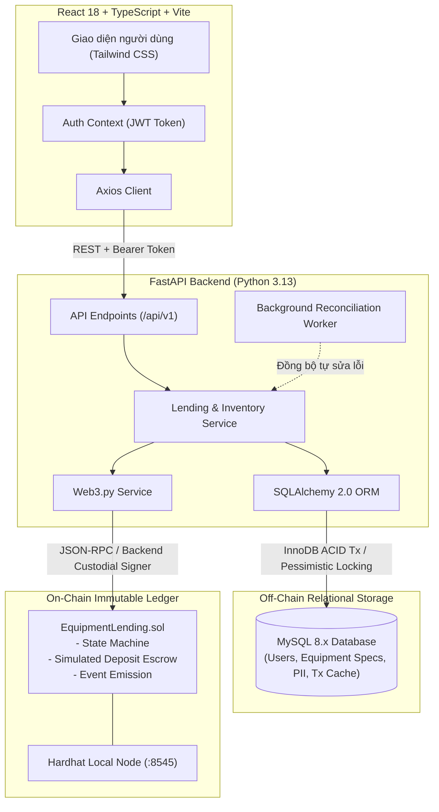
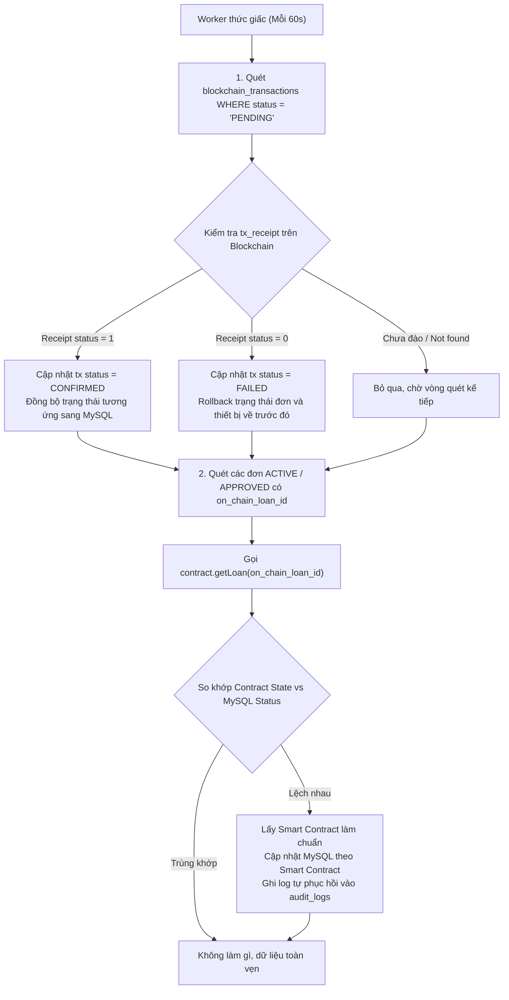

# Findings & Technical Knowledge Base (EduVault)

## 1. Môi trường & Khảo sát ban đầu (Environment Discovery)

| Thành phần | Phiên bản / Trạng thái | Quyết định kỹ thuật |
| :--- | :--- | :--- |
| **Hệ điều hành** | Windows x64 | PowerShell |
| **Node.js & npm** | Node `v24.15.0` / npm `11.15.0` | Dùng cho Vite (React + TS) và Hardhat local EVM |
| **Python** | Python `3.13.13` (`py -3.13`) / pip `26.0.1` | Dùng cho FastAPI, SQLAlchemy 2.0, Alembic, Web3.py |
| **Cơ sở dữ liệu** | **MySQL 8.x (MySQL80 service)** | Host `127.0.0.1:3306`, User `root`, DB `equipment_lending_db` đã tạo và kết nối thành công! |
| **Blockchain** | Hardhat Local EVM (`http://127.0.0.1:8545`) | Chain ID `31337`, Solidity ^0.8.24, Hardhat Toolbox |
| **Frontend UI Stack** | React 18 + TS + Tailwind + Lucide | Thư viện icon chuẩn `lucide-react`, tiện ích `clsx`, `tailwind-merge` |

---

## 2. Phát hiện Kỹ thuật Quan trọng (Dependencies & Compatibility)

1. **Khả năng tương thích Web3.py trên Python 3.13 (Windows)**:
   - Trên Python 3.13 Windows, `ckzg` (dùng cho EIP-4844 blobs trong `eth-account>=0.11.0`) chưa có prebuilt C wheel và yêu cầu MSVC compiler (`cl.exe`).
   - *Giải pháp*: Ghim `eth-account<0.11.0` (phiên bản `0.10.0`), `eth-typing<5.0.0` và `eth-utils<5.0.0`. Web3.py 6.20.4 khởi tạo thành công 100% trên Python 3.13 không cần trình biên dịch C.
2. **Kết nối MySQL trên Windows (`localhost` vs `127.0.0.1`)**:
   - MySQL 8.x mặc định lắng nghe IPv4 (`127.0.0.1:3306`). Trên Windows, chuỗi kết nối `localhost` có thể ưu tiên IPv6 `::1` dẫn tới lỗi kết nối.
   - *Giải pháp*: Cấu hình chuẩn `127.0.0.1` trong `.env`. Đã tạo thành công database `equipment_lending_db`.
3. **Thư viện UI/Icon**:
   - Sử dụng `lucide-react` cho toàn bộ hệ thống icon trực quan.
   - Kết hợp `tailwindcss` cùng `tailwind-merge` và `clsx` để tạo giao diện hiện đại, tối ưu trải nghiệm (anti-slop, clean typography, status badges).

---

## 3. Kiến trúc hệ thống tổng thể (System Architecture)



---

## 4. Ranh giới dữ liệu & Nguồn dữ liệu chuẩn (Source of Truth)

| Thực thể dữ liệu | Nơi lưu trữ chuẩn (Authoritative) | Bộ nhớ đệm / Lưu phụ | Chiến lược đồng bộ |
| :--- | :--- | :--- | :--- |
| **Thông tin cá nhân (PII)**: Tên, MSSV, Email, Password Hash, Vai trò | **MySQL** | Không lưu on-chain (Bảo mật & GDPR) | Quản lý độc quyền bởi MySQL. |
| **Thông số thiết bị**: Tên, Cấu hình, Serial, Ảnh, Danh mục | **MySQL** | Contract chỉ lưu `equipmentId` (uint256) | MySQL lưu chi tiết; ID truyền vào Smart Contract. |
| **Trạng thái mượn (Loan State)**: Submitted, Approved, Active, Returned, Cancelled, Disputed | **Smart Contract** | MySQL (`lending_requests.status`) | Smart Contract là chuẩn (canonical). MySQL cập nhật khi tx receipt `status == 1`. Riêng trạng thái `REJECTED` là off-chain only trên MySQL vì đơn bị từ chối trước khi đưa lên chain. |
| **Trạng thái tiền cọc**: None, Locked, Refunded, Forfeited | **Smart Contract** | MySQL (`lending_requests.deposit_status`) | Smart Contract là chuẩn. |
| **Mốc thời gian**: Hạn trả (`dueDate`), Bàn giao thực tế, Trả thực tế | **Smart Contract** | MySQL (`lending_requests.*_date`) | Contract lưu Unix timestamp; MySQL lưu `DATETIME`. |
| **Nhật ký kiểm toán**: `tx_hash`, `block_number`, `gas_used` | **EVM Block Header** | MySQL (`blockchain_transactions`) | Ghi nhận từ transaction receipt sau khi đào vào block. |

---

## 5. Mô hình Ký giao dịch & Phân quyền (Web2.5 Custodial Relayer)

- **Vấn đề**: Sinh viên và giảng viên không có ví Web3 (MetaMask) và không có ETH để trả phí gas.
- **Giải pháp**: Backend FastAPI đóng vai trò **Custodial Relayer / Admin Signer**:
  - Backend nắm giữ private key của tài khoản Admin/Operator (Hardhat Account #0: `0xf39Fd6e51aad88F6F4ce6aB8827279cffFb92266`) cấu hình trong `.env`.
  - Sinh viên đăng nhập vào Web UI bằng Email/Password $\rightarrow$ Nhận JWT Bearer Token (`role: BORROWER`).
  - Khi sinh viên bấm "Mượn thiết bị": Backend xác thực JWT, tạo bản ghi `PENDING` trong MySQL và dùng tài khoản Relayer ký gửi giao dịch `createLoan` lên Smart Contract thay mặt sinh viên (kèm mã định danh sinh viên).
  - Khi Quản lý kho (Admin) đăng nhập $\rightarrow$ Nhận JWT (`role: ADMIN`). Các thao tác Duyệt (`approveLoan`), Bàn giao (`confirmHandover`), Trả máy (`confirmReturn`) được Backend kiểm tra quyền `ADMIN` và ký gửi lên contract.
  - **Bảo mật**: Private key nằm hoàn toàn ở backend, tuyệt đối không lộ ở frontend hay commit lên Git.

---

## 6. Tiền cọc mô phỏng & Quy tắc phạt quá hạn (Simulated Deposit & Penalty Rules)

- **Thiết kế tiền cọc**: Hợp đồng **không giữ ETH thật hay test ETH** để loại bỏ hoàn toàn rủi ro tấn công Reentrancy và lỗi kẹt tiền khi hoàn cọc. Thay vào đó, hợp đồng quản lý **Simulated Deposit Accounting** (lưu số tiền cọc dưới dạng số nguyên điểm/VND và quản lý trạng thái `LOCKED`, `REFUNDED`, `FORFEITED`). Vừa đảm bảo tính bất biến minh bạch trên blockchain, vừa an toàn tuyệt đối.
- **Quy tắc phạt & Trạng thái quá hạn (`OVERDUE`)**:
  - `OVERDUE` là **điều kiện suy luận (derived condition)**: Xảy ra khi trạng thái hợp đồng là `Active` và thời gian hiện tại `block.timestamp > dueDate`.
  - **Bảng quy tắc khấu trừ khi hoàn trả:**
    - Đúng hạn & Thiết bị nguyên vẹn (`GOOD`): Phạt 0%, hoàn cọc 100% (`Refunded`).
    - Trễ $\le 24$ giờ & Thiết bị nguyên vẹn: Khấu trừ 10% phí trễ hạn, hoàn trả 90% cọc.
    - Trễ $> 24$ giờ & Thiết bị nguyên vẹn: Khấu trừ 50% phí trễ hạn, hoàn trả 50% cọc.
    - Thiết bị hỏng (`DAMAGED`): Thu hồi 100% cọc (`Forfeited`) chuyển vào quỹ sửa chữa.
    - Thiết bị mất (`LOST`): Thu hồi 100% cọc (`Forfeited`) + Khóa tài khoản sinh viên trên MySQL.

---

## 7. Xử lý cạnh tranh & Chống đặt trùng (Concurrency & Double-Booking Prevention)

- **Tại tầng MySQL**: Khi Admin duyệt đơn mượn, sử dụng khóa dòng bị động (Pessimistic Locking):
  ```sql
  SELECT id, status FROM equipment WHERE id = :equipment_id FOR UPDATE;
  ```
  Nếu `status == 'AVAILABLE'`, cập nhật `equipment.status = 'RESERVED'` và gửi giao dịch lên blockchain. Đơn cạnh tranh cùng thời điểm sẽ bị chặn lại và báo lỗi `409 Conflict`.
- **Tại tầng Smart Contract**: Mapping `mapping(uint256 => bytes32) public activeEquipmentLoan` đóng vai trò Mutex khóa thiết bị trên blockchain, từ chối bất kỳ giao dịch duyệt trùng lặp nào.

---

## 8. Xử lý Dual-Write & Cơ chế tự sửa lỗi (Reconciliation & Idempotency)

- **Nguyên tắc ghi**: Backend chỉ cập nhật trạng thái MySQL sang `ACTIVE` hoặc `RETURNED` khi receipt blockchain trả về `status == 1`.
- **Khóa chống trùng lặp (Idempotency)**:
  - Bảng `blockchain_transactions` có ràng buộc `UNIQUE(tx_hash)`.
  - Mã đơn `on_chain_loan_id` được băm bằng `keccak256(userId, equipmentId, requestTime)` và có ràng buộc `UNIQUE` trên MySQL và Smart Contract.
- **Worker tự phục hồi (Background Reconciliation Worker)**:
  - Nếu blockchain thực thi thành công nhưng server bị sập trước khi MySQL kịp ghi: Khi khởi động lại, worker quét các đơn có `status == PENDING` hoặc `tx.status == PENDING`, truy vấn trực tiếp trạng thái trên Smart Contract và sự kiện (`LoanApproved`, `HandoverConfirmed`, `LoanReturned`), sau đó đồng bộ lại MySQL mà không làm nhân bản dữ liệu.

---

## 9. Cấu trúc CSDL MySQL (Relational Schema)

```sql
-- 1. Bảng Người dùng
CREATE TABLE users (
    id INT AUTO_INCREMENT PRIMARY KEY,
    student_staff_id VARCHAR(50) NOT NULL UNIQUE,
    full_name VARCHAR(150) NOT NULL,
    email VARCHAR(150) NOT NULL UNIQUE,
    password_hash VARCHAR(255) NOT NULL,
    role ENUM('ADMIN', 'BORROWER') NOT NULL DEFAULT 'BORROWER',
    wallet_address VARCHAR(42) NULL,
    is_active BOOLEAN NOT NULL DEFAULT TRUE,
    failed_login_count INT NOT NULL DEFAULT 0,
    locked_until DATETIME NULL,
    created_at TIMESTAMP DEFAULT CURRENT_TIMESTAMP,
    updated_at TIMESTAMP DEFAULT CURRENT_TIMESTAMP ON UPDATE CURRENT_TIMESTAMP,
    INDEX idx_user_role (role)
) ENGINE=InnoDB DEFAULT CHARSET=utf8mb4 COLLATE=utf8mb4_unicode_ci;

-- 2. Bảng Thiết bị
CREATE TABLE equipment (
    id INT AUTO_INCREMENT PRIMARY KEY,
    serial_number VARCHAR(100) NOT NULL UNIQUE,
    name VARCHAR(200) NOT NULL,
    category VARCHAR(100) NOT NULL,
    specifications TEXT NULL,
    status ENUM('AVAILABLE', 'RESERVED', 'IN_USE', 'MAINTENANCE', 'RETIRED') NOT NULL DEFAULT 'AVAILABLE',
    deposit_amount DECIMAL(15, 2) NOT NULL DEFAULT 0.00,
    image_url VARCHAR(500) NULL,
    created_at TIMESTAMP DEFAULT CURRENT_TIMESTAMP,
    updated_at TIMESTAMP DEFAULT CURRENT_TIMESTAMP ON UPDATE CURRENT_TIMESTAMP,
    INDEX idx_equipment_status (status)
) ENGINE=InnoDB DEFAULT CHARSET=utf8mb4 COLLATE=utf8mb4_unicode_ci;

-- 3. Bảng Yêu cầu mượn
CREATE TABLE lending_requests (
    id INT AUTO_INCREMENT PRIMARY KEY,
    user_id INT NOT NULL,
    equipment_id INT NOT NULL,
    request_date TIMESTAMP DEFAULT CURRENT_TIMESTAMP,
    expected_handover_date DATETIME NOT NULL,
    due_date DATETIME NOT NULL,
    actual_handover_date DATETIME NULL,
    actual_return_date DATETIME NULL,
    -- Lưu ý: OVERDUE là trạng thái suy luận (derived condition: status = 'ACTIVE' AND NOW() > due_date), không lưu cứng trong ENUM
    status ENUM('PENDING', 'APPROVED', 'REJECTED', 'ACTIVE', 'RETURNED', 'DISPUTED', 'CANCELLED') NOT NULL DEFAULT 'PENDING',
    return_condition ENUM('GOOD', 'DAMAGED', 'LOST') NULL,
    deposit_amount DECIMAL(15, 2) NOT NULL DEFAULT 0.00,
    deposit_status ENUM('PENDING', 'LOCKED', 'REFUNDED', 'FORFEITED') NOT NULL DEFAULT 'PENDING',
    on_chain_loan_id VARCHAR(66) NULL UNIQUE,
    admin_notes TEXT NULL,
    created_at TIMESTAMP DEFAULT CURRENT_TIMESTAMP,
    updated_at TIMESTAMP DEFAULT CURRENT_TIMESTAMP ON UPDATE CURRENT_TIMESTAMP,
    FOREIGN KEY (user_id) REFERENCES users(id),
    FOREIGN KEY (equipment_id) REFERENCES equipment(id),
    INDEX idx_request_status (status)
) ENGINE=InnoDB DEFAULT CHARSET=utf8mb4 COLLATE=utf8mb4_unicode_ci;

-- 4. Bảng Giao dịch Blockchain
CREATE TABLE blockchain_transactions (
    id INT AUTO_INCREMENT PRIMARY KEY,
    request_id INT NULL,
    tx_hash VARCHAR(66) NOT NULL UNIQUE,
    action_type ENUM('CREATE_LOAN', 'APPROVE_LOAN', 'REJECT_LOAN', 'HANDOVER', 'RETURN_LOAN', 'CANCEL_LOAN') NOT NULL,
    from_address VARCHAR(42) NOT NULL,
    to_address VARCHAR(42) NOT NULL,
    block_number BIGINT NULL,
    gas_used INT NULL,
    status ENUM('PENDING', 'CONFIRMED', 'FAILED') NOT NULL DEFAULT 'PENDING',
    error_message TEXT NULL,
    created_at TIMESTAMP DEFAULT CURRENT_TIMESTAMP,
    FOREIGN KEY (request_id) REFERENCES lending_requests(id) ON DELETE SET NULL,
    INDEX idx_tx_hash (tx_hash)
) ENGINE=InnoDB DEFAULT CHARSET=utf8mb4 COLLATE=utf8mb4_unicode_ci;

-- 5. Bảng Nhật ký kiểm toán
CREATE TABLE audit_logs (
    id INT AUTO_INCREMENT PRIMARY KEY,
    user_id INT NULL,
    action VARCHAR(100) NOT NULL,
    entity_name VARCHAR(100) NOT NULL,
    entity_id INT NOT NULL,
    details_json JSON NULL,
    created_at TIMESTAMP DEFAULT CURRENT_TIMESTAMP,
    FOREIGN KEY (user_id) REFERENCES users(id) ON DELETE SET NULL
) ENGINE=InnoDB DEFAULT CHARSET=utf8mb4 COLLATE=utf8mb4_unicode_ci;
```

---

## 10. Đặc tả Smart Contract (`EquipmentLending.sol`)

- **Enums**:
  - `LoanState`: `Submitted` (0), `Approved` (1), `Active` (2), `Returned` (3), `Cancelled` (4), `Disputed` (5).
  - `DepositState`: `None` (0), `Locked` (1), `Refunded` (2), `Forfeited` (3).
- **Quyền hạn truy cập**: Toàn bộ hàm thay đổi trạng thái đều dùng modifier `onlyOwner` (kế thừa từ OpenZeppelin `Ownable`). Trong kiến trúc Web2.5 của đồ án, tài khoản Owner chính là tài khoản Custodial Relayer / Admin Signer (Hardhat Account #0) được quản lý an toàn bởi Backend.
- **Functions chính**:
  1. `createLoan(bytes32 loanId, uint256 equipmentId, string studentId, address borrower, uint256 expectedHandover, uint256 dueDate, uint256 depositAmount) external onlyOwner`
  2. `approveLoan(bytes32 loanId) external onlyOwner`
  3. `confirmHandover(bytes32 loanId) external onlyOwner`
  4. `confirmReturn(bytes32 loanId, uint8 returnCondition, uint8 penaltyPercent) external onlyOwner`
  5. `cancelLoan(bytes32 loanId, string reason) external onlyOwner`
  6. `calculatePenalty(bytes32 loanId, uint8 returnCondition) public view returns (uint8 penalty, DepositState depState, LoanState nextState)`
  7. `isOverdue(bytes32 loanId) external view returns (bool)`
- **Events**: `LoanCreated`, `LoanApproved`, `HandoverConfirmed`, `LoanReturned`, `LoanCancelled`.

---

## 11. Danh mục API REST cốt lõi

| Method | Endpoint | Quyền | Mô tả |
| :--- | :--- | :--- | :--- |
| `POST` | `/api/v1/auth/login` | Public | Đăng nhập trả về JWT token |
| `POST` | `/api/v1/admin/users` | `ADMIN` | Tạo tài khoản sinh viên mới |
| `GET` | `/api/v1/admin/users` | `ADMIN` | Danh sách tài khoản |
| `GET` | `/api/v1/users/me` | Authenticated | Thông tin tài khoản đang đăng nhập |
| `GET` | `/api/v1/equipment` | All | Danh sách thiết bị (lọc theo danh mục, trạng thái) |
| `POST` | `/api/v1/equipment` | `ADMIN` | Thêm thiết bị mới |
| `POST` | `/api/v1/loans/request` | `BORROWER` | Sinh viên gửi yêu cầu mượn máy |
| `POST` | `/api/v1/loans/{id}/approve` | `ADMIN` | Duyệt đơn & khóa giữ thiết bị |
| `POST` | `/api/v1/loans/{id}/reject` | `ADMIN` | Từ chối đơn |
| `POST` | `/api/v1/loans/{id}/handover` | `ADMIN` | Xác nhận bàn giao thực tế & khóa cọc on-chain |
| `POST` | `/api/v1/loans/{id}/return` | `ADMIN` | Nhận lại máy, kiểm tra tình trạng, xử lý cọc/phạt |
| `POST` | `/api/v1/loans/{id}/cancel` | `BORROWER` / `ADMIN` | Hủy đơn trước khi bàn giao |
| `GET` | `/api/v1/audit/transactions` | Authenticated | Danh sách các transaction hash trên local EVM |
| `GET` | `/api/v1/audit/loans/{id}/verify` | Authenticated | Đối soát trực tiếp giữa dữ liệu MySQL và Smart Contract |


---

## 12. Thiết kế Xác thực & Phân quyền (Authentication & Authorization)

### 12.1 Luồng đăng nhập (Login Flow)

- **Không có self-registration**: Admin tạo tài khoản cho sinh viên. Dữ liệu demo được nạp qua `scripts/seed.py`.
- **Endpoint duy nhất**: `POST /api/v1/auth/login` nhận `{email, password}`, trả về `{access_token, token_type, role}`.
- **Thuật toán băm mật khẩu**: `bcrypt` qua thư viện `passlib[bcrypt]`.

```
Luồng xử lý:
1. Client gửi POST /auth/login {email, password}
2. Backend truy vấn users WHERE email = :email
3. Nếu không tìm thấy → 401 Unauthorized (không tiết lộ email tồn tại)
4. Kiểm tra is_active == False → 401 "Tài khoản đã bị khóa"
5. Kiểm tra locked_until > now() → 401 "Tài khoản tạm khóa do đăng nhập sai quá nhiều"
6. So khớp bcrypt(password, password_hash)
   - Sai → tăng failed_login_count; nếu >= 5 → set locked_until = now() + 15 phút
   - Đúng → reset failed_login_count = 0, locked_until = NULL
7. Tạo JWT payload: {sub: user_id, role: "ADMIN"|"BORROWER", exp: now() + 30 phút}
8. Ký JWT bằng HS256 với JWT_SECRET_KEY từ .env
9. Trả về {access_token, token_type: "bearer", role}
```

### 12.2 Cấu hình JWT

| Tham số | Giá trị | Ghi chú |
| :--- | :--- | :--- |
| Thuật toán | HS256 | Đủ cho single-server demo |
| Thời hạn | 30 phút | Không dùng refresh token (ghi nhận là giới hạn demo) |
| Lưu trữ phía client | `localStorage` | Production nên dùng httpOnly cookie chống XSS |
| Thư viện | `python-jose[cryptography]` | Đã có trong requirements.txt |

### 12.3 Chuỗi phân quyền FastAPI (RBAC Enforcement)

```python
# Pseudocode - Chuỗi Depends()
async def get_current_user(token: str = Depends(oauth2_scheme)) -> User:
    payload = jwt.decode(token, SECRET_KEY, algorithms=[ALGORITHM])
    user = db.query(User).filter(User.id == payload["sub"]).first()
    if not user or not user.is_active:
        raise HTTPException(401)
    return user

def require_role(*roles: str):
    def checker(user: User = Depends(get_current_user)) -> User:
        if user.role not in roles:
            raise HTTPException(403, "Không đủ quyền truy cập")
        return user
    return checker

# Sử dụng trong endpoint:
@router.post("/loans/{id}/approve")
async def approve_loan(id: int, user: User = Depends(require_role("ADMIN"))):
    ...
```

### 12.4 Chống Brute Force

- Sau **5 lần đăng nhập sai liên tiếp**: khóa tài khoản **15 phút** (`locked_until`).
- Reset `failed_login_count = 0` khi đăng nhập thành công.
- Không triển khai rate limiting ở tầng middleware (giới hạn phạm vi demo).

### 12.5 Bổ sung cột bảng `users`

```sql
ALTER TABLE users
  ADD COLUMN failed_login_count INT NOT NULL DEFAULT 0,
  ADD COLUMN locked_until DATETIME NULL,
  ADD COLUMN updated_at TIMESTAMP DEFAULT CURRENT_TIMESTAMP ON UPDATE CURRENT_TIMESTAMP;
```

### 12.6 Dữ liệu mẫu (Seed Data)

Script `scripts/seed.py` nạp vào MySQL:

| Vai trò | Email | Mật khẩu | MSSV/Mã NV |
| :--- | :--- | :--- | :--- |
| `ADMIN` | admin@eduvault.local | admin123 | NV001 |
| `BORROWER` | sv001@eduvault.local | student123 | SV20210001 |
| `BORROWER` | sv002@eduvault.local | student123 | SV20210002 |
| `BORROWER` | sv003@eduvault.local | student123 | SV20210003 |

Thiết bị mẫu: 5-10 item (laptop, projector, camera, tablet, micro) với deposit_amount khac nhau.

### 12.7 Endpoint bổ sung cho quản lý tài khoản

| Method | Endpoint | Quyền | Mô tả |
| :--- | :--- | :--- | :--- |
| `POST` | `/api/v1/admin/users` | `ADMIN` | Tạo tài khoản sinh viên mới |
| `GET` | `/api/v1/admin/users` | `ADMIN` | Danh sách tài khoản |
| `GET` | `/api/v1/users/me` | Authenticated | Thông tin tài khoản đang đăng nhập |

### 12.8 Giới hạn đã biết (Known Limitations - Demo Scope)

1. Không có refresh token → phiên đăng nhập hết hạn sau 30 phút, phải đăng nhập lại.
2. Không có self-registration → Admin phải tạo tài khoản thủ công hoặc qua seed.
3. Không có reset password → Nếu quên mật khẩu, Admin phải reset trong DB.
4. JWT lưu localStorage → Dễ bị XSS nếu có lỗ hổng frontend (chấp nhận được cho demo local).
5. Logout chỉ xóa token phía client → Token vẫn hợp lệ cho đến khi hết hạn (30 phút).


---

## 13. Chi tiết Thuật toán Vận hành & Vòng đời Mượn trả (Lifecycle Algorithms)

### 13.1 Thuật toán Yêu cầu Mượn (`Request Loan`)
- **Tác nhân**: Sinh viên (`BORROWER`).
- **Input**: `equipment_id`, `expected_handover_date`, `due_date`.
- **Quy trình xử lý**:
  1. Xác thực JWT bearer token $\rightarrow$ Lấy `user_id`, `student_staff_id`.
  2. Kiểm tra điều kiện sinh viên:
     - Không có khoản mượn nào đang ở trạng thái `OVERDUE` hoặc `DISPUTED`.
     - Không có đơn mượn nào của cùng thiết bị đang ở trạng thái `PENDING` hoặc `APPROVED`.
  3. Kiểm tra tính hợp lệ của thời gian: `expected_handover_date < due_date` và `expected_handover_date >= now()`.
  4. Lấy thông tin thiết bị: lấy `deposit_amount` tương ứng.
  5. Tạo bản ghi trong `lending_requests`:
     - `status = 'PENDING'`
     - `deposit_status = 'PENDING'`
     - `on_chain_loan_id = NULL` (chưa phát sinh giao dịch on-chain tại bước này để tiết kiệm chi phí/gas).
  6. Trả về mã đơn yêu cầu `request_id`.

---

### 13.2 Thuật toán Duyệt đơn & Khóa giữ Thiết bị (`Approve Loan`)
- **Tác nhân**: Quản trị viên (`ADMIN`).
- **Input**: `request_id`.
- **Mục tiêu**: Đảm bảo tính nhất quán cao, chống tranh chấp (concurrency race condition).
- **Quy trình xử lý**:
  1. Mở MySQL Transaction:
     ```sql
     SELECT * FROM lending_requests WHERE id = :request_id FOR UPDATE;
     SELECT * FROM equipment WHERE id = :equipment_id FOR UPDATE;
     ```
  2. Xác minh:
     - `lending_requests.status == 'PENDING'`.
     - `equipment.status == 'AVAILABLE'`.
  3. Tạo `on_chain_loan_id = keccak256(user_id, equipment_id, request_date)`.
  4. Cập nhật MySQL tạm:
     - `equipment.status = 'RESERVED'`
     - `lending_requests.status = 'APPROVED'`
     - `lending_requests.on_chain_loan_id = on_chain_loan_id`
  5. Gọi Smart Contract qua Relayer:
     - Gửi `createLoan(...)` và `approveLoan(...)` lên contract.
     - Chờ nhận `tx_receipt` (status == 1).
  6. Ghi nhận `blockchain_transactions` (`tx_hash`, `block_number`, `gas_used`, `status = CONFIRMED`).
  7. Commit MySQL Transaction. Nếu blockchain revert $\rightarrow$ Rollback MySQL transaction, báo lỗi `500/409`.

---

### 13.3 Thuật toán Xác nhận Bàn giao (`Confirm Handover`)
- **Tác nhân**: Quản trị viên (`ADMIN`).
- **Input**: `request_id`.
- **Quy trình xử lý**:
  1. Kiểm tra đơn mượn: `status == 'APPROVED'`, thiết bị `status == 'RESERVED'`.
  2. Sinh viên có mặt tại quầy, xuất trình thẻ SV khớp với `student_id`.
  3. Gọi Smart Contract: `confirmHandover(on_chain_loan_id)`.
     - Smart Contract chuyển `state = Active`, `depositState = Locked`.
  4. Cập nhật MySQL:
     - `lending_requests.status = 'ACTIVE'`
     - `lending_requests.actual_handover_date = NOW()`
     - `lending_requests.deposit_status = 'LOCKED'`
     - `equipment.status = 'IN_USE'`
  5. Lưu audit log và transaction hash.

---

### 13.4 Thuật toán Trả thiết bị & Quyết toán Phạt/Cọc (`Confirm Return`)
- **Tác nhân**: Quản trị viên (`ADMIN`).
- **Input**: `request_id`, `return_condition` (0: GOOD, 1: DAMAGED, 2: LOST), `admin_notes`.
- **Quy trình xử lý**:
  1. Kiểm tra đơn mượn: `status == 'ACTIVE'`, thiết bị `status == 'IN_USE'`.
  2. Backend gọi Smart Contract: `confirmReturn(on_chain_loan_id, return_condition, 0)`.
  3. Smart Contract tự động tính toán theo quy tắc:
     - Nếu `return_condition in (DAMAGED, LOST)` $\rightarrow$ Phạt 100%, cọc `Forfeited`, trạng thái `Disputed`.
     - Nếu `GOOD` & đúng hạn $\rightarrow$ Phạt 0%, cọc `Refunded`, trạng thái `Returned`.
     - Nếu `GOOD` & trễ $\le 24$h $\rightarrow$ Phạt 10%, cọc `Refunded`, trạng thái `Returned`.
     - Nếu `GOOD` & trễ $> 24$h $\rightarrow$ Phạt 50%, cọc `Refunded`, trạng thái `Returned`.
     - Smart Contract tự giải phóng Mutex: `activeEquipmentLoan[equipmentId] = 0`.
  4. Cập nhật MySQL sau khi nhận receipt:
     - `lending_requests.status = (return_condition == 0 ? 'RETURNED' : 'DISPUTED')`
     - `lending_requests.actual_return_date = NOW()`
     - `lending_requests.return_condition = condition_enum`
     - `lending_requests.deposit_status = (return_condition == 0 ? 'REFUNDED' : 'FORFEITED')`
     - Nếu `condition == LOST` $\rightarrow$ Cập nhật `equipment.status = 'RETIRED'`, khóa tài khoản `users.is_active = FALSE`.
     - Nếu `condition == DAMAGED` $\rightarrow$ Cập nhật `equipment.status = 'MAINTENANCE'`.
     - Nếu `condition == GOOD` $\rightarrow$ Cập nhật `equipment.status = 'AVAILABLE'`.
  5. Ghi nhận giao dịch vào `blockchain_transactions`.

---

### 13.5 Thuật toán Hủy đơn (`Cancel Loan`)
- **Tác nhân**: `BORROWER` (khi đơn chưa bàn giao) hoặc `ADMIN`.
- **Input**: `request_id`, `reason`.
- **Quy trình xử lý**:
  1. Nếu đơn đang ở trạng thái `PENDING`:
     - Chưa có dữ liệu on-chain.
     - Cập nhật trực tiếp MySQL: `lending_requests.status = 'CANCELLED'`.
  2. Nếu đơn đang ở trạng thái `APPROVED`:
     - Thiết bị đang bị khóa giữ on-chain (`activeEquipmentLoan`).
     - Gọi Smart Contract: `cancelLoan(on_chain_loan_id, reason)`.
     - Smart Contract chuyển `state = Cancelled`, giải phóng `activeEquipmentLoan`.
     - Cập nhật MySQL: `lending_requests.status = 'CANCELLED'`, `equipment.status = 'AVAILABLE'`.
  3. Nếu đơn đã `ACTIVE`: Từ chối hủy, bắt buộc phải thực hiện quy trình Trả thiết bị.

---

### 13.6 Thuật toán Từ chối Đơn (`Reject Loan`)
- **Tác nhân**: Quản trị viên (`ADMIN`).
- **Input**: `request_id`, `admin_notes`.
- **Đặc điểm**: Hoàn toàn **Off-Chain Only** (vì đơn `PENDING` chưa được đưa lên Smart Contract).
- **Quy trình xử lý**:
  1. Kiểm tra đơn mượn: `status == 'PENDING'`. Nếu trạng thái khác $\rightarrow$ báo lỗi `400 Bad Request`.
  2. Cập nhật MySQL:
     - `lending_requests.status = 'REJECTED'`
     - `lending_requests.admin_notes = admin_notes`
     - `lending_requests.updated_at = NOW()`
  3. Thiết bị vẫn giữ nguyên trạng thái `AVAILABLE` (không cần giải phóng vì chưa từng bị khóa).
  4. Ghi nhận nhật ký vào `audit_logs` (`action = 'REJECT_LOAN'`). Không phát sinh giao dịch blockchain.

---

## 14. Thuật toán Đối soát Tự động & Tự phục hồi (Reconciliation Worker Algorithm)

### 14.1 Vấn đề cốt lõi (Dual-Write Failure Mode)
Trong mô hình Web2.5 (FastAPI kết hợp MySQL và EVM Blockchain):
- Trường hợp 1: Giao dịch on-chain đã đào thành công nhưng Backend bị crash trước khi cập nhật MySQL $\rightarrow$ Dữ liệu bị lệch (Blockchain báo Active, MySQL vẫn báo Approved).
- Trường hợp 2: Giao dịch on-chain bị Revert (hết gas, xung đột) nhưng Backend chưa kịp rollback $\rightarrow$ Thiết bị bị treo trạng thái `RESERVED`.

### 14.2 Quy trình chạy định kỳ của Reconciliation Worker
Worker chạy nền định kỳ mỗi 60 giây (hoặc gọi thủ công qua API `/api/v1/audit/reconcile`):



---

## 15. Thiết kế Chi tiết Giao diện Người dùng (Frontend UX/UI Specification)

### 15.1 Bảng màu & Phong cách Thiết kế (Design Language)
- **Phong cách**: Clean Corporate / Modern Academic Dashboard (lấy cảm hứng từ Linear & Vercel UI).
- **Màu sắc chủ đạo**:
  - Primary: Deep Indigo / Slate (`slate-900`, `indigo-600`, `indigo-500`).
  - Background: Crisp White / Neutral light gray (`bg-slate-50`, `bg-white`).
  - Accent / Status Badges:
    - `AVAILABLE` / `GOOD` / `Returned`: Emerald Green (`emerald-600`, `bg-emerald-50`).
    - `RESERVED` / `APPROVED` / `Locked`: Blue/Amber (`amber-600`, `bg-amber-50`).
    - `ACTIVE` / `IN_USE`: Indigo (`indigo-600`, `bg-indigo-50`).
    - `OVERDUE` / `DAMAGED` / `LOST` / `Disputed`: Rose/Red (`rose-600`, `bg-rose-50`).
- **Icon chuẩn**: `lucide-react` (Laptop, Camera, Projector, ShieldCheck, Clock, AlertTriangle, Key, History, RefreshCw).

### 15.2 Bản đồ Trang & Chức năng từng màn hình

| Tuyến đường (Route) | Quyền truy cập | Thành phần & Chức năng chính |
| :--- | :--- | :--- |
| `/login` | Public | Form đăng nhập (Email/Password), 2 nút Quick Fill tài khoản Demo (Admin / Sinh viên), thông báo trạng thái khóa tài khoản. |
| `/` hoặc `/equipment` | All | Danh mục thiết bị: Thanh tìm kiếm, lọc theo Danh mục (Laptop, Camera, etc.), lọc trạng thái; Card thiết bị với ảnh, thông số kỹ thuật, tiền cọc; Nút "Đăng ký mượn". |
| `/loans/new?equipment_id=X` | `BORROWER` | Modal / Form tạo yêu cầu mượn: Chọn ngày giờ dự kiến lấy máy, hạn trả; Tóm tắt quy định tiền cọc và phạt trễ hạn; Nút "Xác nhận gửi đơn". |
| `/my-loans` | `BORROWER` | Quản lý đơn cá nhân: Danh sách các đơn mượn của sinh viên đang đăng nhập, hiển thị tiến trình (Stepper: Đã gửi $\rightarrow$ Đã duyệt $\rightarrow$ Đang sử dụng $\rightarrow$ Đã trả), nút "Hủy đơn" (nếu chưa lấy máy). |
| `/admin/loans` | `ADMIN` | Trung tâm điều phối mượn trả: Bảng dữ liệu có phân tab (Chờ duyệt, Đang mượn, Đã hoàn tất), Modal Duyệt đơn (kích hoạt blockchain tx), Modal Bàn giao, Modal Trả máy (chọn tình trạng: Tốt / Hỏng / Mất, tính phạt tức thì). |
| `/admin/inventory` | `ADMIN` | Quản trị thiết bị: Thêm mới thiết bị, cập nhật tình trạng thiết bị (Bảo trì / Sẵn sàng / Hủy kho), cập nhật tiền cọc mẫu. |
| `/audit` | Authenticated | **Audit & Blockchain Explorer**: Bảng theo dõi các block giao dịch trên local Hardhat; Công cụ kiểm tra đối soát (Verify Loan) xem trạng thái MySQL và Smart Contract có khớp 100% hay không; Nút "Chạy đối soát ngay". |

---

## 16. Kịch bản Báo cáo Đồ án & Bộ Câu hỏi Phản biện (Defense Strategy)

### 16.1 Kịch bản Demo 5 Bước (Thời lượng 5-7 phút cho Giảng viên)
1. **Bước 1: Giới thiệu Kiến trúc Hybrid Web2.5 (30 giây)**:
   - Trình chiếu sơ đồ luồng dữ liệu: Sinh viên không cần cài MetaMask, backend quản lý ví ký tập trung (Custodial Relayer), loại bỏ rào cản UX nhưng vẫn đảm bảo tính toàn vẹn bất biến trên Blockchain.
2. **Bước 2: Sinh viên đăng nhập & Tạo đơn mượn (1 phút)**:
   - Dùng nút Quick Fill đăng nhập tài khoản Sinh viên (`sv001@eduvault.local`).
   - Chọn Laptop Dell XPS, chọn hạn trả, gửi đơn mượn $\rightarrow$ Đơn tạo trên MySQL với trạng thái `PENDING`.
3. **Bước 3: Quản lý kho duyệt đơn & Bàn giao thiết bị (1.5 phút)**:
   - Chuyển sang tài khoản Quản lý (`admin@eduvault.local`).
   - Bấm "Duyệt đơn": Giao dịch gửi lên Hardhat, khóa Mutex thiết bị, tạo `on_chain_loan_id`.
   - Bấm "Xác nhận bàn giao": Hợp đồng chuyển sang `Active`, khóa tiền cọc mô phỏng `Locked`.
4. **Bước 4: Trả thiết bị & Xử lý tình huống vi phạm (2 phút)**:
   - Demo case 1: Trả máy trễ hạn $\rightarrow$ Hệ thống tự động tính phạt 10% / 50% dựa trên chênh lệch `block.timestamp` và `dueDate`.
   - Demo case 2: Báo hỏng máy (`DAMAGED`) $\rightarrow$ Khấu trừ 100% cọc vào quỹ trường, chuyển trạng thái `Disputed`.
5. **Bước 5: Minh chứng tính toàn vẹn trên Blockchain Audit (1 phút)**:
   - Mở trang `/audit`: Tra cứu `tx_hash`, so khớp dữ liệu MySQL với Smart Contract, minh chứng dữ liệu không thể bị sửa lén trong database.

### 16.2 Bộ Câu hỏi Phản biện Thường gặp & Câu trả lời Chuẩn

- **Câu hỏi 1: Tại sao không lưu toàn bộ dữ liệu lên Blockchain mà lại cần MySQL?**
  - *Trả lời*: Blockchain (đặc biệt là EVM) có chi phí lưu trữ rất đắt, tốc độ truy vấn tìm kiếm/phân trang hạn chế và không phù hợp lưu trữ dữ liệu cá nhân (PII như Email, Mật khẩu, MSSV) do tính chất công khai và các quy định quyền riêng tư (GDPR). Do đó, EduVault áp dụng mô hình phân tách tối ưu: MySQL xử lý dữ liệu nghiệp vụ, tìm kiếm tốc độ cao; Smart Contract đóng vai trò sổ cái kiểm toán bất biến (Audit Trail) lưu giữ trạng thái mượn và tiền cọc.

- **Câu hỏi 2: Tại sao không dùng ETH thật cho tiền cọc mà lại dùng Tiền cọc mô phỏng (Simulated Deposit)?**
  - *Trả lời*: Trong môi trường giáo dục, sinh viên không sở hữu tiền điện tử và việc giữ native ETH trong hợp đồng tiềm ẩn rủi ro tấn công Reentrancy hoặc tắc nghẽn giao dịch khi chuyển tiền. Thiết kế Simulated Deposit Accounting quản lý số dư và trạng thái cọc (`Locked`, `Refunded`, `Forfeited`) như một sổ cái logic bất biến, vừa đảm bảo tính minh bạch, vừa an toàn 100% về mặt bảo mật.

- **Câu hỏi 3: Nếu MySQL bị hack và sửa trạng thái đơn thành 'Đã trả', hệ thống phát hiện thế nào?**
  - *Trả lời*: Trang `/audit/verify` đối soát trực tiếp giữa MySQL và hàm `getLoan()` trên Smart Contract. Nếu kẻ gian sửa MySQL, đối soát sẽ phát hiện `MySQL.status != Contract.state`. Smart Contract là nguồn dữ liệu chuẩn (Canonical Source of Truth), worker đối soát sẽ ghi log cảnh báo và khôi phục dữ liệu MySQL theo Blockchain.

- **Câu hỏi 4: Backend giữ Private Key thì có rủi ro bị tấn công tập trung không?**
  - *Trả lời*: Đây là mô hình Custodial Relayer phổ biến trong các ứng dụng Web2.5 để đơn giản hóa trải nghiệm người dùng. Trong đồ án, key được cô lập hoàn toàn trong biến môi trường server `.env`, không lộ ở client. Trong môi trường doanh nghiệp thực tế, khóa này sẽ được lưu trữ trong AWS KMS hoặc HashiCorp Vault có chính sách ký đa chữ ký (Multi-sig).

---

## 17. Đặc tả Kiến trúc Dashboard Giới thiệu Hệ thống (EduVault Interactive Showcase with GSAP 3D)

### 17.1 Mục tiêu Thiết kế
Trang Showcase đóng vai trò giao diện trực quan hóa cao cấp (High-Tech Overview & Live Monitoring) nhằm giới thiệu tổng quan kiến trúc hệ thống, dòng chảy Web2.5 và stream trực tiếp các block/giao dịch sinh ra từ Hardhat EVM phục vụ buổi báo cáo đồ án.

### 17.2 Cấu trúc 4 Phân vùng Chính (Layout Architecture)
1. **Zone 1: Hero Section & Khối 3D Vault Tương tác:**
   - Khối hình học 3D "The Digital Vault" được xây dựng bằng CSS 3D Transforms / WebGL nhẹ kết hợp GSAP `quickTo` bắt tọa độ chuột (`clientX`, `clientY`) tạo góc nhìn xoay đa chiều mượt mà ($\pm 15^\circ$).
   - 3 Counter số liệu sống (Live Metrics Counter) ứng dụng GSAP `countUp` nhảy từ 0 khi tải trang (Tổng thiết bị sẵn sàng, Giao dịch on-chain đã duyệt, Tỷ lệ bảo toàn quỹ cọc 100%).
2. **Zone 2: Visual Pipeline - Dòng chảy Web2.5:**
   - 4 trạm dừng tương tác có hiệu ứng GSAP ScrollTrigger và luồng sáng năng lượng (Pulse Light Beam):
     - *Trạm 1 (Off-Chain):* Sinh viên gửi đơn $\rightarrow$ MySQL thực thi Khóa dòng (`SELECT ... FOR UPDATE`).
     - *Trạm 2 (Custodial Relayer):* FastAPI Backend ký số bằng Admin Private Key (`web3.py`).
     - *Trạm 3 (Smart Contract):* Khóa tiền cọc mô phỏng & Kích hoạt Mutex `EquipmentLocked`.
     - *Trạm 4 (Nghiệm thu):* Hoàn cọc 100% hoặc Khấu trừ phạt tự động theo biên bản trả máy.
3. **Zone 3: Live On-Chain Transaction Terminal:**
   - Console màu tối chuyên nghiệp (`bg-slate-950 text-emerald-400 font-mono`).
   - Tự động bắt giao dịch mới từ Hardhat EVM; mỗi bản ghi mới trượt vào bằng hiệu ứng GSAP slide-in (`opacity: 0, y: -20`).
   - Hiển thị đầy đủ `tx_hash`, `block_number`, `gas_used`, `action_type`, nút sao chép hash nhanh.
4. **Zone 4: Equipment Spotlight & Simulator Playground:**
   - Lưới hiển thị thiết bị thực tế kèm mức cọc và tình trạng Mutex.
   - Bảng giả lập tương tác cho phép chọn kịch bản mượn trả mẫu (Đúng hạn hoàn 100%, Trễ 24h phạt 10%, Trễ >24h phạt 50%, Báo mất phạt 100%) để xem Smart Contract phản hồi trực tiếp.

### 17.3 5 Đề xuất Tính năng Nâng cấp để Giao việc
1. *Simulator Playground:* Bảng điều khiển giả lập kịch bản mượn/phạt tức thì ngay tại trang giới thiệu.
2. *Dual-State Live Diff Visualizer:* Widget so sánh đối soát song song giữa MySQL và Smart Contract, cảnh báo lệch dữ liệu.
3. *Interactive 3D Blockchain Blocks:* Chuỗi khối 3D trực quan kết nối mắt xích, click vào block mở transaction receipt.
4. *Reconciliation Worker Visual Monitor:* Nút giả lập server crash và trực quan hóa tiến trình tự đồng bộ dữ liệu.
5. *Export Báo cáo Kiểm toán PDF:* Xuất chứng thư kiểm toán điện tử có mã QR trỏ tới Hash giao dịch.

